

  <strong>中文</strong> | <a href="STYLES_en.md">English</a>

# 手绘风格完整图鉴（FA-001–FH-043 · 共 329 种）

> 这里收录了本库全部 **329 种手绘风格**的独立编号图鉴与核心提示词特征。每种风格均配有标准图样预览、分类编号、英文生图名称、风格参考来源与核心视觉特征，供在 GitHub 上直接图文浏览选款。详细对照表见 [styles_200_reorganized.md](styles_200_reorganized.md)。

## 目录导航

- [FA · 国际社论幽默（FA-001–FA-040 · 40 种）](#group-fa)
- [FB · 经典绘本叙事（FB-001–FB-066 · 66 种）](#group-fb)
- [FC · 现代平面艺术（FC-001–FC-032 · 32 种）](#group-fc)
- [FD · 日本当代插画（FD-001–FD-042 · 42 种）](#group-fd)
- [FE · 新国风与传统工艺（FE-001–FE-067 · 67 种）](#group-fe)
- [FF · 3D黏土毛毡与纸雕（FF-001–FF-017 · 17 种）](#group-ff)
- [FG · 动漫和赛璐璐（FG-001–FG-022 · 22 种）](#group-fg)
- [FH · 先锋实验与综合媒介（FH-001–FH-043 · 43 种）](#group-fh)

---

## FA · 国际社论幽默（FA-001–FA-040 · 40 种）

适合日常幽默、讽刺随笔、都市观察与生活吐槽。以松散线条、冷面幽默与鲜明人物轮廓为主要特征。

| 效果预览 | 效果预览 | 效果预览 |
| :---: | :---: | :---: |
| 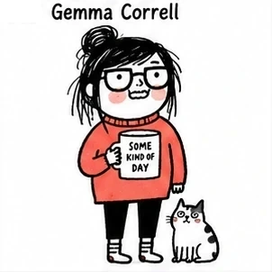 **FA-001** <small>(#001)</small> · Playful Deadpan Doodle 参考: Gemma Correll 

查看核心特征
 松散黑线、怪萌人物、少量点色、白底、日常吐槽与尴尬幽默；人物轮廓优先于细节堆砌，脸型、头身比例与手脚形状要形成清楚而独立的视觉语言；表情偏冷脸、尴尬或突然夸张，姿态要有明确喜剧节奏，避免统一的可爱微笑。
 | 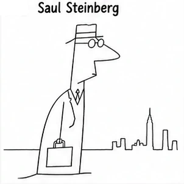 **FA-002** <small>(#002)</small> · Conceptual Continuous-Line Editorial 参考: Saul Steinberg 

查看核心特征
 极简线描、连续线、概念隐喻、人与空间一体化、智性幽默。
 | 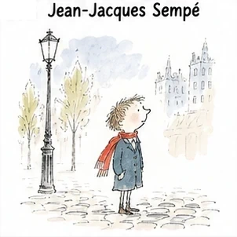 **FA-003** <small>(#003)</small> · Fine-Line Urban Miniature 参考: Jean-Jacques Sempé 

查看核心特征
 极细钢笔线、小人物大空间、大量留白、温柔法式都市幽默。
 |
| 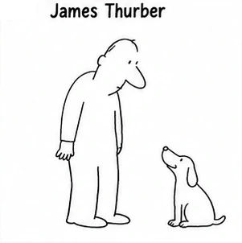 **FA-004** <small>(#004)</small> · Awkward Minimal Ink Cartoon 参考: James Thurber 

查看核心特征
 故意笨拙的极简线条、比例失衡、几笔成形、冷幽默。
 | 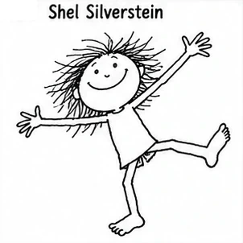 **FA-005** <small>(#005)</small> · Childlike Free-Line Humor 参考: Shel Silverstein 

查看核心特征
 极简黑线、儿童式自由造型、荒诞动作、低细节。
 | 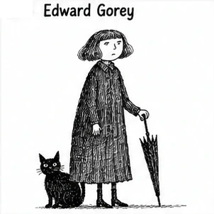 **FA-006** <small>(#006)</small> · Victorian Crosshatch Gothic Cartoon 参考: Edward Gorey 

查看核心特征
 黑白钢笔、密集排线、维多利亚气息、古怪冷峻黑色幽默。
 |
| 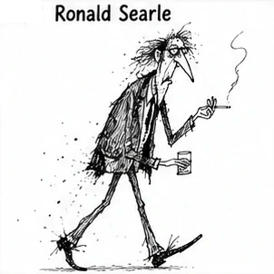 **FA-007** <small>(#007)</small> · Frenetic Scratch-Ink Caricature 参考: Ronald Searle 

查看核心特征
 狂躁钢笔、断裂墨线、细长人体、尖锐夸张、动态极强。
 | 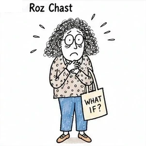 **FA-008** <small>(#008)</small> · Nervous Urban Notebook Cartoon 参考: Roz Chast 

查看核心特征
 神经质手绘、歪斜线条、手写文字、都市焦虑式喜剧；人物轮廓优先于细节堆砌，脸型、头身比例与手脚形状要形成清楚而独立的视觉语言；表情与肢体动作要服从该风格的人格机制，避免回落为统一的标准Q版表情。
 | 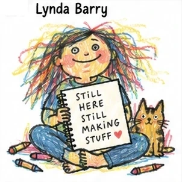 **FA-009** <small>(#009)</small> · Raw Zine Diary Cartoon 参考: Lynda Barry 

查看核心特征
 粗糙手帐、Zine 感、手写字、原始情绪、反精致；人物轮廓优先于细节堆砌，脸型、头身比例与手脚形状要形成清楚而独立的视觉语言；保留纸纹、颗粒、套印或手工媒介的不完美，强化独立出版物的触感。
 |
| 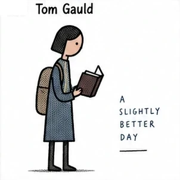 **FA-010** <small>(#010)</small> · Geometric Literary Deadpan 参考: Tom Gauld 

查看核心特征
 极小几何人物、极简场景、文学/科技梗、冷面幽默；脸部与服装主动做减法，依靠清楚轮廓、眼口和少量关键形状建立人物辨识度；表情偏冷脸、尴尬或突然夸张，姿态要有明确喜剧节奏，避免统一的可爱微笑。
 | 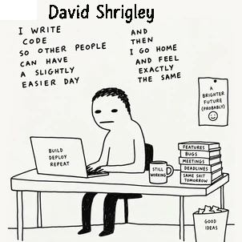 **FA-011** <small>(#011)</small> · Deliberately Bad Absurd Doodle 参考: David Shrigley 

查看核心特征
 故意画坏、粗糙黑线、幼稚造型、荒诞文字、强 meme 感；人物轮廓优先于细节堆砌，脸型、头身比例与手脚形状要形成清楚而独立的视觉语言；表情偏冷脸、尴尬或突然夸张，姿态要有明确喜剧节奏，避免统一的可爱微笑。
 | 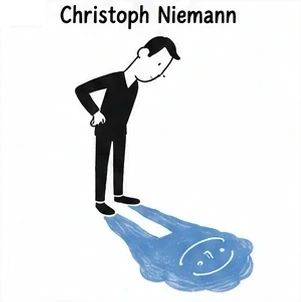 **FA-012** <small>(#012)</small> · Minimal Visual-Pun Editorial 参考: Christoph Niemann 

查看核心特征
 极简概念设计、物体重解释、视觉双关、脑洞型构图；脸部与服装主动做减法，依靠清楚轮廓、眼口和少量关键形状建立人物辨识度；表情与肢体动作要服从该风格的人格机制，避免回落为统一的标准Q版表情。
 |
| 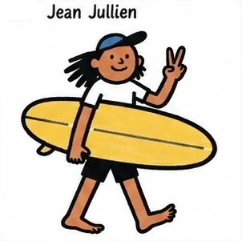 **FA-013** <small>(#013)</small> · Bold Flat Everyday Satire 参考: Jean Jullien 

查看核心特征
 粗黑轮廓、扁平色块、现代人物、互联网生活讽刺；以醒目外轮廓和大形组织人物，五官少而有力，动作通过肩胯与手脚方向直接传达；表情偏冷脸、尴尬或突然夸张，姿态要有明确喜剧节奏，避免统一的可爱微笑。
 | 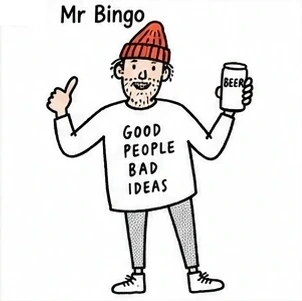 **FA-014** <small>(#014)</small> · Handwritten British Anti-Inspiration Cartoon 参考: Mr Bingo 

查看核心特征
 随手钢笔、手写字、恶趣味、英式反鸡汤幽默；保留明显手绘笔压、停顿与轻微不齐整感，让轮廓产生真实纸上绘制的节奏；表情偏冷脸、尴尬或突然夸张，姿态要有明确喜剧节奏，避免统一的可爱微笑。
 | 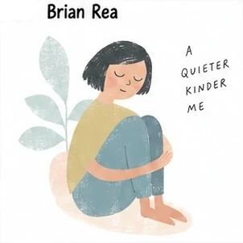 **FA-015** <small>(#015)</small> · Soft Relationship Editorial Line Art 参考: Brian Rea 

查看核心特征
 极简人物线稿、人与关系、柔和色块、生活型社论；脸部与服装主动做减法，依靠清楚轮廓、眼口和少量关键形状建立人物辨识度；配色控制在柔和低刺激色域，用少量点色区分层次，背景保持轻和干净。
 |
| 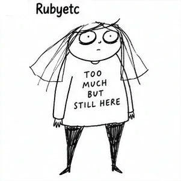 **FA-016** <small>(#016)</small> · Raw Emotional Internet Doodle 参考: Rubyetc 

查看核心特征
 粗糙黑线、极简人体、心理情绪、自嘲式互联网漫画；脸部与服装主动做减法，依靠清楚轮廓、眼口和少量关键形状建立人物辨识度；保留纸纹、颗粒、套印或手工媒介的不完美，强化独立出版物的触感。
 | 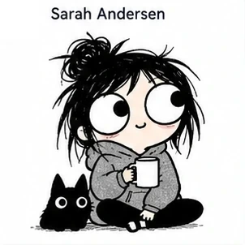 **FA-017** <small>(#017)</small> · Black-and-White Reaction Diary Cartoon 参考: Sarah Andersen 

查看核心特征
 黑白简线、圆眼反应表情、松散黑发、日常衣着；人物常与小动物或生活物件并置，依靠简单轮廓和大面积留白塑造轻松的生活漫画感。
 | 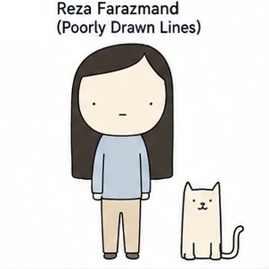 **FA-018** <small>(#018)</small> · Minimal Deadpan Dialogue Cartoon 参考: Poorly Drawn Lines / Reza Farazmand 

查看核心特征
 极简圆头人物、面无表情、简单动物、灰蓝与米色小色块；人物和动物以干净轮廓置于白底中，靠冷淡姿态和微小关系制造荒诞幽默。
 |
| 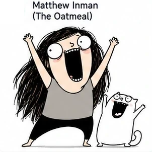 **FA-019** <small>(#019)</small> · Explosive Webcomic Exaggeration 参考: The Oatmeal / Matthew Inman 

查看核心特征
 粗黑线、夸张圆眼、张大嘴、头发和四肢大幅甩动；人物常与动物同框，以强烈动作、巨大表情和少量灰黑色块形成爆发式网络漫画效果。
 | 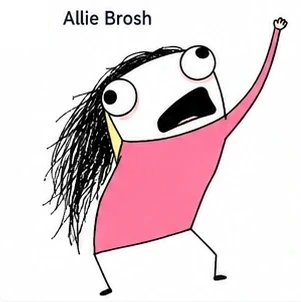 **FA-020** <small>(#020)</small> · Low-Fi Frenzy Cartoon 参考: Allie Brosh 

查看核心特征
 粗糙鼠绘感、黑色乱发、极端大眼大嘴、粉色大色块、单人失控动作；保留低保真数字涂画的不规整轮廓和直接粗粝的互联网幽默。
 | 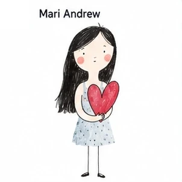 **FA-021** <small>(#021)</small> · Watercolor Handwritten Life Notes 参考: Mari Andrew 

查看核心特征
 极简女性人物、细黑线、细长四肢、柔和水彩点染；以红色心形等单一物件承载生活情绪，画面保持白底、留白和轻微纸张质感。
 |
| 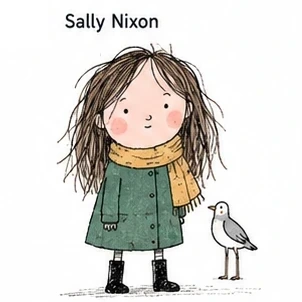 **FA-022** <small>(#022)</small> · Flat Everyday Women Lifestyle 参考: Sally Nixon 

查看核心特征
 日常女性人物、蓬松手绘线稿、低饱和外套与围巾、旁边的小鸟；姿态自然站立，服装和动物用清楚色块区分，整体保留生活速写的轻松感。
 | 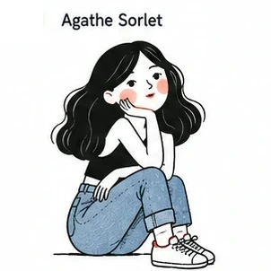 **FA-023** <small>(#023)</small> · Warm Minimal Female Line Cartoon 参考: Agathe Sorlet 

查看核心特征
 黑色简线、黑色长发女性、坐姿、白上衣与蓝色牛仔裤；以少量暖色腮红和红色鞋带点亮画面，背景保持干净，气质亲密而松弛。
 | 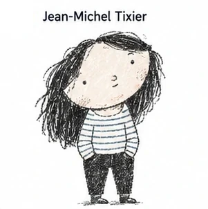 **FA-024** <small>(#024)</small> · Geometric Fashion Deadpan 参考: Jean-Michel Tixier 

查看核心特征
 夸张大头、松散黑色短线、冷面人物、横条纹上衣、灰黑与浅色块；人物比例故意不协调，依靠简化脸部和粗略纹理形成时尚而疏离的幽默感。
 |
| 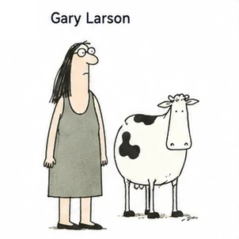 **FA-025** <small>(#025)</small> · One-Panel Absurd Social Cartoon 参考: Gary Larson 

查看核心特征
 单格漫画、极简黑线、细长人物与动物并置、荒诞社会情境；人物和动物以克制的姿态和少量灰绿色块呈现一本正经的反逻辑幽默。
 | 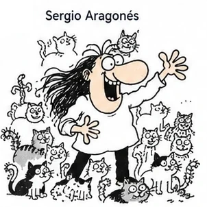 **FA-026** <small>(#026)</small> · Dense Silent Physical Comedy 参考: Sergio Aragonés 

查看核心特征
 密集小动物和小人物、粗黑线、夸张鼻子与张嘴大笑、四肢向外伸展；画面充满无字肢体喜剧和拥挤的动作信息。
 | 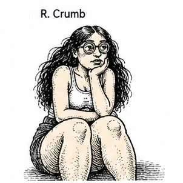 **FA-027** <small>(#027)</small> · Underground Crosshatched Grotesque Cartoon 参考: R. Crumb 

查看核心特征
 黑色密排线、粗重轮廓、坐姿人物、夸张而不修饰的人体比例；皮肤、头发和衣物依靠密集交叉排线塑造，带有地下漫画的粗粝与怪诞。
 |
| 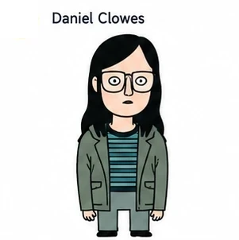 **FA-028** <small>(#028)</small> · Retro Detached American Comic 参考: Daniel Clowes 

查看核心特征
 黑色齐肩直发、方形眼镜、条纹上衣与绿色外套、冷静平涂色块；人物正面站立、表情疏离，画面具有复古美式成人漫画的克制感。
 | 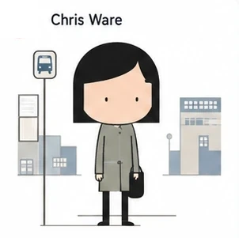 **FA-029** <small>(#029)</small> · Geometric Diagrammatic Narrative 参考: Chris Ware 

查看核心特征
 几何精密线条、孤立小人物、公交站牌与城市方块、信息图式留白；人物和环境由规整矩形与细线组成，色彩克制，叙事像一张安静的城市图表。
 | 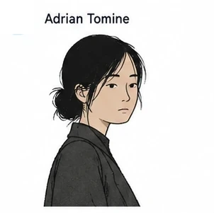 **FA-030** <small>(#030)</small> · Clean Urban Solitude Comic 参考: Adrian Tomine 

查看核心特征
 清晰细线、年轻亚洲女性半身像、深色外套、低饱和肤色与黑发；人物侧身回望，表情安静克制，背景留白，呈现都市观察和轻微疏离。
 |
| 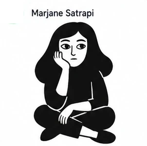 **FA-031** <small>(#031)</small> · High-Contrast Black-White Memoir Cartoon 参考: Marjane Satrapi 

查看核心特征
 黑白高对比、粗黑剪影、盘坐女性、简化五官、大片纯黑服装；人物姿态直接而静止，依靠白色脸部和黑色轮廓形成克制的回忆录漫画感。
 | 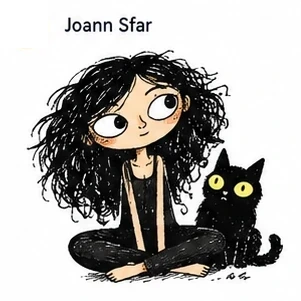 **FA-032** <small>(#032)</small> · Loose French Improvised Ink 参考: Joann Sfar 

查看核心特征
 松散法式墨线、蓬乱卷发、大眼女性、黑猫、随意坐姿；线条保留手绘停顿和轻微不齐整，配合少量暖色块，形成即兴、俏皮而略带怪诞的画面。
 | 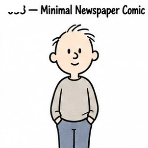 **FA-033** <small>(#033)</small> · Minimal Newspaper Comic 参考: Charles M. Schulz 

查看核心特征
 极简报纸漫画线、圆头小人物、低动作高人格、细微表情。
 |
| 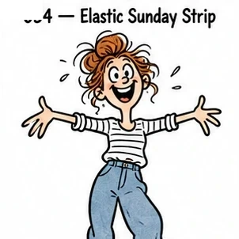 **FA-034** <small>(#034)</small> · Elastic Sunday Strip 参考: Bill Watterson 

查看核心特征
 松散弹性墨线、夸张儿童表情、强肢体动作、少量透明水彩；保留明显手绘笔压、停顿与轻微不齐整感，让轮廓产生真实纸上绘制的节奏；上色保留透明叠染、柔软边缘和纸纹，允许轻微颜色不均与留白。
 | 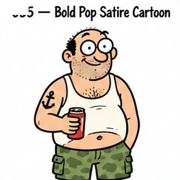 **FA-035** <small>(#035)</small> · Bold Pop Satire Cartoon 参考: Matt Groening 

查看核心特征
 粗黑轮廓、圆凸大眼、扁平人物、极少阴影、成人讽刺；以醒目外轮廓和大形组织人物，五官少而有力，动作通过肩胯与手脚方向直接传达；配色使用少量高纯度撞色和平涂，让人物剪影和服装保持强图形对比。
 | 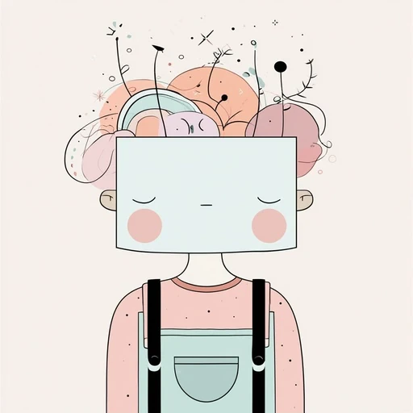 **FA-036** <small>(#229)</small> · Minimalist Organic Pastel Editorial 参考: OscarAI 

查看核心特征
 现代极简编辑插画风、轻细灵动的铅笔/墨线、抽象有机几何形状、柔和莫兰迪粉彩色调、微颗粒纸本噪点与呼吸感留白。
 |
| 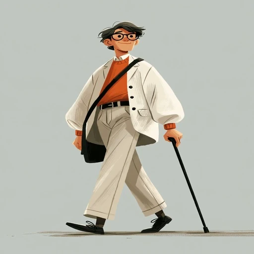 **FA-037** <small>(#231)</small> · Chic Urban Editorial Motion Character 参考: Ahmed 

查看核心特征
 现代都市时尚编辑插画风、优雅舒展的动态剪影、松弛大方的服饰垂坠感、哑光粉彩与柔和铅笔微颗粒纹理、暖色提亮撞色、兼具高级时尚感与动画角色设计的清爽气质。
 | 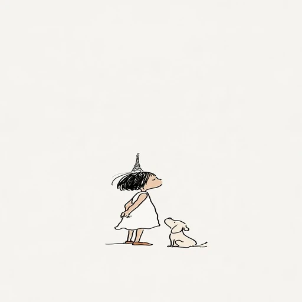 **FA-038** <small>(#253)</small> · Minimalist Poetic Sempé Ink Doodle 参考: James Yeung 

查看核心特征
 极简法式诗意水墨线描风、桑贝式松弛写意小人与萌宠、大面积纯净留白、质朴手绘墨水笔触、治愈松弛的都市童心与生活小哲思。
 | 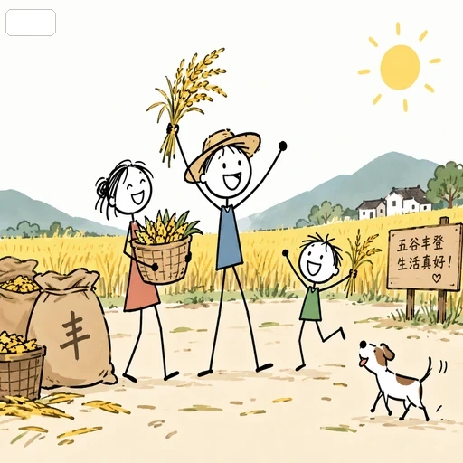 **FA-039** <small>(#274)</small> · Hand-Drawn Stick Figure Cartoon 参考: 手绘火柴人漫画 

查看核心特征
 手绘火柴人漫画。人物必须采用真正的 stick figure anatomy：正常偏小的圆形头部，头部约占人物总高度 1/4～1/3；脖子、躯干、双臂、双腿主要由单根细黑线构成。肩、肘、膝只通过线条折角表达，手和脚极度简化。五官仅用两个小黑点眼睛、短线眉毛和极简单嘴型，发型用简单平涂。人物姿态依靠火柴线骨架的倾斜、弯曲、重心和四肢方向表达。黑色细手绘线条，轻微不规则，但整体清晰克制。上身/衣服用极简单的几何色块。背景根据主题使用低细节卡通，部分留白。
 |
| 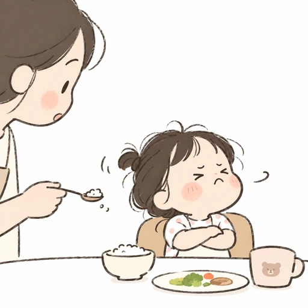 **FA-040** <small>(#279)</small> · Minimalist 2D Hand-Drawn Doodle 参考: 极简手绘 

查看核心特征
 极简2D手绘简笔画表现，强调概括造型、轻柔线条、低细节、天真趣味
 |  |  |

---

## FB · 经典绘本叙事（FB-001–FB-066 · 66 种）

适合温情叙事、儿童插画、治愈绘本与水彩手账。以经典手绘质感、细腻笔触与叙事氛围为主要特征。

| 效果预览 | 效果预览 | 效果预览 |
| :---: | :---: | :---: |
| 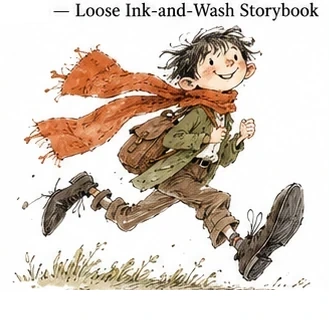 **FB-001** <small>(#036)</small> · Loose Ink-and-Wash Storybook 参考: Quentin Blake 

查看核心特征
 抖动墨线、松散水彩、四肢夸张、动作极灵、快速速写感。
 | 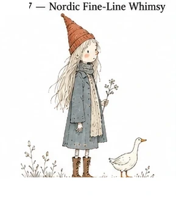 **FB-002** <small>(#037)</small> · Nordic Fine-Line Whimsy 参考: Tove Jansson 

查看核心特征
 北欧墨线、细密但轻盈、奇异人物、温柔孤独、大留白。
 | 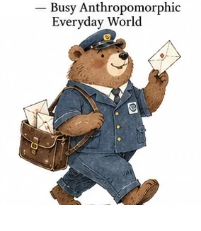 **FB-003** <small>(#038)</small> · Busy Anthropomorphic Everyday World 参考: Richard Scarry 

查看核心特征
 拟人动物社会、职业角色、圆润轮廓、丰富生活动作。
 |
| 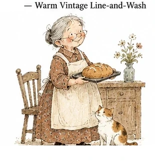 **FB-004** <small>(#039)</small> · Warm Vintage Line-and-Wash 参考: Arnold Lobel 

查看核心特征
 古典细线、水彩旧书感、安静角色、温暖生活气息。
 | 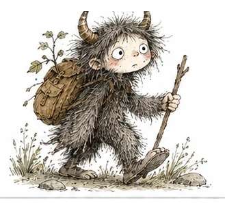 **FB-005** <small>(#040)</small> · Crosshatched Wild Storybook 参考: Maurice Sendak 

查看核心特征
 细线排线、怪物造型、童话荒诞、毛茸茸纹理。
 | 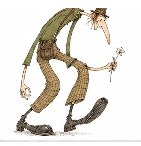 **FB-006** <small>(#041)</small> · Bendy Absurd Storybook 参考: Dr. Seuss 

查看核心特征
 极端比例、弯曲结构、怪生物、流动线条、疯狂想象。
 |
| 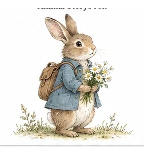 **FB-007** <small>(#042)</small> · Naturalist Watercolor Animal Storybook 参考: Beatrix Potter 

查看核心特征
 精细水彩、自然主义动物、古典绘本、柔和纸张感。
 | 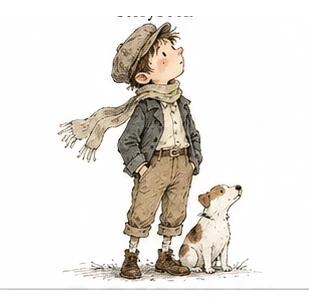 **FB-008** <small>(#043)</small> · Classic Pen-and-Light-Wash Storybook 参考: E. H. Shepard 

查看核心特征
 钢笔速写、淡水彩、古典角色、优雅而轻松。
 | 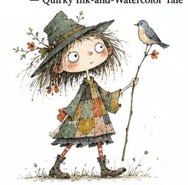 **FB-009** <small>(#044)</small> · Quirky Ink-and-Watercolor Tale 参考: Satoshi Kitamura 

查看核心特征
 怪趣人物、墨线、水彩、不规则比例、现代童话；保留明显手绘笔压、停顿与轻微不齐整感，让轮廓产生真实纸上绘制的节奏；上色保留透明叠染、柔软边缘和纸纹，允许轻微颜色不均与留白。
 |
| 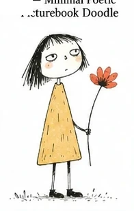 **FB-010** <small>(#045)</small> · Minimal Poetic Picturebook Doodle 参考: Oliver Jeffers 

查看核心特征
 极简人物、手写感、松散涂色、诗意荒诞；脸部与服装主动做减法，依靠清楚轮廓、眼口和少量关键形状建立人物辨识度；表情偏冷脸、尴尬或突然夸张，姿态要有明确喜剧节奏，避免统一的可爱微笑。
 |  **FB-011** <small>(#046)</small> · Bold Geometric Picturebook 参考: Chris Haughton 

查看核心特征
 几何块面、极简轮廓、高饱和色、强剪影；脸部与服装主动做减法，依靠清楚轮廓、眼口和少量关键形状建立人物辨识度；配色使用少量高纯度撞色和平涂，让人物剪影和服装保持强图形对比。
 |  **FB-012** <small>(#047)</small> · Muted Deadpan Picturebook 参考: Jon Klassen 

查看核心特征
 极简动物、半闭眼、低饱和、Deadpan 冷幽默；脸部与服装主动做减法，依靠清楚轮廓、眼口和少量关键形状建立人物辨识度；配色控制在柔和低刺激色域，用少量点色区分层次，背景保持轻和干净。
 |
|  **FB-013** <small>(#048)</small> · Folk-Line Decorative Storybook 参考: Carson Ellis 

查看核心特征
 民俗线描、复古配色、植物纹样、奇异群像；人物轮廓优先于细节堆砌，脸型、头身比例与手脚形状要形成清楚而独立的视觉语言；表情与肢体动作要服从该风格的人格机制，避免回落为统一的标准Q版表情。
 |  **FB-014** <small>(#049)</small> · Dreamlike Surreal Storybook 参考: Shaun Tan 

查看核心特征
 柔和手绘笔触、轻微超现实人物、低饱和梦境配色、安静叙事气质；人物轮廓简洁清楚，比例略诗意变形，表情克制偏沉静，留出白底与空间感，避免过于指向单一作者的独特怪脸机制。
 |  **FB-015** <small>(#050)</small> · Layered Vintage Storybook Collage 参考: Lane Smith 

查看核心特征
 分层拼贴质感、复古纸张肌理、手工剪贴与印刷颗粒感并存；人物由大形与贴纸般色块构成，造型怪趣但易读，配色温暖克制，强调材料感与旧书气息，避免复现某个固定童书角色。
 |
|  **FB-016** <small>(#051)</small> · Expressive Character Sketch Cartoon 参考: Peter de Sève 

查看核心特征
 速写式手绘线条、夸张但亲切的人物表演、清楚外轮廓与鲜明性格；脸部结构简化，眉眼嘴主导情绪，动作有动画草图般弹性和节奏，适合做高人格角色，避免过度逼近具体作者角色设计。
 |  **FB-017** <small>(#052)</small> · Dreamlike Clean-Line Sci-Fi Figure 参考: Jean Giraud / Moebius 

查看核心特征
 干净细线、轻科技感人物、简洁未来服装与梦境般留白；线条清晰克制，配色偏浅淡蓝灰或柔和中性色，人物修长、姿态安静，强调现代科幻插图气质而非某个具体世界观。
 |  **FB-018** <small>(#053)</small> · European Clear-Line Adventure Figure 参考: Hergé 

查看核心特征
 欧洲清线漫画语言、整洁闭合轮廓、平涂配色、人物可读性极高；造型简洁、动作明确，脸部结构控制在少量特征之内，带轻冒险叙事感，避免直接滑向某个经典固定角色。
 |
|  **FB-019** <small>(#054)</small> · Geometric European Clear-Line Figure 参考: Joost Swarte 

查看核心特征
 几何化清线人物、现代主义图形秩序、简洁建筑感服装与姿态；以圆方弧线组织角色，平涂色块干净，表情直接而克制，整体更偏欧洲平面设计人物感，避免过强的单一作者指纹。
 |  **FB-020** <small>(#218)</small> · Quirky 60s-70s Retro Storybook Illustration 参考: OscarAI 

查看核心特征
 60-70年代复古儿童绘本插画感、夸张大眼睛与生动面部特征、粗糙手绘线条、质朴色铅笔/蜡笔颗粒质感、暖调复古配色、简练几何轮廓与怪诞可爱的人物造型。
 |  **FB-021** <small>(#219)</small> · Charming Vintage Storybook Illustration 参考: OscarAI 

查看核心特征
 复古暖调手绘儿童绘本插画风、质感蜡笔与彩铅颗粒肌理、松弛粗糙的墨水轮廓线、夸张生动的大眼睛与古怪可爱角色造型、复古纸本留边边框、明亮温暖的欧式复古动画叙事感。
 |
|  **FB-022** <small>(#222)</small> · Mid-Century Poetic Ink & Watercolor Storybook 参考: OscarAI 

查看核心特征
 二十世纪中叶经典复古儿童绘本风、细腻松弛的钢笔墨水线条、清透柔和的水彩晕染、大面积纯净留白、质朴水彩纸纹理、丁丁历险记般的诗意复古童趣。
 |  **FB-023** <small>(#223)</small> · Whimsical Watercolor Die-Cut Sticker Cartoon 参考: OscarAI 

查看核心特征
 手绘水彩贴纸风、圆形模切与干净白边边框、明亮灵动的大眼睛与微卷发丝、温润水彩与不透明水粉质感、治愈可爱的现代儿童插画与潮玩贴纸美学。
 |  **FB-024** <small>(#226)</small> · Painterly Gouache Animation Storybook 参考: OscarAI 

查看核心特征
 温暖厚涂水粉动画插画风、松弛可见的干湿画笔笔触、夸张清澈的纯真大眼、温润电影感柔光与雪景氛围、复古绘本与现代动画长片概念美术质感。
 |
|  **FB-025** <small>(#230)</small> · Vintage Ink & Watercolor Comic Storybook 参考: OscarAI 

查看核心特征
 经典复古手绘漫画绘本风、生动流畅的蘸水笔墨水线条、温润质朴的水彩平涂晕染、复古报刊插画排线、大眼睛与红润脸蛋的可爱人物造型、温暖怀旧的童年冒险叙事感。
 |  **FB-026** <small>(#233)</small> · Warm Gouache & Colored Pencil Storybook Character 参考: OscarAI 

查看核心特征
 温暖水粉与彩色铅笔手绘绘本风、细腻柔和的铅笔颗粒质感与排线肌理、圆润饱满的卡通面部轮廓、大黑框眼镜与可爱红鼻头、治愈温馨的现代儿童插画质感。
 |  **FB-027** <small>(#235)</small> · Edwardian Vintage Ink Fashion Editorial 参考: OscarAI 

查看核心特征
 爱德华时代复古时尚墨水插画风、精美利落的钢笔排线与羽化阴影、典雅复古的礼帽长裙剪影、极简复古蓝与芥末黄点缀平涂、大面积呼吸感留白与诗意文学氛围。
 |
|  **FB-028** <small>(#243)</small> · Loose Ink & Gouache Storybook Studio 参考: OscarAI 

查看核心特征
 松散墨水线条与水粉手绘插画风、率性写意的笔触排线、大头蓬松卷发与胡须大叔与宠物鸭子、温馨充满故事感的欧式生活日常画室。
 |  **FB-029** <small>(#251)</small> · Charming Children Crayon Storybook 参考: 儿童蜡笔手绘绘本 

查看核心特征
 儿童蜡笔手绘绘本风、粗蜡笔涂抹质感与明显手绘肌理、低幼绘本插画、童真可爱、造型简化与平视视角、画面干净简约、温暖柔和马卡龙配色、明亮轻快、线条自然稚拙、整体温暖治愈。
 |  **FB-030** <small>(#252)</small> · Soft Crayon & Sumi-e Cat Storybook 参考: なっくす 

查看核心特征
 温润蜡笔与水墨和风绘本风、质朴手绘炭笔蜡笔颗粒肌理、巨型猫咪的翡翠绿眼与细腻毛流、微型人偶与红色印章、充满童趣温暖的日式日常绘本。
 |
|  **FB-031** <small>(#254)</small> · Jimmy Liao Whimsical & Poetic Storybook Watercolor 参考: 几米 

查看核心特征
 几米绘本插画风、大面积纯净留白与空灵通透构图、童真童趣与细腻温情、淡雅水彩晕染与柔和手绘线条、治愈诗意的绘本故事感。
 |  **FB-032** <small>(#258)</small> · Minimalist Atmospheric Storybook & Vast Scale Contrast 参考: yang02010 

查看核心特征
 现代极简绘本插画风、大面积同色系连续环境主导画面、背景极度简化并仅保留少量必要景物、人物微缩与宏大环境强烈尺度反差、安静松弛与诗意孤独氛围、非对称大面积负空间留白、主体轮廓简练概括、手绘笔触与纸张颗粒/蜡笔丙烯干刷纹理。
 |  **FB-033** <small>(#266)</small> · Forest Children Storybook Illustration 参考: 森系儿童插画 

查看核心特征
 新自然系童话绘本插画；孩子与自然环境共处；人物小巧可爱、造型圆润简洁；自然植物占据画面主体；嫩绿、草绿、深绿与少量暖色点缀；柔和自然光、树影斑驳、逆光透叶；雨露与水面高光；环境丰富但不过度写实；植物轮廓概括而有节奏；儿童绘本与动画背景结合；温暖、安静、清透、富有生命力；现代平面装饰型森林童话插画；高度二维化；圆润几何植物；大块纯色色形；弱透视、弱光影；简洁童真、安静治愈、装饰海报感
 |
|  **FB-034** <small>(#280)</small> · Minimalist Doodle & Semi-Realistic Hybrid Illustration 参考: 简笔与半写实融合风 

查看核心特征
 写实与简笔融合的混合插画风。画面中同时存在两种清晰区分的视觉语言：一部分内容采用细腻写实或半写实表现，强调自然质感、真实纹理、柔和层次、细节刻画与轻盈光感；另一部分内容采用极简2D手绘简笔画表现，强调概括造型、轻柔线条、低细节、适度留白与天真趣味。两种画法并置共存，形成明确可辨的风格反差，同时保持统一、和谐、克制的审美协调。 主体角色或主要视觉对象优先采用2D插画化表现，保持平面感、手绘感与概括感，不要做成照片感、3D感或厚重写实感；其余环境、植物、材质、局部场景元素可适度引入细腻半写实表现，另有部分装饰性元素可继续使用极简手绘简笔语言。整体应保留“主体偏2D、局部写实、局部简笔”的清晰层次关系。 整体气质轻盈、温柔、治愈、清新、诗意，带有文艺感与绘本感。色彩以低饱和、高明度、柔和通透的浅色系为主，避免浓烈对比、厚重综合色块和高饱和炫目视觉。背景倾向干净、简洁、留白充足，不过度堆叠信息，画面重视呼吸感、秩序感与视觉节奏。 写实部分不要过度摄影化，不要强烈商业修图感，不要走照片级写实路线；简笔部分不要复杂化，不追求真实结构与繁复刻画，应保留手绘的松弛感、稚拙感与亲和力。线条细而柔和，造型圆润、概括、克制，整体呈现“精致与天真并存”“真实与童趣并存”的视觉效果。 风格重点不是把所有内容统一成单一画法，而是保留“精细写实”与“简洁手绘”之间清晰可辨的差异，并让这种差异成为画面的核心风格特征。整体不做厚涂，不做3D，不做强戏剧光影，不做复杂纹样堆砌，不做过强体积塑造，不做商业海报式锐利修饰。
 |  **FB-035** <small>(#291)</small> · Charlie Mackesy Expressive Ink & Watercolor Storybook 参考: Charlie Mackesy 

查看核心特征
 参考绘本作者Charlie Mackesy
 |  **FB-036** <small>(#292)</small> · Liz Climo Minimal Animal Cartoon Storybook 参考: Liz Climo 

查看核心特征
 参考绘本作者Liz Climo
 |
|  **FB-037** <small>(#293)</small> · Naoko Takagi Warm Daily Life Storybook 参考: Naoko Takagi 

查看核心特征
 参考绘本作者Naoko Takagi
 |  **FB-038** <small>(#294)</small> · Yoko Sano Whimsical Crayon & Watercolor Storybook 参考: Yoko Sano 

查看核心特征
 参考绘本作者Yoko Sano
 |  **FB-039** <small>(#295)</small> · Emily Hughes Wild Lush Botanical Storybook 参考: Emily Hughes 

查看核心特征
 参考绘本作者Emily Hughes
 |
|  **FB-040** <small>(#296)</small> · Felicita Sala Cozy Kitchen & Nature Storybook 参考: Felicita Sala 

查看核心特征
 参考绘本作者Felicita Sala
 |  **FB-041** <small>(#297)</small> · Michael Grejniec Textured Paper Watercolor Storybook 参考: Michael Grejniec 

查看核心特征
 参考绘本作者Michael Grejniec
 |  **FB-042** <small>(#298)</small> · Jackie Morris Luminous Wildlife Watercolor Storybook 参考: Jackie Morris 

查看核心特征
 参考绘本作者Jackie Morris
 |
|  **FB-043** <small>(#299)</small> · Manuel Marsol Bold Acrylic Cinematic Storybook 参考: Manuel Marsol 

查看核心特征
 参考绘本作者Manuel Marsol
 |  **FB-044** <small>(#300)</small> · Suzy Lee Expressive Border Charcoal & Watercolor Storybook 参考: Suzy Lee 

查看核心特征
 参考绘本作者Suzy Lee
 |  **FB-045** <small>(#301)</small> · Komako Sakai Textured Acrylic & Charcoal Storybook 参考: Komako Sakai 

查看核心特征
 参考绘本作者Komako Sakai
 |
|  **FB-046** <small>(#302)</small> · Sydney Smith Luminous Atmospheric Watercolor Storybook 参考: Sydney Smith 

查看核心特征
 参考绘本作者Sydney Smith
 |  **FB-047** <small>(#303)</small> · Isabelle Arsenault Poetic Pencil & Gouache Storybook 参考: Isabelle Arsenault 

查看核心特征
 参考绘本作者Isabelle Arsenault
 |  **FB-048** <small>(#304)</small> · Júlia Sardà Ornate Gothic Whimsical Storybook 参考: Júlia Sardà 

查看核心特征
 参考绘本作者Júlia Sardà
 |
|  **FB-049** <small>(#305)</small> · Sophie Blackall Vintage Chinese Ink & Watercolor Storybook 参考: Sophie Blackall 

查看核心特征
 参考绘本作者Sophie Blackall
 |  **FB-050** <small>(#306)</small> · Katsumi Komagata Minimal Geometric Cut-Paper Storybook 参考: Katsumi Komagata 

查看核心特征
 参考绘本作者Katsumi Komagata
 |  **FB-051** <small>(#307)</small> · Kazuo Iwamura Warm Forest Animals Watercolor Storybook 参考: Kazuo Iwamura 

查看核心特征
 参考绘本作者Kazuo Iwamura
 |
|  **FB-052** <small>(#308)</small> · Keiko Sena Whimsical Collage Paper-Cut Storybook 参考: Keiko Sena 

查看核心特征
 参考绘本作者Keiko Sena
 |  **FB-053** <small>(#309)</small> · Rotraut Susanne Berner Bustling Wimmelbuch Line & Wash Storybook 参考: Rotraut Susanne Berner 

查看核心特征
 参考绘本作者Rotraut Susanne Berner
 |  **FB-054** <small>(#310)</small> · Wolf Erlbruch Philosophical Collage & Chalk Storybook 参考: Wolf Erlbruch 

查看核心特征
 参考绘本作者Wolf Erlbruch
 |
|  **FB-055** <small>(#311)</small> · Peter Sis Intricate Stippled Map & Fantasy Storybook 参考: Peter Sís 

查看核心特征
 参考绘本作者Peter Sis
 |  **FB-056** <small>(#312)</small> · Carll Cneut Ornate Flemish Baroque Gouache Storybook 参考: Carll Cneut 

查看核心特征
 参考绘本作者Carll Cneut
 |  **FB-057** <small>(#313)</small> · Benjamin Lacombe Gothic Romantic Gouache Storybook 参考: Benjamin Lacombe 

查看核心特征
 参考绘本作者Benjamin Lacombe
 |
|  **FB-058** <small>(#314)</small> · Rebecca Green Cozy Gouache & Colored Pencil Storybook 参考: Rébecca Green 

查看核心特征
 参考绘本作者Rebecca Green
 |  **FB-059** <small>(#315)</small> · Marianne Dubuc Gentle Forest Animal Watercolor Storybook 参考: Marianne Dubuc 

查看核心特征
 参考绘本作者Marianne Dubuc
 |  **FB-060** <small>(#316)</small> · Marla Frazee Playful Childlike Pencil & Watercolor Storybook 参考: Marla Frazee 

查看核心特征
 参考绘本作者Marla Frazee
 |
|  **FB-061** <small>(#317)</small> · Catarina Sobral Bold Geometric Midcentury Graphic Storybook 参考: Catarina Sobral 

查看核心特征
 参考绘本作者Catarina Sobral
 |  **FB-062** <small>(#318)</small> · Violeta Lopiz Poetic Minimal Ink & Botanical Storybook 参考: Violeta Lópiz 

查看核心特征
 参考绘本作者Violeta Lopiz
 |  **FB-063** <small>(#319)</small> · Mariachiara Di Giorgio Luminous Atmospheric Water & Nature Storybook 参考: Mariachiara Di Giorgio 

查看核心特征
 参考绘本作者Mariachiara Di Giorgio
 |
|  **FB-064** <small>(#320)</small> · JiHyun Kim Deep Ocean Sunlit Watercolor Storybook 参考: JiHyun Kim 

查看核心特征
 参考绘本作者JiHyun Kim
 |  **FB-065** <small>(#321)</small> · Cai Gao Traditional Chinese Folk Warm Storybook 参考: 蔡皋 

查看核心特征
 参考绘本作者蔡皋
 |  **FB-066** <small>(#322)</small> · Aiko Fukawa Cozy Domestic Life & Floral Gouache Storybook 参考: Aiko Fukawa / 布川爱子 

查看核心特征
 参考绘本作者Aiko Fukawa
 |

---

## FC · 现代平面艺术（FC-001–FC-032 · 32 种）

适合现代平面广告、波普艺术、时尚杂志与高饱和海报。以醒目色块、现代构成与矢量平面为主要特征。

| 效果预览 | 效果预览 | 效果预览 |
| :---: | :---: | :---: |
|  **FC-001** <small>(#055)</small> · Chaotic Color Doodle Crowd 参考: Jon Burgerman |  **FC-002** <small>(#056)</small> · Pop Magazine Doodle Overlay 参考: Hattie Stewart 

查看核心特征
 卡通嘴眼、杂志涂鸦覆盖、Pop 色彩、朋克恶搞；人物轮廓优先于细节堆砌，脸型、头身比例与手脚形状要形成清楚而独立的视觉语言；配色使用少量高纯度撞色和平涂，让人物剪影和服装保持强图形对比。
 |  **FC-003** <small>(#057)</small> · Retro Geometric City Cartoon 参考: Andy Rementer 

查看核心特征
 几何人物、复古城市、高饱和平涂、70s–80s 商业卡通感；人物以圆、方、弧线等大形构成，五官图标化，比例强调图形辨识而非写实解剖；配色使用少量高纯度撞色和平涂，让人物剪影和服装保持强图形对比。
 |
|  **FC-004** <small>(#058)</small> · Minimal Bold-Color Fashion Geometry 参考: Olimpia Zagnoli 

查看核心特征
 极简几何、大块高饱和色、女性时尚人物；脸部与服装主动做减法，依靠清楚轮廓、眼口和少量关键形状建立人物辨识度；配色使用少量高纯度撞色和平涂，让人物剪影和服装保持强图形对比。
 |  **FC-005** <small>(#059)</small> · High-Contrast Negative-Space Figure 参考: Malika Favre 

查看核心特征
 极简剪影、正负形、高对比色、强视觉切割；脸部与服装主动做减法，依靠清楚轮廓、眼口和少量关键形状建立人物辨识度；主要依靠黑白关系和大面积留白塑形，表情集中在眼神、眉形与嘴形变化。
 |  **FC-006** <small>(#060)</small> · Negative-Space Visual-Pun Graphic 参考: Noma Bar 

查看核心特征
 负空间、双重图像、极少颜色、视觉双关；人物轮廓优先于细节堆砌，脸型、头身比例与手脚形状要形成清楚而独立的视觉语言；表情与肢体动作要服从该风格的人格机制，避免回落为统一的标准Q版表情。
 |
|  **FC-007** <small>(#061)</small> · Midcentury Geometric Fairytale 参考: Mary Blair 

查看核心特征
 几何童话、现代主义色块、夸张比例、明快配色。
 |  **FC-008** <small>(#062)</small> · Ultra-Geometric Nature Character 参考: Charley Harper 

查看核心特征
 极端几何化动物与人物、Flat Shape、装饰性强。
 |  **FC-009** <small>(#063)</small> · Rough Cut-Paper Modernist Graphic 参考: Saul Bass 

查看核心特征
 剪纸般粗粝几何形、强符号、极少元素。
 |
|  **FC-010** <small>(#064)</small> · Playful Modernist Collage Character 参考: Paul Rand 

查看核心特征
 拼贴、玩具式图形、几何人物、现代主义幽默。
 |  **FC-011** <small>(#065)</small> · Retro Pop Editorial Figure 参考: Milton Glaser 

查看核心特征
 复古社论、强轮廓、波普色彩、海报化人物。
 |  **FC-012** <small>(#066)</small> · Bold Retro Advertising Cartoon 参考: Seymour Chwast 

查看核心特征
 粗线、复古广告、怪趣人物、Push Pin 气质。
 |
|  **FC-013** <small>(#067)</small> · Decorative Retro Commercial Illustration 参考: Push Pin Studios 

查看核心特征
 复古商业插画、装饰线条、怪人物、印刷感。
 |  **FC-014** <small>(#068)</small> · Freeform Cut-Paper Figure 参考: Henri Matisse cut-outs 

查看核心特征
 剪纸色块、自由人体、极简轮廓、大面积纯色。
 |  **FC-015** <small>(#069)</small> · Poetic Single-Line Figure 参考: Jean Cocteau line drawing 

查看核心特征
 单线脸、不断笔、极少细节、优雅诗性。
 |
|  **FC-016** <small>(#070)</small> · Abstract Continuous-Line Figure 参考: Pablo Picasso line drawings 

查看核心特征
 连续线、抽象人体、几何变形、符号化。
 |  **FC-017** <small>(#071)</small> · Bold Kinetic Street-Pictogram 参考: Keith Haring 

查看核心特征
 粗黑连续轮廓、动态小人、高动作、街头图腾。
 |  **FC-018** <small>(#072)</small> · Raw Symbolic Graffiti Figure 参考: Jean-Michel Basquiat 

查看核心特征
 原始涂鸦、皇冠与符号、文字碎片、爆裂能量。
 |
|  **FC-019** <small>(#073)</small> · Punk Ink-and-Text Editorial 参考: Raymond Pettibon 

查看核心特征
 黑墨速写、朋克线稿、文字并置、粗粝社论；保留明显手绘笔压、停顿与轻微不齐整感，让轮廓产生真实纸上绘制的节奏；表情与肢体动作要服从该风格的人格机制，避免回落为统一的标准Q版表情。
 |  **FC-020** <small>(#074)</small> · Grotesque Classical-Comic Portrait 参考: George Condo drawing 

查看核心特征
 扭曲五官、怪表情、古典人物与漫画混合；人物轮廓优先于细节堆砌，脸型、头身比例与手脚形状要形成清楚而独立的视觉语言；表情与肢体动作要服从该风格的人格机制，避免回落为统一的标准Q版表情。
 |  **FC-021** <small>(#075)</small> · Flat Belle-Époque Poster Figure 参考: Henri de Toulouse-Lautrec 

查看核心特征
 海报式人物、简化轮廓、平面色块、都市生活。
 |
|  **FC-022** <small>(#076)</small> · Angular Expressive Figure Line 参考: Egon Schiele drawing 

查看核心特征
 断裂敏感线条、细瘦人体、扭曲姿态、强情绪。
 |  **FC-023** <small>(#077)</small> · Raw Art-Brut Figure 参考: Jean Dubuffet 

查看核心特征
 Art Brut、粗糙线、人形符号、儿童式反精致。
 |  **FC-024** <small>(#078)</small> · Poetic Geometric Symbol Figure 参考: Paul Klee 

查看核心特征
 细线几何、童真符号、诗意色块、抽象人物。
 |
|  **FC-025** <small>(#079)</small> · Biomorphic Symbolic Character 参考: Joan Miró 

查看核心特征
 生物符号、原始线条、红蓝黄点色、自由空间。
 |  **FC-026** <small>(#080)</small> · Fluid Single-Line Motion Figure 参考: Alexander Calder drawings 

查看核心特征
 单线人物、流畅连续线、极简动态。
 |  **FC-027** <small>(#081)</small> · Cinematic Grainy Flat-Shape Illustration 参考: Tom Haugomat 

查看核心特征
 电影感极简色块、颗粒、强光影、远近层次；脸部与服装主动做减法，依靠清楚轮廓、眼口和少量关键形状建立人物辨识度；保留纸纹、颗粒、套印或手工媒介的不完美，强化独立出版物的触感。
 |
|  **FC-028** <small>(#082)</small> · Retro Silkscreen Geometric Figure 参考: Blexbolex 

查看核心特征
 复古丝网印刷、厚重几何色层、旧书颗粒；人物以圆、方、弧线等大形构成，五官图标化，比例强调图形辨识而非写实解剖；保留纸纹、颗粒、套印或手工媒介的不完美，强化独立出版物的触感。
 |  **FC-029** <small>(#276)</small> · Clean Airy Flat Vector Illustration 参考: 清透扁平插画 

查看核心特征
 轮廓清晰的大面积平涂色块塑造形体；造型适度概括与圆润几何化，保留关键识别特征；每个区域最多两级平面明暗与清晰硬边阴影，通过色块明度、冷暖和面积对比表现空间层次；色彩明亮清爽、柔和通透，纯净平滑的画面质感；极简主义、简洁现代，具有轻盈的现代商业插画与编辑插画感
 |  **FC-030** <small>(#287)</small> · Flat Geometric Airbrush Grain Illustration 参考: 扁平几何气刷颗粒插画 

查看核心特征
 扁平几何插图、夸张的不对称比例、柔和的气刷阴影、精细的印刷颗粒感。角色由几个超大尺寸、不对称的形状构建而成。大型物体是姿势的一部分，并改变轮廓。黑色剪纸面部特征。情感从全身姿态中传达出来。扁平颜色块带有清晰边缘；形状重叠处采用柔和的深色到颜色的喷雾渐变。精细的点刻颗粒主要位于墨水区域内部，在纸张上几乎不可见。
 |
|  **FC-031** <small>(#288)</small> · Modern Retro Rubber-Hose Cartoon Illustration 参考: 美式现代复古橡皮管卡通插画 

查看核心特征
 灵感来自美式现代复古 Rubber-Hose 插画风格。但整体更加现代、明亮、干净、可爱。角色采用圆润、简洁、夸张的卡通造型，四肢像柔软的橡皮管一样自然弯曲和延伸，弱化真实关节与人体结构，让动作更自由、更有节奏感。整体以粗而流畅的黑色轮廓线搭配干净的平涂色块，减少复杂光影和厚重做旧效果。造型简洁时尚，比例可爱，表情有个性。整体清爽、协调、有设计感。画面具有轻松幽默、俏皮可爱和一点点怪趣感，动作夸张流畅，像带有爵士节奏的动态瞬间。整体视觉偏现代潮流插画、复古海报和独立品牌插画质感，干净、可爱、有辨识度，减少老旧胶片颗粒与过度怀旧感。
 |  **FC-032** <small>(#328)</small> · Alphonse Mucha Art Nouveau Illustration 参考: 阿尔丰斯·穆夏 / Alphonse Mucha |  |

---

## FD · 日本当代插画（FD-001–FD-042 · 42 种）

适合日系当代插画、轻小说插画、城市散策与唯美空气感。以日系干净线条、空气透视与独特人物形体为主要特征。

| 效果预览 | 效果预览 | 效果预览 |
| :---: | :---: | :---: |
|  **FD-001** <small>(#083)</small> · Dynamic East-Asian Ink Editorial 参考: Yuko Shimizu 

查看核心特征
 流动墨线、东方笔意、强动作、现代 Editorial；保留明显手绘笔压、停顿与轻微不齐整感，让轮廓产生真实纸上绘制的节奏；线条带书写性与留白意识，衣褶、发丝和姿势顺势流动，东方感来自形与节奏。
 |  **FD-002** <small>(#084)</small> · Quiet Low-Saturation Japanese Editorial 参考: Tatsuro Kiuchi 

查看核心特征
 安静平面人物、低饱和、留白、日系现代社论；人物轮廓优先于细节堆砌，脸型、头身比例与手脚形状要形成清楚而独立的视觉语言；配色控制在柔和低刺激色域，用少量点色区分层次，背景保持轻和干净。
 |  **FD-003** <small>(#085)</small> · Minimal Fashion Line Figure 参考: Yu Nagaba 

查看核心特征
 极简黑线、时尚人物、无阴影、大白底；脸部与服装主动做减法，依靠清楚轮廓、眼口和少量关键形状建立人物辨识度；人物姿态松弛自然，服装靠清楚剪影体现时尚感，避免模板化甜美脸。
 |
|  **FD-004** <small>(#086)</small> · Cool Minimal Black-and-White Figure 参考: Noritake 

查看核心特征
 黑白线稿、极简脸、无表情、清冷日常；脸部与服装主动做减法，依靠清楚轮廓、眼口和少量关键形状建立人物辨识度；主要依靠黑白关系和大面积留白塑形，表情集中在眼神、眉形与嘴形变化。
 |  **FD-005** <small>(#087)</small> · Showa Retro Commercial Cartoon 参考: Ryohei Yanagihara 

查看核心特征
 昭和商业插画、圆润人物、明快复古色。
 |  **FD-006** <small>(#088)</small> · Airy Transparent Watercolor Figure 参考: Chihiro Iwasaki 

查看核心特征
 极轻透明水彩、柔和人物、湿边晕染、大量白纸。
 |
|  **FD-007** <small>(#089)</small> · Showa Everyday Family Comic 参考: Machiko Hasegawa 

查看核心特征
 昭和家庭漫画、简洁线条、日常观察。
 |  **FD-008** <small>(#090)</small> · Folklore Monster Ink Cartoon 参考: Shigeru Mizuki 

查看核心特征
 朴拙漫画线、民俗怪谈、妖怪造型、黑白纹理。
 |  **FD-009** <small>(#091)</small> · Classic Rounded Manga Character 参考: Osamu Tezuka 

查看核心特征
 圆润漫画轮廓、清楚表演、大眼、强动作可读性。
 |
|  **FD-010** <small>(#092)</small> · Rebellious Big-Head Deadpan Figure 参考: Yoshitomo Nara 

查看核心特征
 大头冷脸、叛逆眼神、极少背景、怪可爱；人物轮廓优先于细节堆砌，脸型、头身比例与手脚形状要形成清楚而独立的视觉语言；表情偏冷脸、尴尬或突然夸张，姿态要有明确喜剧节奏，避免统一的可爱微笑。
 |  **FD-011** <small>(#093)</small> · 80s Clean-Line Urban Pop Girl 参考: Hisashi Eguchi 

查看核心特征
 清线都市少女、80s 时尚、大块留白、Pop 色；人物轮廓优先于细节堆砌，脸型、头身比例与手脚形状要形成清楚而独立的视觉语言；配色使用少量高纯度撞色和平涂，让人物剪影和服装保持强图形对比。
 |  **FD-012** <small>(#094)</small> · Ornate Strange Botanical Ink 参考: Yuko Higuchi 

查看核心特征
 精密钢笔、奇异动植物、古典怪萌、细节密集；保留明显手绘笔压、停顿与轻微不齐整感，让轮廓产生真实纸上绘制的节奏；表情与肢体动作要服从该风格的人格机制，避免回落为统一的标准Q版表情。
 |
|  **FD-013** <small>(#095)</small> · Fashion Diary Sketch Girl 参考: きくちあつこ 

查看核心特征
 女孩穿搭速写、手绘服装、Instagram 日记感；保留明显手绘笔压、停顿与轻微不齐整感，让轮廓产生真实纸上绘制的节奏；人物姿态松弛自然，服装靠清楚剪影体现时尚感，避免模板化甜美脸。
 |  **FD-014** <small>(#096)</small> · Loose Deadpan Everyday Sketch 参考: しまだなな 

查看核心特征
 脱力人物、松散线条、生活吐槽；人物轮廓优先于细节堆砌，脸型、头身比例与手脚形状要形成清楚而独立的视觉语言；表情偏冷脸、尴尬或突然夸张，姿态要有明确喜剧节奏，避免统一的可爱微笑。
 |  **FD-015** <small>(#097)</small> · Yuru-Surreal Minimal Everyday Cartoon 参考: のなか海 

查看核心特征
 ゆるシュール、极简人物、反逻辑日常；脸部与服装主动做减法，依靠清楚轮廓、眼口和少量关键形状建立人物辨识度；表情与肢体动作要服从该风格的人格机制，避免回落为统一的标准Q版表情。
 |
|  **FD-016** <small>(#098)</small> · Notebook Lifestyle Doodle 参考: tomatomayu 

查看核心特征
 手帐式小人物、小物罗列、文字注记、生活记录；人物轮廓优先于细节堆砌，脸型、头身比例与手脚形状要形成清楚而独立的视觉语言；表情与肢体动作要服从该风格的人格机制，避免回落为统一的标准Q版表情。
 |  **FD-017** <small>(#099)</small> · Cute Essay-Manga Everyday 参考: 鈴芽とろ 

查看核心特征
 可爱 Essay Manga、生活与职场小剧场；人物轮廓优先于细节堆砌，脸型、头身比例与手脚形状要形成清楚而独立的视觉语言；表情与肢体动作要服从该风格的人格机制，避免回落为统一的标准Q版表情。
 |  **FD-018** <small>(#100)</small> · Rough Gag-Manga Reaction 参考: うめじろう 

查看核心特征
 粗糙搞笑漫画、强 reaction、夸张情绪；人物轮廓优先于细节堆砌，脸型、头身比例与手脚形状要形成清楚而独立的视觉语言；表情偏冷脸、尴尬或突然夸张，姿态要有明确喜剧节奏，避免统一的可爱微笑。
 |
|  **FD-019** <small>(#101)</small> · Clean Young-Lifestyle Manga Line 参考: ASUMINA 

查看核心特征
 清秀线稿、年轻女性、轻宅生活感；人物轮廓优先于细节堆砌，脸型、头身比例与手脚形状要形成清楚而独立的视觉语言；人物姿态松弛自然，服装靠清楚剪影体现时尚感，避免模板化甜美脸。
 |  **FD-020** <small>(#102)</small> · Friendly Girl-Diary Cartoon 参考: モチダちひろ 

查看核心特征
 女生日常博客漫画、简单可亲、生活感；人物轮廓优先于细节堆砌，脸型、头身比例与手脚形状要形成清楚而独立的视觉语言；人物姿态松弛自然，服装靠清楚剪影体现时尚感，避免模板化甜美脸。
 |  **FD-021** <small>(#103)</small> · Minimal Absurd Short-Gag Cartoon 参考: YAGI 

查看核心特征
 荒诞短漫画、冷笑话、极简小人物；脸部与服装主动做减法，依靠清楚轮廓、眼口和少量关键形状建立人物辨识度；表情偏冷脸、尴尬或突然夸张，姿态要有明确喜剧节奏，避免统一的可爱微笑。
 |
|  **FD-022** <small>(#104)</small> · Warm Slightly-Strange Everyday Line 参考: むらたさき 

查看核心特征
 温暖线条、轻怪角色、小众生活气质；人物轮廓优先于细节堆砌，脸型、头身比例与手脚形状要形成清楚而独立的视觉语言；表情与肢体动作要服从该风格的人格机制，避免回落为统一的标准Q版表情。
 |  **FD-023** <small>(#105)</small> · Fast Family-Essay Sketch 参考: よこみねさやか 

查看核心特征
 家庭 Essay、快速线稿、日常观察；人物轮廓优先于细节堆砌，脸型、头身比例与手脚形状要形成清楚而独立的视觉语言；表情与肢体动作要服从该风格的人格机制，避免回落为统一的标准Q版表情。
 |  **FD-024** <small>(#106)</small> · Minimal Quirky Motion Character 参考: おべとも 

查看核心特征
 极简古怪人物、图形化、短动画式节奏；脸部与服装主动做减法，依靠清楚轮廓、眼口和少量关键形状建立人物辨识度；表情与肢体动作要服从该风格的人格机制，避免回落为统一的标准Q版表情。
 |
|  **FD-025** <small>(#107)</small> · Elegant Sparse-Line Girl 参考: そとこ / Sotoko 

查看核心特征
 极少线条、纤细女孩、优雅留白；线条轻细并保留呼吸感，人物比例偏修长，眉眼与嘴角的小变化承担主要表情；人物姿态松弛自然，服装靠清楚剪影体现时尚感，避免模板化甜美脸。
 |  **FD-026** <small>(#108)</small> · Delicate Emotional Female Line 参考: yasuna 

查看核心特征
 纤细人物线稿、女性情绪、长线条发丝；线条轻细并保留呼吸感，人物比例偏修长，眉眼与嘴角的小变化承担主要表情；人物姿态松弛自然，服装靠清楚剪影体现时尚感，避免模板化甜美脸。
 |  **FD-027** <small>(#109)</small> · Pop-Culture Minimal Figure 参考: オガワナツミ 

查看核心特征
 简化人物、Pop Culture、年轻轻时尚；脸部与服装主动做减法，依靠清楚轮廓、眼口和少量关键形状建立人物辨识度；配色使用少量高纯度撞色和平涂，让人物剪影和服装保持强图形对比。
 |
|  **FD-028** <small>(#110)</small> · Modern Editorial Female Line 参考: Mira Lou 

查看核心特征
 现代女性线稿、编辑插画、清爽人物；人物轮廓优先于细节堆砌，脸型、头身比例与手脚形状要形成清楚而独立的视觉语言；人物姿态松弛自然，服装靠清楚剪影体现时尚感，避免模板化甜美脸。
 |  **FD-029** <small>(#111)</small> · Soft Magazine Line-and-Wash 参考: ソウノナホ 

查看核心特征
 细线 + 淡水彩、生活方式、日系杂志感；线条轻细并保留呼吸感，人物比例偏修长，眉眼与嘴角的小变化承担主要表情；上色保留透明叠染、柔软边缘和纸纹，允许轻微颜色不均与留白。
 |  **FD-030** <small>(#112)</small> · Minimal Daily-Life Girl Line 参考: Appy 

查看核心特征
 极简女生日常、细线、低干扰构图；脸部与服装主动做减法，依靠清楚轮廓、眼口和少量关键形状建立人物辨识度；人物姿态松弛自然，服装靠清楚剪影体现时尚感，避免模板化甜美脸。
 |
|  **FD-031** <small>(#113)</small> · Transparent Watercolor Magazine Figure 参考: reism・i 

查看核心特征
 简线人物、透明水彩、干净女性杂志感；人物轮廓优先于细节堆砌，脸型、头身比例与手脚形状要形成清楚而独立的视觉语言；上色保留透明叠染、柔软边缘和纸纹，允许轻微颜色不均与留白。
 |  **FD-032** <small>(#114)</small> · Playful Marker Fairytale Character 参考: 北澤平祐 

查看核心特征
 彩色马克笔、奇想小物、轻童话人物；以醒目外轮廓和大形组织人物，五官少而有力，动作通过肩胯与手脚方向直接传达；表情与肢体动作要服从该风格的人格机制，避免回落为统一的标准Q版表情。
 |  **FD-033** <small>(#115)</small> · Loose Pop Advertising Girl 参考: 白根ゆたんぽ 

查看核心特征
 女孩、奇怪姿态、广告 Pop、松弛幽默；人物轮廓优先于细节堆砌，脸型、头身比例与手脚形状要形成清楚而独立的视觉语言；配色使用少量高纯度撞色和平涂，让人物剪影和服装保持强图形对比。
 |
|  **FD-034** <small>(#116)</small> · Transparent Emotional Youth Illustration 参考: 藍にいな / Ai Niina 

查看核心特征
 青春情绪、透明色、MV 感、线条流动；人物轮廓优先于细节堆砌，脸型、头身比例与手脚形状要形成清楚而独立的视觉语言；上色保留透明叠染、柔软边缘和纸纹，允许轻微颜色不均与留白。
 |  **FD-035** <small>(#117)</small> · Warm Lifestyle Magazine Figure 参考: 山中玲奈 

查看核心特征
 温暖人物、轻线稿、生活杂志氛围；人物轮廓优先于细节堆砌，脸型、头身比例与手脚形状要形成清楚而独立的视觉语言；保留纸纹、颗粒、套印或手工媒介的不完美，强化独立出版物的触感。
 |  **FD-036** <small>(#118)</small> · Soft Empathy Social Comic 参考: はまふぐ 

查看核心特征
 柔软人物、共感型短漫画、社交媒体情绪；人物轮廓优先于细节堆砌，脸型、头身比例与手脚形状要形成清楚而独立的视觉语言；配色控制在柔和低刺激色域，用少量点色区分层次，背景保持轻和干净。
 |
|  **FD-037** <small>(#119)</small> · High-Saturation Gen-Z Fashion Girl 参考: Nah 

查看核心特征
 潮流女孩、高饱和、Z 世代、Graphic Fashion；人物轮廓优先于细节堆砌，脸型、头身比例与手脚形状要形成清楚而独立的视觉语言；配色使用少量高纯度撞色和平涂，让人物剪影和服装保持强图形对比。
 |  **FD-038** <small>(#120)</small> · Soft Dreamy Animated Illustration 参考: misato. 

查看核心特征
 柔和幻想、轻动画感、梦境人物；人物轮廓优先于细节堆砌，脸型、头身比例与手脚形状要形成清楚而独立的视觉语言；配色控制在柔和低刺激色域，用少量点色区分层次，背景保持轻和干净。
 |  **FD-039** <small>(#121)</small> · Pastel Yami-Kawaii Girly 参考: min² 

查看核心特征
 Pastel Girly、梦幻、Yami-kawaii、低对比；人物轮廓优先于细节堆砌，脸型、头身比例与手脚形状要形成清楚而独立的视觉语言；人物姿态松弛自然，服装靠清楚剪影体现时尚感，避免模板化甜美脸。
 |
|  **FD-040** <small>(#122)</small> · Tokyo Street Graphic Girl 参考: A.YAMI 

查看核心特征
 东京街头、图形化女孩、年轻潮流；人物轮廓优先于细节堆砌，脸型、头身比例与手脚形状要形成清楚而独立的视觉语言；人物姿态松弛自然，服装靠清楚剪影体现时尚感，避免模板化甜美脸。
 |  **FD-041** <small>(#123)</small> · Mystic Fashion Character Graphic 参考: めめんち 

查看核心特征
 强配色、神秘女孩、Fashion × Character；人物轮廓优先于细节堆砌，脸型、头身比例与手脚形状要形成清楚而独立的视觉语言；人物姿态松弛自然，服装靠清楚剪影体现时尚感，避免模板化甜美脸。
 |  **FD-042** <small>(#260)</small> · Japanese Kawaii Mini Chibi 2D Illustration 参考: 日系超萌1.5头身Q版 

查看核心特征
 Japanese Mini Chibi /Kawaii Chibi, 2d, 1.5 头身。
 |

---

## FE · 新国风与传统工艺（FE-001–FE-067 · 67 种）

适合国潮国风、非遗工艺、传统节日与典雅东方题材。以工笔白描、重彩壁画、剪纸皮影与水墨丹青为主要特征。

| 效果预览 | 效果预览 | 效果预览 |
| :---: | :---: | :---: |
|  **FE-001** <small>(#124)</small> · Gentle Nature Dreambook Illustration 参考: 卤猫 

查看核心特征
 温柔手绘、人与自然、植物动物、梦境色彩；人物轮廓优先于细节堆砌，脸型、头身比例与手脚形状要形成清楚而独立的视觉语言；表情与肢体动作要服从该风格的人格机制，避免回落为统一的标准Q版表情。
 |  **FE-002** <small>(#125)</small> · Minimal Black-White Visual-Pun Cartoon 参考: Tango / 高幼军 

查看核心特征
 黑白极简、视觉双关、几笔成梗、无对白冷幽默；脸部与服装主动做减法，依靠清楚轮廓、眼口和少量关键形状建立人物辨识度；主要依靠黑白关系和大面积留白塑形，表情集中在眼神、眉形与嘴形变化。
 |  **FE-003** <small>(#126)</small> · Elongated New-Chinese Minimal Figure 参考: 呼葱觅蒜 

查看核心特征
 修长人物、无脸或弱五官、新中式、古典生活；脸部与服装主动做减法，依靠清楚轮廓、眼口和少量关键形状建立人物辨识度；线条带书写性与留白意识，衣褶、发丝和姿势顺势流动，东方感来自形与节奏。
 |
|  **FE-004** <small>(#127)</small> · Dense East-Asian Fantasy Editorial 参考: Victo Ngai / 倪传婧 

查看核心特征
 高密度东方构图、丰富线条、奇幻 Editorial；人物轮廓优先于细节堆砌，脸型、头身比例与手脚形状要形成清楚而独立的视觉语言；线条带书写性与留白意识，衣褶、发丝和姿势顺势流动，东方感来自形与节奏。
 |  **FE-005** <small>(#128)</small> · Seasonal Travel Watercolor Diary 参考: Oamul Lu 

查看核心特征
 柔和水彩、季节与旅行、自然、治愈留白；人物轮廓优先于细节堆砌，脸型、头身比例与手脚形状要形成清楚而独立的视觉语言；上色保留透明叠染、柔软边缘和纸纹，允许轻微颜色不均与留白。
 |  **FE-006** <small>(#129)</small> · Blue-Orange Grainy Chinese Editorial 参考: 吴和平 Luo 

查看核心特征
 蓝橙撞色、颗粒色块、中国现代社论；人物轮廓优先于细节堆砌，脸型、头身比例与手脚形状要形成清楚而独立的视觉语言；线条带书写性与留白意识，衣褶、发丝和姿势顺势流动，东方感来自形与节奏。
 |
|  **FE-007** <small>(#130)</small> · Cinematic Saturated Story Illustration 参考: 方块阿兽 

查看核心特征
 强色彩、电影感场景、故事性人物；人物轮廓优先于细节堆砌，脸型、头身比例与手脚形状要形成清楚而独立的视觉语言；表情与肢体动作要服从该风格的人格机制，避免回落为统一的标准Q版表情。
 |  **FE-008** <small>(#131)</small> · Modern New-Guofeng Flat-Line Illustration 参考: 特浓 TN 

查看核心特征
 新国风、流畅线条、黄橙蓝绿、传统元素现代化；人物以圆、方、弧线等大形构成，五官图标化，比例强调图形辨识而非写实解剖；线条带书写性与留白意识，衣褶、发丝和姿势顺势流动，东方感来自形与节奏。
 |  **FE-009** <small>(#132)</small> · Decorative Guochao Character Illustration 参考: 奇舫社 

查看核心特征
 国潮商业插画、人物 + 建筑 + 装饰纹样；人物轮廓优先于细节堆砌，脸型、头身比例与手脚形状要形成清楚而独立的视觉语言；表情与肢体动作要服从该风格的人格机制，避免回落为统一的标准Q版表情。
 |
|  **FE-010** <small>(#133)</small> · Ornate Flowing Eastern Fantasy Figure 参考: 唐意 TY 

查看核心特征
 飘逸人物、东方幻想、蓝绿橙红、装饰性强；人物轮廓优先于细节堆砌，脸型、头身比例与手脚形状要形成清楚而独立的视觉语言；线条带书写性与留白意识，衣褶、发丝和姿势顺势流动，东方感来自形与节奏。
 |  **FE-011** <small>(#134)</small> · Soft Chinese Watercolor Atmosphere 参考: CAA 陈思佚 

查看核心特征
 柔和水彩、中国元素、朦胧光线；人物轮廓优先于细节堆砌，脸型、头身比例与手脚形状要形成清楚而独立的视觉语言；上色保留透明叠染、柔软边缘和纸纹，允许轻微颜色不均与留白。
 |  **FE-012** <small>(#135)</small> · Contemporary Chinese Cultural Editorial 参考: 李旻 

查看核心特征
 传统文化现代编辑化、干净构图、当代中国气质；人物轮廓优先于细节堆砌，脸型、头身比例与手脚形状要形成清楚而独立的视觉语言；线条带书写性与留白意识，衣褶、发丝和姿势顺势流动，东方感来自形与节奏。
 |
|  **FE-013** <small>(#136)</small> · Freehand Ink-Wash Ancient Figure 参考: 伊吹五月 

查看核心特征
 水墨人物、古风衣袂、潇洒笔触、大面积留白；保留明显手绘笔压、停顿与轻微不齐整感，让轮廓产生真实纸上绘制的节奏；上色保留透明叠染、柔软边缘和纸纹，允许轻微颜色不均与留白。
 |  **FE-014** <small>(#137)</small> · Wild Ink Eastern Weirdness 参考: 早稻 ZAODAO 

查看核心特征
 野生墨线、水墨怪人、东方妖异、极强作者手感；保留明显手绘笔压、停顿与轻微不齐整感，让轮廓产生真实纸上绘制的节奏；线条带书写性与留白意识，衣褶、发丝和姿势顺势流动，东方感来自形与节奏。
 |  **FE-015** <small>(#138)</small> · Elegant Soft Ink Ancient Figure 参考: 眠狼 

查看核心特征
 清雅水墨、古风人物、柔和情绪；保留明显手绘笔压、停顿与轻微不齐整感，让轮廓产生真实纸上绘制的节奏；配色控制在柔和低刺激色域，用少量点色区分层次，背景保持轻和干净。
 |
|  **FE-016** <small>(#139)</small> · Refined Eastern Line-Art Character 参考: loli武士 

查看核心特征
 精致手绘线稿、东方人物、清雅漫画感；线条轻细并保留呼吸感，人物比例偏修长，眉眼与嘴角的小变化承担主要表情；线条带书写性与留白意识，衣褶、发丝和姿势顺势流动，东方感来自形与节奏。
 |  **FE-017** <small>(#140)</small> · Modern Eastern Fantasy Character 参考: 古戈力 

查看核心特征
 新国风人物、东方奇幻、现代角色设计；人物轮廓优先于细节堆砌，脸型、头身比例与手脚形状要形成清楚而独立的视觉语言；线条带书写性与留白意识，衣褶、发丝和姿势顺势流动，东方感来自形与节奏。
 |  **FE-018** <small>(#141)</small> · Elegant Historical Manga Line 参考: 夏达 

查看核心特征
 清雅漫画线稿、古风青年、细腻叙事；人物轮廓优先于细节堆砌，脸型、头身比例与手脚形状要形成清楚而独立的视觉语言；线条带书写性与留白意识，衣褶、发丝和姿势顺势流动，东方感来自形与节奏。
 |
|  **FE-019** <small>(#142)</small> · Ornate Dark-Fantasy Figure 参考: 黑色禁药 

查看核心特征
 华丽人物、暗黑幻想、装饰细节、唯美系；人物轮廓优先于细节堆砌，脸型、头身比例与手脚形状要形成清楚而独立的视觉语言；表情与肢体动作要服从该风格的人格机制，避免回落为统一的标准Q版表情。
 |  **FE-020** <small>(#143)</small> · Mythic Bestiary Ink Character 参考: 杉泽 

查看核心特征
 山海经异兽、传统笔意、现代怪物设计；保留明显手绘笔压、停顿与轻微不齐整感，让轮廓产生真实纸上绘制的节奏；表情与肢体动作要服从该风格的人格机制，避免回落为统一的标准Q版表情。
 |  **FE-021** <small>(#144)</small> · Blue-Gray Dream Narrative Figure 参考: Lost7 

查看核心特征
 蓝灰梦境、孤独人物、绘本叙事；人物轮廓优先于细节堆砌，脸型、头身比例与手脚形状要形成清楚而独立的视觉语言；表情与肢体动作要服从该风格的人格机制，避免回落为统一的标准Q版表情。
 |
|  **FE-022** <small>(#145)</small> · Expressive Girl-Life Internet Comic 参考: 牛轰轰 

查看核心特征
 女生生活漫画、夸张表情、网络吐槽；人物轮廓优先于细节堆砌，脸型、头身比例与手脚形状要形成清楚而独立的视觉语言；表情偏冷脸、尴尬或突然夸张，姿态要有明确喜剧节奏，避免统一的可爱微笑。
 |  **FE-023** <small>(#146)</small> · Minimal Youth Emotion Comic 参考: 郭斯特 

查看核心特征
 极简青年日常、社交情绪、轻漫画；脸部与服装主动做减法，依靠清楚轮廓、眼口和少量关键形状建立人物辨识度；表情与肢体动作要服从该风格的人格机制，避免回落为统一的标准Q版表情。
 |  **FE-024** <small>(#147)</small> · Poetic Urban Dreambook Illustration 参考: 几米 / Jimmy Liao 

查看核心特征
 彩色手绘、诗意都市、童话超现实、孤独感；人物轮廓优先于细节堆砌，脸型、头身比例与手脚形状要形成清楚而独立的视觉语言；表情与肢体动作要服从该风格的人格机制，避免回落为统一的标准Q版表情。
 |
|  **FE-025** <small>(#148)</small> · Minimal Adult Relationship Satire 参考: 朱德庸 

查看核心特征
 极简成人漫画、都市男女、关系讽刺；脸部与服装主动做减法，依靠清楚轮廓、眼口和少量关键形状建立人物辨识度；表情偏冷脸、尴尬或突然夸张，姿态要有明确喜剧节奏，避免统一的可爱微笑。
 |  **FE-026** <small>(#149)</small> · Delicate Eastern Female Comic 参考: 阿梗 

查看核心特征
 东方女性漫画、细腻线条、古典氛围；线条轻细并保留呼吸感，人物比例偏修长，眉眼与嘴角的小变化承担主要表情；人物姿态松弛自然，服装靠清楚剪影体现时尚感，避免模板化甜美脸。
 |  **FE-027** <small>(#150)</small> · Dreamy Youth Picturebook Color 参考: 寂地 

查看核心特征
 绘本色彩、梦境、青春情绪、柔和人物；人物轮廓优先于细节堆砌，脸型、头身比例与手脚形状要形成清楚而独立的视觉语言；配色控制在柔和低刺激色域，用少量点色区分层次，背景保持轻和干净。
 |
|  **FE-028** <small>(#151)</small> · Internet Girl-Life Story Comic 参考: 伟大的安妮 

查看核心特征
 网络少女漫画、清晰情绪、生活叙事；人物轮廓优先于细节堆砌，脸型、头身比例与手脚形状要形成清楚而独立的视觉语言；人物姿态松弛自然，服装靠清楚剪影体现时尚感，避免模板化甜美脸。
 |  **FE-029** <small>(#152)</small> · Fast-Paced Chinese Meme Comic 参考: 使徒子 

查看核心特征
 中文互联网梗漫画、表情强、节奏快；人物轮廓优先于细节堆砌，脸型、头身比例与手脚形状要形成清楚而独立的视觉语言；表情偏冷脸、尴尬或突然夸张，姿态要有明确喜剧节奏，避免统一的可爱微笑。
 |  **FE-030** <small>(#153)</small> · Free-Line Urban Youth Comic 参考: Golo 高佬 

查看核心特征
 青春手绘、自由线条、城市青年；人物轮廓优先于细节堆砌，脸型、头身比例与手脚形状要形成清楚而独立的视觉语言；表情与肢体动作要服从该风格的人格机制，避免回落为统一的标准Q版表情。
 |
|  **FE-031** <small>(#154)</small> · Contemporary Urban-Tech Character Illustration 参考: 插画师卷耳 

查看核心特征
 当代商业人物、都市/科技、清晰平面语言；人物轮廓优先于细节堆砌，脸型、头身比例与手脚形状要形成清楚而独立的视觉语言；表情与肢体动作要服从该风格的人格机制，避免回落为统一的标准Q版表情。
 |  **FE-032** <small>(#201)</small> · Delicate Youth Narrative Comic 参考: 阿梗 

查看核心特征
 偏写实的人物比例与青春群像；细腻线稿，水彩、水墨与版画经验融入彩色画面；重视光线、环境与人物情绪，画面清爽但不是“大头萌系日常”。
 |  **FE-033** <small>(#202)</small> · Dreamy Emotional Picturebook Comic 参考: 寂地 

查看核心特征
 清新温暖而带淡淡忧伤；色彩承担情绪表达，现实场景与幻想意象交织；人物和空间具有绘本式象征性，文字与画面共同完成叙事。
 |
|  **FE-034** <small>(#203)</small> · Classical Chinese Fine-Line Manga 参考: 夏达 

查看核心特征
 细密、灵秀的线条和人物塑造；古典服饰、建筑与自然背景考究；人物情绪含蓄，擅长历史与古风长篇叙事，不宜简化为“古风美女插画”。
 |  **FE-035** <small>(#204)</small> · Faceless New-Chinese Figure Illustration 参考: 呼葱觅蒜 

查看核心特征
 标志性的“无脸古装群像”；以发型、服装、轮廓、动作和环境传达身份与情绪；人物多修长、弱化五官，强调衣袂节奏、光影和电影感构图，追求“无脸有魂”。
 |  **FE-036** <small>(#205)</small> · Chinese Pet Deadpan Cartoon 参考: 白茶 

查看核心特征
 以猫狗性格和“内心戏”驱动笑点；造型概括、表情高度角色化，常配短句或对白；画面干净、留白多，兼具漫画感和中国绘画趣味，核心不是单纯“可爱”。
 |
|  **FE-037** <small>(#206)</small> · Philosophical Minimal Dog Cartoon 参考: 慕容引刀 

查看核心特征
 简洁的轮廓线与大面积留白；白色小狗“刀刀”以沉静旁观者姿态出现，常站在屋顶、街角、栏杆或城市边缘；配合短句、独白和轻哲思，形成温柔、孤独、幽默的都市寓言感。
 |  **FE-038** <small>(#207)</small> · Minimal Visual-Pun Cartoon 参考: Tango 

查看核心特征
 寥寥几笔、黑白或极少色彩、大留白；把日常物件、人物和动物重新组合形成视觉双关；逻辑清晰但结果荒诞，常用无字或极少文字制造“看懂后一笑”的瞬间。
 |  **FE-039** <small>(#208)</small> · Conceptual Eastern Film Poster Design 参考: 黄海 

查看核心特征
 以电影核心概念为先，而非固定画法；擅长“减法”、视觉隐喻与大尺度留白，常借鉴水墨、书法、传统图形与东方空间意识；摄影、插画、字体、图形会随项目变化。
 |
|  **FE-040** <small>(#209)</small> · Digital Chinese Gongbi Fantasy 参考: 张旺 

查看核心特征
 用数位板和数字笔刷模拟中国画皴、擦、点、染；重视白描、工笔人物、衣纹和结构；题材常取古典文学、志怪、神话与历史，具有严谨线描和数字水墨结合的特征。
 |  **FE-041** <small>(#210)</small> · Contemporary Chinese Ink Picturebook 参考: 熊亮 

查看核心特征
 中国水墨的线条与墨色为核心，但叙事结构现代；造型简练、灵动、略带拙趣与怪趣；把传统神祇、民俗和东方哲学转换成儿童可以进入的日常童话。
 |  **FE-042** <small>(#211)</small> · Wild Chinese Ink Fantasy Comic 参考: 早稻 

查看核心特征
 铅笔、毛笔、墨水、水彩与有质感纸张并用；墨线狂放、干湿与飞白明显，静态细节与强烈动作并存；常见少年侠客、山林、妖怪与志怪幻想，气质野、孤独而自由。
 |
|  **FE-043** <small>(#212)</small> · Hong Kong Urban Female Comic Illustration 参考: 门小雷 

查看核心特征
 强烈的女性主体意识与身体表现；人物自信、性感但不以媚态为核心；水彩、漫画线条、时装与香港都市经验交织，构图自由且有当代独立漫画气质。
 |  **FE-044** <small>(#213)</small> · Gentle Seasonal Nature Illustration 参考: 卤猫 

查看核心特征
 长期围绕四季、自然、旅行和日常生活；人物常缩小在更大的环境中，强调人与自然的关系；色彩柔和明亮、笔触松弛，画面带梦境感、季节光线和安静的孤独感。
 |  **FE-045** <small>(#214)</small> · Warm Nostalgic Everyday Picturebook 参考: 天朝羽 

查看核心特征
 作者自述关键词为“温暖、感动、记录”；常以80后成长记忆、家庭、友情与生活阶段为内容；画面偏日记和绘本叙事，柔和温暖，偶尔进入荒诞或黑白想象。
 |
|  **FE-046** <small>(#215)</small> · Realistic Absurdist Webcomic 参考: 左手韩 

查看核心特征
 基础造型相对写实，人物面部和肢体却高度表演化；夸张表情、无厘头台词、鬼畜式节奏和电影分镜制造喜剧反差；作者常自拍表情作为绘画参考。
 |  **FE-047** <small>(#216)</small> · Beijing Hutong Watercolor Graphic Novel 参考: 聂峻 

查看核心特征
 全水彩手绘、明快色彩、轻松线条与流畅分镜；擅长老北京胡同、街坊日常与儿童视角，把现实生活和轻度奇幻自然融合，空间细节丰富但整体温暖轻盈。
 |  **FE-048** <small>(#188)</small> · Chinese Retro Lianhuanhua 参考: 中式复古连环画 

查看核心特征
 黑色细线、旧纸、有限色、传统叙事。
 |
|  **FE-049** <small>(#189)</small> · New-Guochao Flat Gongbi 参考: 新国潮工笔扁平 

查看核心特征
 工笔结构 + 平面色块 + 金色/传统纹样。
 |  **FE-050** <small>(#190)</small> · Modern Dunhuang Illustration 参考: 敦煌新插画 

查看核心特征
 飞天曲线、矿物色、莲花云纹、壁画颗粒。
 |  **FE-051** <small>(#191)</small> · Modernized Song-Dynasty Light Color 参考: 宋画淡彩现代化 

查看核心特征
 米白留白、细线、青绿赭石、古典安静。
 |
|  **FE-052** <small>(#192)</small> · New-Chinese Tiny Ink Figures 参考: 新中式水墨小人 

查看核心特征
 大留白、水墨晕染、小人物、东方情绪。
 |  **FE-053** <small>(#193)</small> · Cantonese Dim-Sum Guochao 参考: 广式早茶国潮 

查看核心特征
 岭南元素、点心、暖橙青绿、生活国潮。
 |  **FE-054** <small>(#194)</small> · Shanghai Calendar-Poster Retro 参考: 海派月份牌 Retro 

查看核心特征
 20–30 年代上海商业画、女性、复古广告色。
 |
|  **FE-055** <small>(#195)</small> · Republic-Era Advertising Redesign 参考: 民国广告画再设计 

查看核心特征
 旧商业人物、平涂、复古字体结构、现代化简化。
 |  **FE-056** <small>(#240)</small> · Pale Lacquer & Raden Decorative Illustration 参考: 素漆螺钿插画风 

查看核心特征
 **当代新中式浅色漆画式二维装饰插画，融合中国古典人物画的造型语言与现代平面设计。整体首先呈现为平面装饰画，而非传统工笔写实绘画。造型高度概括，轮廓完整流畅，人物比例与形态根据主题自适应，但始终保持简化、纤细、含蓄；面部几乎不塑造真实体积，五官简洁、符号化、留白化，肤色均匀平整。** **以清晰轮廓、大面积平涂色块和极少量柔和过渡塑造形体，内部细节明显删减并图案化；弱明暗、弱透视、弱空间纵深，不表现真实光源，不使用空气透视和写实景深。** **整体采用高明度、浅暖色基调，但避免颜色过度灰化、粉化和褪色。画面约 65%–80% 保持象牙白、米白、浅杏、暖灰、浅玉色等明亮区域；朱砂、石青、石绿、灰蓝、浅赭等传统矿物色作为有限的中等面积色块使用。整体饱和度在原有浅雅基础上轻微提升约 10%–15%，使朱砂更鲜润、石青更清透、石绿更明确，但仍保持柔和克制，不进入高饱和、浓艳或艳俗状态。** **色彩关系强调“浅底 + 少量较纯色块”的对比：大面积背景和肤色继续保持低饱和、高明度，服饰边缘、器物、花叶、局部装饰可以使用稍纯一些的朱砂红、石青蓝、石绿色形成视觉节奏。避免整幅画平均增艳，也避免所有颜色同时提高饱和度。** **深色只承担少量轮廓、结构与视觉锚点，禁止形成大面积黑色或深褐色块，避免黑漆底、暗金底和厚重宫廷色调。深色面积应明显少于浅色和中性色，整体仍保持通透、明亮、柔和。** **表面保留中国传统漆艺的温润、细腻和微微矿物质感，但以浅色漆面、哑光漆面和柔和矿物颜料质感为主。色彩表面可以具有轻微矿物颜料的颗粒感、天然色差和温润厚度，但不追求厚重黑漆、金箔堆积、高反射或珠宝般光泽。** **螺钿与贝母仅作为极少量的“装饰性镶嵌层”使用，而不是全局材质。虹彩区域控制在画面约 3%–8%，只出现在具有明确装饰属性的局部纹样、边缘、点缀区域或次要表面中；不得随机覆盖主要造型，不改变主体原本的材质属性。** **螺钿效果应呈现为薄片状、细碎、局部、克制的贝母色偏，可出现极轻微的青绿、粉紫、淡蓝虹彩，但综合色彩必须服从整体矿物色体系，而不是形成大片闪光、水晶化、金属化或珠宝化效果。** **尤其保持主体核心形态、皮肤、面部、主要大色块和大面积背景的材质纯净，不被螺钿纹理侵入。虹彩只作为视觉点睛，而不是画面主要质感。** **画面强调装饰性构成，通过平面叠压、轮廓遮挡、局部越界和形状穿插建立层次；空间更接近漆画、壁画、屏风画与现代装饰画的组织逻辑，而不是现实场景透视。** **整体气质明亮、温润、静谧、古雅、精致、轻盈、含蓄。相比传统低饱和新中式插画，色彩稍微更鲜活、更清澈、更有矿物颜料的纯净感，但仍然保持高级、克制和东方审美，不做浓艳国潮，不做鲜艳商业插画。** **避免：大面积黑色、黑漆底、暗金色调、厚重宫廷感、全局螺钿化、随机虹彩覆盖、大块贝壳拼贴、水晶化、珠宝化、过度灰粉、过度奶油色、全画面褪色、低对比到发白、浓艳国潮、高饱和撞色、荧光色、写实工笔、真实人体塑造、现代古风 CG、摄影感、电影光影、真实三维空间、写实山水透视、复杂衣纹、精细刺绣、高密度环境细节、仙侠氛围。**
 |  **FE-057** <small>(#242)</small> · Contemporary Peking Opera Comic Illustration 参考: 当代戏曲漫画插画风 

查看核心特征
 当代手绘戏曲漫画插画风，借用中国京剧人物画谱、京剧脸谱和老派中国戏曲漫画的造型语言，并以现代插画审美重新简化和整理。古代人物：保留明显的戏曲角色特征。一张图中如果有多个角色，每个人都要有不同眉眼结构，让角色之间通过眼形、眉形、脸型和妆容直接形成区分；避免所有人物共用同一张“京剧脸”。现代人物：不要用脸谱和头饰，但是可以有戏曲式化妆，除了女主角，其他人都不要吊眼角。所有人物比例整体偏短、偏宽、偏压缩，约2.5～3头身，头部相对较大、躯干较短、腿短、手脚小；即使人物处于坐姿、奔跑、打斗或其他动作中，也不要恢复正常写实人体比例，而要始终保持紧凑、团块化、略带笨拙的戏曲漫画体态。人物、动物、器物和环境都可根据性格与剧情进行概括、压缩、夸张和变形，造型紧凑、歪斜、略带拙趣。使用松弛清晰的黑色手绘墨线，搭配经过现代插画化提亮的朱红、翠绿、湖蓝、鹅黄、粉紫、青绿等中高明度东方色彩，以大色块和平涂为主，整体明快、轻盈、干净，不做灰暗复古和仿古做旧。画面强调大轮廓、低细节密度和大量负空间，人物高度概括，场景不必完整展开，只保留最能说明情境的局部元素和少量环境线索，避免复杂建筑、密集军阵、繁复纹样和满画面铺陈。整体既有京剧脸谱和老派戏曲漫画的怪趣、程式感与角色性，又具有当代插画的简洁、鲜亮、轻松和设计感。人物高度概括，背景简洁，保留大量负空间。
 |
|  **FE-058** <small>(#256)</small> · Feng Zikai Literati Brushwork & Whimsical Ink Sketch 参考: 丰子恺 

查看核心特征
 丰子恺文人漫画风格、大面积宣纸意境留白、朴实幽默与生活哲思趣意、简练写意的传统毛笔水墨勾勒、高度概括生动的人形动态、温润清雅的传统国画设色。
 |  **FE-059** <small>(#257)</small> · Airy Chinese Ink Fantasy Animation 参考: 中国奇谭·鹅鹅鹅 

查看核心特征
 参考作品：中国奇谭《鹅鹅鹅》的画风。仅参考其整体视觉语言、线条、笔触、水墨质感、设色方式、人物造型语言、东方幻想气质与手绘动画感，不直接复制或延续原作中的角色、服装、道具、场景、构图、剧情和具体视觉元素；如果主题没有明确指定，默认不要引入任何原作角色或标志性元素。 保留其古朴、诡谲、含蓄、荒诞的东方水墨动画气质，但整体画面不要过暗。减少大面积黑灰和重墨压暗，避免低曝光、强暗角和大片深色阴影；提高整体明度与空气感，多使用浅墨、淡彩、米白、灰青、浅赭等高明度低饱和色彩，让纸张底色、雾气和留白参与画面。画面可以神秘、诡异，但不要靠“压黑”制造氛围，整体保持清透、柔和、层次分明。
 |  **FE-060** <small>(#267)</small> · Kobayashi Manga Minimal Ink Style 参考: 小林漫画 

查看核心特征
 白底中国式极简手绘漫画；黑色毛笔/软头笔快速勾画；线条松散粗粝、粗细变化明显、略带断笔与手绘抖动；人物高度概括、比例略夸张、造型笨拙有趣；场景只保留最必要的物件与动作；大面积留白；黑色线稿为主体；脸颊、衣服或小道具加入少量红黄绿局部平涂；中国写意人物画与老式讽刺漫画的味道；
 |
|  **FE-061** <small>(#268)</small> · Contemporary Literati Ink Cartoon 参考: 当代人文水墨漫画 

查看核心特征
 现代生活人物、动物和日常小场景；白色或微暖纸面、大面积留白；毛笔和墨线快速画人物；线条松弛、粗细不一、枯湿自然、允许断笔和不闭合轮廓；人物高度概括、比例略笨拙，以姿态和动作表达情绪；人物是画面的主要视觉主体；场景保留少量必要元素；墨色为主，少量朱红、赭石、石绿、湖蓝局部点染；书法题字和朱红印章自然嵌入留白；整体拙朴、松弛、幽默、闲适；现代生活速写与中国写意笔墨结合
 |  **FE-062** <small>(#269)</small> · Socialist Realist Propaganda Poster 参考: 社会主义现实主义宣传画 |  **FE-063** <small>(#270)</small> · Chinese Farmers Painting 参考: 中国农民画 

查看核心特征
 错透视、鲜艳平涂、大量留白。
 |
|  **FE-064** <small>(#271)</small> · 1980s-1990s Chinese Textbook Illustration 参考: 八九十年代中国课本插图风 |  **FE-065** <small>(#277)</small> · Vintage Chinese Handmade Puppet Stop-Motion Animation 参考: 中国老式手工木偶定格动画风 

查看核心特征
 中国老式手工木偶定格动画风；东方传统手工人偶；细长且略显笨拙的人体比例；狭长脸型、细眉凤眼、极简手绘五官与淡淡胭脂；苍白哑光的纸偶、木偶与泥偶面部；粗糙毛发纤维；朴素粗布古装，剪裁质朴，保留明显布料纤维与手工针线缝制痕迹；实体微缩手工布景，微缩道具，背景疏朗开阔与大面积空处；低技术微缩定格动画摄影棚质感，轻微胶片颗粒与浅景深；古典中式民间传说与志怪故事气息
 |  **FE-066** <small>(#289)</small> · Dreams of the Mortal World: Red Chamber Color Illustration 参考: 尘世梦影·彩绘红楼梦 

查看核心特征
 参考风格：尘世梦影：彩绘红楼梦， 孙温，但是整体略微明亮鲜润，亮度提升约15%，饱和度适度提升，画面适当留白有呼吸感，更符合现代年轻人审美
 |
|  **FE-067** <small>(#290)</small> · The Legend of Sealed Book Animation Style 参考: 天书奇谭 |  |  |

---

## FF · 3D黏土毛毡与纸雕（FF-001–FF-017 · 17 种）

适合萌系手工、定格动画感、童趣立体与材质艺术。以手工黏土捏塑、针织毛毡、立体纸雕与真实微缩质感为主要特征。

| 效果预览 | 效果预览 | 效果预览 |
| :---: | :---: | :---: |
|  **FF-001** <small>(#217)</small> · Stylized 3D Cartoon Personality 参考: OscarAI 

查看核心特征
 奇想风格化3D卡通美学、夸张头身比例、富有表现力的大眼、独特剪影轮廓与精细触感材质纹理；具有现代动画长片质感。
 |  **FF-002** <small>(#220)</small> · Stylized Graphic 2D Animation Character 参考: OscarAI 

查看核心特征
 现代2D动画概念设计风、干练利落的几何剪影、大块平涂与微质感光影、夸张修长的身体比例、极富个性的面部轮廓与黑框眼镜造型、清新明快的角色概念原画感。
 |  **FF-003** <small>(#221)</small> · Tactile Felt & Knitted 3D Puppet 参考: OscarAI 

查看核心特征
 定格动画式手工毛毡与针织3D人偶、温润质朴的毛线与布料绒毛纤维肌理、童趣复古粉彩色调、夸张头身比与古怪时尚着装、触感真实的微缩实体模型感。
 |
|  **FF-004** <small>(#224)</small> · Retro 70s Tactile Wool & Clay Stop-Motion Puppet 参考: OscarAI 

查看核心特征
 70年代复古定格动画人偶风、温润黏土与羊羔绒/颗粒毛圈布料触感、暖调复古暖棕与姜黄配色、朴拙可爱的五官与夸张大脚大耳、怀旧儿童剧集的微缩实体感。
 |  **FF-005** <small>(#225)</small> · Textured Cut-Paper Collage Storybook 参考: OscarAI 

查看核心特征
 复古手工剪纸拼贴绘本风、几何块面切割与质朴纸张撕边肌理、多层纹理纸张套叠、复古哑光大地与红黄色系、简练图形化的人物肖像与版画手工感。
 |  **FF-006** <small>(#227)</small> · Deadpan Stylized 3D Urban Character 参考: Ahmed 

查看核心特征
 现代风格化3D黏土/胶体角色雕刻、略带厌世与冷幽默的死鱼眼夸张神态、独特的拉长头部与夸张下颌剪影、哑光微雕质感、生动诙谐的都市通勤者小剧场。
 |
|  **FF-007** <small>(#228)</small> · Scandinavian Folk-Art Naive Storybook 参考: OscarAI 

查看核心特征
 北欧极简民间艺术绘本风、质朴稚拙的童趣造型、柔和哑光大地色系、松弛质感手绘笔触与克制留白、带有温暖手工民俗温度。
 |  **FF-008** <small>(#232)</small> · Fuzzy Plush Toy 3D Character 参考: OscarAI 

查看核心特征
 治愈系毛绒玩具与雪尼尔毛线3D人偶、逼真蓬松的绒毛与针织纤维触感、明快鲜艳的冰淇淋马卡龙配色、憨萌可爱的几何形体与大头小短腿比例、潮流艺术玩具感。
 |  **FF-009** <small>(#234)</small> · Chunky Knit Mohair Stop-Motion Puppet 参考: OscarAI 

查看核心特征
 定格动画式粗针马海毛毛衣人偶风、逼真细腻的毛圈毛线编织与毛绒长毛纤维肌理、冷脸呆萌的死鱼眼黑框眼镜宅男造型、夸张长款大衣与修长小腿、微缩实体手办质感。
 |
|  **FF-010** <small>(#236)</small> · Stylized 3D Animation Feature Character 参考: OscarAI 

查看核心特征
 现代3D动画长片角色风、温润雕刻感面部轮廓与胡须发丝、颗粒毛衣针织纹理、富有神采的大眼与微表情、暖调柔和的工作室柔光光影。
 |  **FF-011** <small>(#237)</small> · Chubby Pastel Knitted Toy 3D Character 参考: OscarAI 

查看核心特征
 圆滚滚软萌针织与黏土3D玩偶风、细腻质感的棉线针织围巾手套与毛衣、糖果粉彩马卡龙色调、圆润夸张的身材与呆萌微怒表情、潮玩治愈系微缩模型感。
 |  **FF-012** <small>(#248)</small> · Tactile Soft 3D Claymation & Storybook Character 参考: OscarAI 

查看核心特征
 手作触感软萌3D黏土定格动画风、圆润柔和造型与趣味夸张身体比例、微颗粒手作黏土肌理、生动鲜明的个性化角色、介于定格动画玩偶与现代儿童插画绘本之间的温暖美学。
 |
|  **FF-013** <small>(#249)</small> · Tactile Papercraft & Fabric 3D Cartoon 参考: OscarAI 

查看核心特征
 纸雕+折纸+布纹质感3D卡通风、夸张生动五官与趣味身体比例、真实微距立体柔光光影。
 |  **FF-014** <small>(#261)</small> · Charming 2D Animation Feature Character Visdev 参考: OscarAI 

查看核心特征
 温润细腻的2D动画长片角色概念设计风、大眼与黑框眼镜的生动表情、利落剪影造型与微质感笔触边缘、纯白留白背景、质朴温和的大地与森林色系、极具亲和力与故事感的动画视觉开发(visdev)艺术。
 |  **FF-015** <small>(#272)</small> · Paper Sculpture Illustration 参考: 纸雕 

查看核心特征
 纸雕，角色高度概括、比例略夸张、造型笨拙有趣；场景只保留最必要的物件与动作；大面积留白
 |
|  **FF-016** <small>(#273)</small> · Hand-Torn Paper Collage Illustration 参考: 手撕纸拼贴风 

查看核心特征
 角色高度概括、比例略夸张、造型笨拙有趣；场景只保留最必要的物件与动作；大面积留白
 |  **FF-017** <small>(#278)</small> · Vox 3D Origami Collage Animation 参考: VOX 折纸3D立体拼贴动画 

查看核心特征
 vox 折纸3d立体拼贴动画+微缩摄影，场景有景深
 |  |

---

## FG · 动漫和赛璐璐（FG-001–FG-022 · 22 种）

适合热血动漫、复古赛璐璐、像素街机与漫改场景。以经典赛璐璐光影、清晰分镜线稿与黄金时代动漫质感为主要特征。

| 效果预览 | 效果预览 | 效果预览 |
| :---: | :---: | :---: |
|  **FG-001** <small>(#239)</small> · Late-80s Cyberpunk Dark OVA Cel Anime 参考: OscarAI 

查看核心特征
 80年代末日本黑暗赛博朋克OVA赛璐珞动画风、锐利手绘勾线、浓郁阴郁的丙烯手绘背景、高对比度硬光影、冷艳魅惑的女性肖像与黄金时代动画胶片质感。
 |  **FG-002** <small>(#241)</small> · Classic 60s-70s Xerox Cel Animation 参考: OscarAI 

查看核心特征
 60-70年代经典静电复印(Xerox)手绘赛璐珞动画风、生动微糙的石墨铅笔动态勾线、古典手绘水粉城堡背景、优雅灵动的迪士尼黄金时代复古人物造型。
 |  **FG-003** <small>(#245)</small> · Classic 80s-90s Heroic Fantasy Cel Anime 参考: OscarAI 

查看核心特征
 80-90年代经典剑与魔法奇幻赛璐珞动画风、纯正手绘赛璐珞质感、红发持剑女勇士与古堡阴影下的重甲战士、古典戏剧性冷暖打光。
 |
|  **FG-004** <small>(#246)</small> · Vintage 70s European Comic Animation Cel 参考: OscarAI 

查看核心特征
 70年代欧洲传统手绘手作动画风、质朴粗糙的手绘石墙背景、夸张滑稽的红发大胡子卫兵与尖帽侍从、古典讽刺动画与阿斯特里克斯式的幽默神态。
 |  **FG-005** <small>(#247)</small> · Modern Cinematic 2D Character Animation 参考: OscarAI 

查看核心特征
 现代电影级2D动画角色插画风、灵动深邃的大眼睛与微卷盘发墨镜、细腻柔和的室内环境光影与利落干净的动画清线造型。
 |  **FG-006** <small>(#250)</small> · Stylized Cinematic Action-Comedy Character 参考: Shinyi 

查看核心特征
 风格化大块面剪影动画插画风、夸张强壮的胡子大叔与市井风情、干练几何块面平涂与微颗粒光影、充满动势与幽默张力的街头角色原画。
 |
|  **FG-007** <small>(#262)</small> · South Park Animation Style 参考: South Park 

查看核心特征
 扁平几何色块、粗黑轮廓线、简化圆润人物形体、夸张圆眼与极简五官、鲜明高饱和蓝色与海洋色调、电视动画式平涂质感。
 |  **FG-008** <small>(#263)</small> · Patapon Remastered 参考: Patapon Remastered |  **FG-009** <small>(#264)</small> · Don't Starve Animation Style 参考: Don’t Starve |
|  **FG-010** <small>(#265)</small> · Cartoon Saloon Animation Style 参考: Cartoon Saloon |  **FG-011** <small>(#281)</small> · Black and White Horror Manga Style 参考: 黑白恐怖漫画 

查看核心特征
 精密排线、高对比实黑、留白式悬念
 |  **FG-012** <small>(#282)</small> · Tite Kubo Bleach Manga Style 参考: 久保带人《BLEACH》 |
|  **FG-013** <small>(#283)</small> · Tatsuki Fujimoto Chainsaw Man Manga Style 参考: 藤本树《电锯人》 |  **FG-014** <small>(#284)</small> · Gege Akutami Jujutsu Kaisen Manga Style 参考: 芥见下下《咒术回战》 |  **FG-015** <small>(#285)</small> · Masashi Kishimoto Naruto Manga Style 参考: 岸本齐史《火影忍者》 |
|  **FG-016** <small>(#286)</small> · Eiichiro Oda One Piece Manga Style 参考: 尾田荣一郎《海贼王》 |  **FG-017** <small>(#323)</small> · Studio Ghibli Nostalgic Hand-Drawn Cel Anime & Painterly Landscape 参考: 吉卜力 / Studio Ghibli 

查看核心特征
 参考吉卜力动画风格
 |  **FG-018** <small>(#324)</small> · Scissor Seven Season 1 Anime Style, Simple Composition, Highly Generalized Character Design 参考: 小疯映画《刺客伍六七》 / Scissor Seven (Sharefun Studio) 

查看核心特征
 参考风格：小疯映画的刺客伍六七第一季，构图简单，角色高度概括
 |
|  **FG-019** <small>(#325)</small> · Cinematic American Comic Illustration, Expressive Anime Emotion, Digital Impasto 参考: 高饱和电影感美漫插画 / Cinematic American Comic Illustration 

查看核心特征
 风格：高饱和电影感美漫插画（Cinematic American Comic Illustration），也可以称作 美漫线稿 × 日漫表情 × 数字厚涂风格。线条：黑色粗描边、密集排线、手绘刮擦纹理。上色：高饱和撞色、厚涂与赛璐璐结合。人物：日漫式夸张表情，美漫式面部结构。构图：广角透视、电影分镜、强烈的视觉冲突。质感：复古印刷漫画、数字厚涂、AI 插画的混合质感。角色：中国普通老百姓的形象
 |  **FG-020** <small>(#326)</small> · Retro Seinen Manga Line Art, American Narrative Illustration, Digital Cel Shading 参考: 复古青年漫画与美式叙事插画 / Retro Seinen Manga & American Narrative Illustration 

查看核心特征
 复古漫画、半写实人物、日式青年漫画线稿、美式叙事插画、暖色低饱和、手绘墨线、复古纸张纹理、夸张表情、动态速度线、数字赛璐璐上色。
 |  **FG-021** <small>(#327)</small> · Korean Webtoon 参考: 韩漫webtoon / Korean Webtoon |
|  **FG-022** <small>(#329)</small> · Spider-Man: Into the Spider-Verse Animation Style 参考: 动画片《蜘蛛侠：平行宇宙》 / Spider-Man: Into the Spider-Verse |  |  |

---

## FH · 先锋实验与综合媒介（FH-001–FH-043 · 43 种）

适合实验艺术、先锋插画、综合材料拼贴与厚涂重彩。以肌理笔触、混合媒介、粗粝质感与强烈个性化表达为主要特征。

| 效果预览 | 效果预览 | 效果预览 |
| :---: | :---: | :---: |
|  **FH-001** <small>(#155)</small> · Editorial Doodle 参考: Editorial Doodle / 社论涂鸦 

查看核心特征
 随手黑线、少量点色、人物 + 概念、白底。
 |  **FH-002** <small>(#156)</small> · Loose Ink 参考: Loose Ink / 松散墨线 

查看核心特征
 不稳定笔压、断续墨线、快速动作、即兴感。
 |  **FH-003** <small>(#157)</small> · Conceptual Line Drawing 参考: Conceptual Line Drawing / 概念线描 

查看核心特征
 极少线条、视觉隐喻、图形脑洞、留白。
 |
|  **FH-004** <small>(#158)</small> · Classic Magazine Single-Panel Cartoon 参考: New Yorker 单格社论漫画 

查看核心特征
 黑线、成人场景、冷脸人物、一个情境一个笑点。
 |  **FH-005** <small>(#159)</small> · French Café Sketch 参考: 法式 Café Sketch 

查看核心特征
 钢笔速写、细长人物、咖啡馆日常、少量淡彩。
 |  **FH-006** <small>(#160)</small> · Japanese Deadpan Loose-Line Cartoon 参考: 日系脱力线稿漫画 

查看核心特征
 极细线、松垮人体、无力表情、社畜/日常梗。
 |
|  **FH-007** <small>(#161)</small> · Japanese Notebook Doodle 参考: 日系手帐 Doodle 

查看核心特征
 小人物、手写字、箭头、贴纸、小图标。
 |  **FH-008** <small>(#162)</small> · Japanese Magazine Essay Illustration 参考: 日系杂志随笔插画 

查看核心特征
 细线、低饱和、穿搭、美食、轻生活场景。
 |  **FH-009** <small>(#163)</small> · Japanese Offbeat Four-Panel Cartoon 参考: 日系脱线四格漫画风 

查看核心特征
 简单人体、突然夸张表情、短节奏反转。
 |
|  **FH-010** <small>(#164)</small> · Korean Lifestyle Doodle 参考: 韩系 Lifestyle Doodle 

查看核心特征
 柔软细线、奶油色、年轻人物、Instagram 日常。
 |  **FH-011** <small>(#165)</small> · Korean Black-Line Red-Accent Editorial 参考: 韩系黑线红点 Editorial 

查看核心特征
 黑白细线 + 红色点睛、时尚人物、大留白。
 |  **FH-012** <small>(#166)</small> · Indie Zine Rough Drawing 参考: Indie Zine 粗糙手绘 

查看核心特征
 签字笔、故意不专业、Low-fi、地下刊物感。
 |
|  **FH-013** <small>(#167)</small> · Two-Color Risograph Drawing 参考: Risograph / 双色孔版手绘 

查看核心特征
 双色套印、轻微错版、粗颗粒、纸张质感。
 |  **FH-014** <small>(#168)</small> · Crayon Editorial 参考: Crayon Editorial / 蜡笔社论 

查看核心特征
 粗蜡笔、越界填色、颗粒、成人主题 + 儿童画感。
 |  **FH-015** <small>(#169)</small> · Colored Pencil Diary 参考: Colored Pencil Diary / 彩铅日记 

查看核心特征
 铅笔轮廓、轻柔彩铅、纸纹、生活记录。
 |
|  **FH-016** <small>(#170)</small> · Brush-Pen Cartoon 参考: Brush Pen Cartoon / 毛笔漫画 

查看核心特征
 粗细变化巨大、黑色笔刷、强动作、强表情。
 |  **FH-017** <small>(#171)</small> · One-Line Character 参考: One-Line Character / 单线人物画 

查看核心特征
 连续线、极少结构、现代极简、时尚人物。
 |  **FH-018** <small>(#172)</small> · Naive Folk Cartoon 参考: Naive Folk Cartoon / 稚拙民间漫画 

查看核心特征
 错透视、怪比例、直接色块、朴拙成人幽默。
 |
|  **FH-019** <small>(#173)</small> · Primitive Marker Cartoon 参考: Primitive Marker Cartoon / 粗马克笔人物 

查看核心特征
 粗黑线、简单大形、歪比例、极强小尺寸辨识度。
 |  **FH-020** <small>(#174)</small> · Dry-Brush Editorial 参考: Dry Brush Editorial / 干笔社论 

查看核心特征
 断裂笔刷、干涩纸纹、成熟抽象人物。
 |  **FH-021** <small>(#175)</small> · Ink with Flat Spot Color 参考: Ink + Flat Spot Color / 墨线点色 

查看核心特征
 黑墨主体 + 单一强调色、极简但醒目。
 |
|  **FH-022** <small>(#176)</small> · Notebook Margin Cartoon 参考: Notebook Margin Cartoon / 课本边角漫画 

查看核心特征
 圆珠笔感、小人物、箭头注释、随手草图。
 |  **FH-023** <small>(#177)</small> · Deadpan Doodle 参考: Deadpan Doodle / 冷脸涂鸦 

查看核心特征
 人物不演、表情平静、荒谬场景制造笑点。
 |  **FH-024** <small>(#178)</small> · Awkward Cute 参考: Awkward Cute / 怪尴尬手绘 

查看核心特征
 比例别扭、眼神游离、怪但可爱、社恐感。
 |
|  **FH-025** <small>(#179)</small> · Heta-Uma 参考: Heta-Uma / ヘタウマ 

查看核心特征
 “画得不好但很好看”、粗糙比例、怪趣成人感。
 |  **FH-026** <small>(#180)</small> · Showa Retro Girl Illustration 参考: 昭和レトロ少女 

查看核心特征
 昭和杂志人物、旧印刷、有限色、复古少女。
 |  **FH-027** <small>(#181)</small> · Heisei Girls Diary Illustration 参考: 平成ガールズ日記 

查看核心特征
 90s–00s 手帐、贴纸、圆珠笔、少女杂志感。
 |
|  **FH-028** <small>(#182)</small> · Airy Transparent Watercolor 参考: 透明水彩淡彩 

查看核心特征
 大量白纸、轻水彩、低覆盖率、柔和湿边。
 |  **FH-029** <small>(#183)</small> · Copic Pastel 参考: Copic Pastel 

查看核心特征
 马克笔叠色、柔和糖果色、纸面笔触。
 |  **FH-030** <small>(#184)</small> · Kissaten Retro Sketch 参考: 喫茶店 Retro Sketch 

查看核心特征
 昭和咖啡馆、钢笔淡彩、棕橙复古。
 |
|  **FH-031** <small>(#185)</small> · Creamy Social-Media Doodle 参考: 小红书奶油手绘 

查看核心特征
 奶油白、粉黄绿、圆线、轻松可爱。
 |  **FH-032** <small>(#186)</small> · High-Saturation Social Doodle 参考: 小红书高饱和涂鸦 

查看核心特征
 橙蓝绿粉、高饱和、粗线、Sticker 与 doodle 元素。
 |  **FH-033** <small>(#187)</small> · Korean High-Saturation Pop Doodle 参考: 韩国高饱和涂鸦 

查看核心特征
 高饱和 Pop、潮流女孩、圆润线条、图标式装饰。
 |
|  **FH-034** <small>(#196)</small> · Oil-Pastel Healing Illustration 参考: 油画棒治愈手绘 

查看核心特征
 粗颗粒、蜡质色块、奶油高饱和、拙朴人物。
 |  **FH-035** <small>(#197)</small> · Childlike Crayon Naive Style 参考: 儿童蜡笔稚拙风 

查看核心特征
 不准比例、蜡笔越线、高纯色、童真怪萌。
 |  **FH-036** <small>(#198)</small> · Black-White Pen Deadpan Humor 参考: 黑白钢笔冷幽默 

查看核心特征
 极简黑线、冷脸人物、大留白、视觉梗。
 |
|  **FH-037** <small>(#199)</small> · Red-Blue Riso Guochao 参考: 红蓝双色孔版 / Riso 国潮 

查看核心特征
 红蓝套印、错版颗粒、中国元素、青年 Zine。
 |  **FH-038** <small>(#200)</small> · Mid-century Deadpan Ink Mascot 参考: Mid-century Deadpan Ink Mascot 

查看核心特征
 黑白墨线、细长身体、成人服装、冷脸、强留白、Mid-century 社论味。
 |  **FH-039** <small>(#238)</small> · Quirky Fantasy Sketchbook Character Concept 参考: OscarAI 

查看核心特征
 奇幻动画概念速写风、松散纤细的钢笔墨线、质朴水彩晕染与颗粒纸感、精灵耳与慵懒不羁的叛逆神态、层次丰富的异域服饰设计与独立动画设定集美学。
 |
|  **FH-040** <small>(#244)</small> · Medieval Dark Fantasy Ink & Ochre Illustration 参考: OscarAI 

查看核心特征
 中世纪暗黑奇幻墨线插画风、精密细腻的钢笔交错排线、暗调羊皮纸暖赭色调、压迫感十足的重装牛角铠甲骑士与古老石阶遗迹氛围。
 |  **FH-041** <small>(#255)</small> · Modern Minimalist Sumi-e & Red Gouache Illustration 参考: midlibrary 

查看核心特征
 现代极简水墨与高对比度红黑插画风、粗粝松弛的宣纸焦墨飞白干笔、大块纯色水粉撞色平涂、现代几何构图与东方意境留白。
 |  **FH-042** <small>(#259)</small> · Van Gogh Expressive Impasto Oil Painting 参考: 梵高 

查看核心特征
 后印象派厚涂油画质感、短促而强烈的雕塑感厚堆笔触、充满律动感与生命力的线条走势、纯正浓郁的色彩并置与情感张力；只采用梵高标志性的油画画风与笔触肌理，画面元素的选择必须完全切合指定主题，除非用户明确指定，杜绝默认套用星空漩涡、柏树、向日葵、麦田等梵高惯用符号。
 |
|  **FH-043** <small>(#275)</small> · Vintage Risograph and Silkscreen Print Illustration 参考: 复古 Risograph 与丝网印刷插画 

查看核心特征
 暖象牙色纤维旧纸底；深普鲁士蓝与灰珊瑚红限色双色套印；大量纸白留白与大面积负空间；手绘轮廓、蚀刻排线、断续干笔、粗颗粒半调网点、点描与平涂墨块塑形；墨色浓淡不均、磨损边缘、纸纹透出、轻微双色套印错位与局部掉墨；构图简洁疏朗，主体突出，背景层叠概括；20世纪中期复古旅行宣传插画与私人速写怀旧文学感
 |  |  |

---

📦 拼图大表历史归档 (Contact Sheets Archive)

