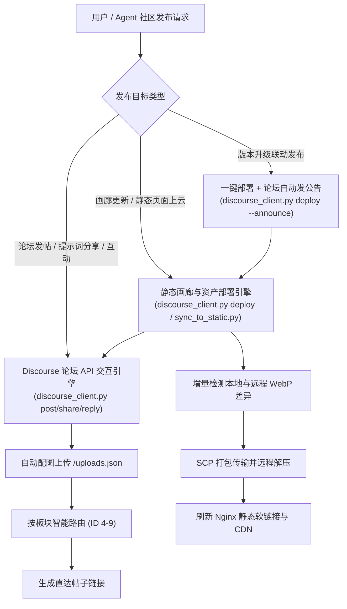

# HandRaw Community Publisher & Manager (手绘风社区发帖与静态页面发布中枢)

## 对话内“分享到网站”

当用户要在 Codex / Claude 出图后的回复中提供分享入口，或点击“分享到网站”时，先读安装包根目录下的 [对话分享合同](references/conversation-sharing.md)，使用 `scripts/conversation_share.py`。该流程分享生成图片与逐字保存的最初创作指令，末尾只附实际编号标签，如 `【画风：FA-013 】`；实际用了图型才附图型标签。不写备注标题、编号解释或“未使用”字段，不加入二阶段参数或完整生图提示词；原有 `share --prompt` 是解析后提示词分享，不能代替此流程。

**目标为作品广场**：通过 `/studio/api/entries` 创建免费 `kind=work` 作品，首图作封面，其余图片作附图，使用 `assets` 关联实际画风与图型。不可直接调用论坛 `/posts.json` 代替广场分享。该约定仅适用于出图后的分享入口；用户明确要求论坛发帖时继续使用下方论坛流程。

生成完成准备本地草稿并输出标准 Markdown 分享链接，打开本机预览页；页面中提供真实的“分享到作品广场”按钮。准备草稿和打开页面均不上传；用户点击页面内发布按钮或明确回复后才发布。不得假定宿主会把 `:codex-followup` 渲染为按钮。组图合为一件广场作品，重复点击返回原链接。每位用户绑定自己的凭据，公开 Skill、按钮参数与分享正文都不得包含密钥。扁平 `.agents/skills` 入口中的相对路径需从安装包根目录重新解析。

本 Skill 是手绘风生态 ([handraw-style.com](https://handraw-style.com)) 的**全功能社区发布引擎**。
涵盖两大核心维度：
1. **动态论坛发帖与内容管理**：向 Discourse 社区各大板块发布图文讨论、出版级手绘提示词卡片、跟帖互动及帖子全生命周期维护。
2. **静态画廊与资产部署上云**：一键将风格画廊页面（`index.html`、`tutorials.html`、`assets.html` 等）、365 种视觉风格数据与 WebP 高清切片图增量同步部署至云服务器与 CDN，并支持自动发布论坛版本更新公告。

---

## 🏛️ 双维发布架构与体系划分



### 社区 6 大核心板块体系

| 板块 ID | 板块名称 | Slug 标识 | 核心定位与适用内容 | 推荐匹配关键词 |
| :---: | :--- | :--- | :--- | :--- |
| **4** | **综合大厅** | `creation-monetization` | 社区官方公告、新人报到、生态思辨、行业前瞻资讯 | 公告, 新人, 大厅, 综合, 资讯 |
| **5** | **好用的工具** | `tools` | 开源项目推荐、AI生图/改图工具、工作流分享、排错求助 | 工具, 开源, workflow, 工作流, 软件, 排错 |
| **6** | **创作交流** | `creative-exchange` | 绘画/写作/视频创作经验交流、出版级双语提示词分享 | 创作, 提示词, prompt, 经验, 交流, 画风 |
| **7** | **运营与变现** | `operations` | 自媒体起号与运营实操、推流算法、商业广告与变现案例 | 运营, 变现, 起号, 推流, 带货, 商业, 赚钱 |
| **8** | **实战作品与爆款** | `showcase` | 晒成片、晒图文、爆款拆解、社群互相点评点赞 | 爆款, 作品, 实战, 晒图, 成片, 案例, 拆解 |
| **9** | **手绘skill** | `handraw-skill` | HandRaw Skill（画风库、版式库、提示词工程）专项交流与官方更新 | skill, 手绘, 技能, 插件, 画风库, 画廊 |

---

## 🛠️ 操作指南与核心发布模式

底层脚本支持在仓库根目录或 Skill 目录直接运行：
`scripts/discourse_client.py` 或 `skills/community-share/scripts/discourse_client.py`。

### 1. 账号绑定与凭据管理 (Authentication)

- **检查当前登录账号**：
  ```bash
  python scripts/discourse_client.py whoami
  ```
- **使用 API Key 绑定登录 (推荐模式)**：
  ```bash
  python scripts/discourse_client.py login --api-key <your_api_key>
  ```
- **使用 用户名/邮箱 + 密码 登录**：
  ```bash
  python scripts/discourse_client.py login --username <user> --password <pass>
  ```
- **退出登录并清除本地缓存**：
  ```bash
  python scripts/discourse_client.py logout
  ```

---

### 2. 模式一：风格画廊与静态资产发布上云 (Static Gallery Deploy)

当风格画廊网页（`gallery/*.html`）、画风数据（`styles.json`）或图片资源（`images/`）更新后，一键同步部署至 `tencent-vm` 云服务器与 CDN。

- **一键增量部署至云端**：
  ```bash
  python scripts/discourse_client.py deploy
  ```
  *(等效于 `python scripts/sync_to_static.py --deploy`)*
- **部署同时提交推送到 GitHub handraw-static 仓库**：
  ```bash
  python scripts/discourse_client.py deploy --git
  ```
- **部署并自动在论坛「手绘skill」板块发布版本更新公告**：
  ```bash
  python scripts/discourse_client.py deploy --announce
  ```

> [!TIP]
> **已部署线上访问地址**：
> - 风格画廊首页：[https://handraw-style.com/gallery/index.html](https://handraw-style.com/gallery/index.html)
> - 提示词拼装器：[https://handraw-style.com/gallery/tutorials.html](https://handraw-style.com/gallery/tutorials.html)
> - 自建资产图库：[https://handraw-style.com/gallery/assets.html](https://handraw-style.com/gallery/assets.html)
> - 核心风格数据：[https://static.handraw-style.com/data/styles.json](https://static.handraw-style.com/data/styles.json)

---

### 3. 模式二：通用全板块发帖 (Generic Post)

适用于发布任意讨论、长文教程、工具测评、行业分析或问题求助，支持纯文本或图文混合。

```bash
python scripts/discourse_client.py post \
  --title "【工具推荐】这个手绘风批量导出插件大幅提升出图效率" \
  --category "好用的工具" \
  --content "今天给大家分享一个非常实用的批量切图与转 WebP 格式的脚本..." \
  --image "path/to/screenshot.png" \
  --tags "工具,工作流,分享"
```

- **从本地 Markdown 文件读取正文**：
  正文内容可传入 `@文件路径`：
  ```bash
  python scripts/discourse_client.py post \
    --title "【运营干货】小红书手绘风起号 7 天破万粉复盘" \
    --category "运营与变现" \
    --content "@path/to/post_review.md" \
    --tags "运营,小红书,复盘"
  ```

---

### 4. 模式三：手绘风出版级作品与提示词分享 (Artwork & Prompts Share)

专为手绘风画廊打造，自动将本地画作直传对象存储，并格式化输出包含【画风编号】、【主题色彩】、【创作者名片】、【双语提示词代码块】的出版级社区卡片。

```bash
python scripts/discourse_client.py share \
  --image "path/to/images/poster-demo-autumn-equinox.webp" \
  --prompt "秋分节气手绘海报，暖秋落叶与静谧庭院，水彩手绘质感，极简构图与柔和光影，中英双语设计排版。A minimalist autumn watercolor illustration featuring golden falling leaves, a serene traditional courtyard, warm sunlight, clean layout, hand-drawn aesthetic, high resolution." \
  --title "【秋分节气手绘海报】暖秋意象与落叶 · 完整出版级提示词分享" \
  --category "创作交流" \
  --style "048" \
  --style-name "极简儿童绘本水彩" \
  --color "C-05" \
  --notes "通过 HandRaw Style Studio API Key 一键测试发布，包含完整高清配图与双语生图提示词。"
```

---

### 5. 模式四：跟帖与讨论互动 (Topic Reply)

支持向指定话题发表评论、追问或补充说明：

```bash
python scripts/discourse_client.py reply \
  --topic-id 38 \
  --content "亲测这个提示词在 DALL-E 3 上效果非常稳定，建议采样时把光影参数调柔和一些！" \
  --image "path/to/test_result.png"
```

---

### 6. 帖子资产管理 (Post Management)

- **查看论坛全部板块清单**：
  ```bash
  python scripts/discourse_client.py categories
  ```
- **查看我发布的帖子列表 (实时统计浏览量、点赞、回复)**：
  ```bash
  python scripts/discourse_client.py my-posts [--limit 15]
  ```
- **删除我的帖子**：
  ```bash
  python scripts/discourse_client.py delete --topic-id <topic_id>
  ```

---

## ⚠️ 关键技术细节与协议避坑指南

1. **中文用户名 Header 编码陷阱 (Latin-1 崩溃)**：
   - Python 的标准库 `http.client` 在处理 HTTP Header 时仅允许 `latin-1` 范围字符。
   - 当用户名为非 ASCII 中文（如 `@小旺旺`）时，**切勿向请求头追加 `Api-Username`**。
   - Discourse 支持直接使用 User API Key 鉴权，只需传递 `Api-Key: <key>`，服务器会自动绑定对应的创作者身份。
2. **图片上传协议规范**：
   - 接口：`POST /uploads.json`
   - Content-Type：`multipart/form-data`
   - 必须字段：`type="composer"`, `synchronous="true"`, `file=<二进制流>`。
   - 成功后返回 `short_url`（如 `upload://xxx.webp`），Discourse 前端会自动解析为带 Lightbox 灯箱缩放的高清视图。
3. **静态部署增量安全机制**：
   - 自动跳过 `individual_backup` 等历史目录，只同步有效 367 种画风和自建资产。
   - 上传后自动触发 Nginx 软链接补齐 (`ln -sfn`)，保证 `img.handraw-style.com`、`static.handraw-style.com` 与主站即时生效。
4. **Discourse 权限控制规则**：
   - 标题长度：必须 $\ge 5$ 个字符。
   - 帖子删除权限：普通用户（TL1）可以自由删除自己发表的跟帖回复 (`DELETE /posts/{id}.json`)；但删除话题主贴（首楼）受论坛系统管理权限控制，若未配置允许用户删主题，论坛将返回 `422/403` 提示联系管理员。
