# GIF 工厂 · 完整作品库

[返回首页](README.md) · [分类说明](styles/README.md) · [使用指南](GUIDE.md)

[表情包展厅](#表情包展厅) · [电子光栅卡展厅](#电子光栅卡展厅) · [动态海报展厅](#动态海报展厅) · [动态艺术签名](#动态艺术签名) · [电影片头](#电影片头) · [动态绘本展厅](#动态绘本展厅) · [品牌宣传片展厅](#品牌宣传片展厅)

## 表情包展厅

这里有 **244 张已有示例**，还有 **2 张刚重做的动作试样，等使用者确认**。点击动图可以看原尺寸。大部分约两秒一轮，部分动作示例会短一些。另有 **9 张电子光栅卡**、**13 张动态海报**，和品牌短片一起单独分类，不计入聊天表情包数量。

**各系列默认收起；点击对应窗口即可展开分类动图。**

[下载整个项目：244 张表情包示例＋2 张重做试样＋9 张光栅卡＋13 张动态海报＋品牌短片案例](https://github.com/WoYun520/gif-factory/archive/refs/heads/main.zip)

### 大肥鱼 · 12 张动态预览

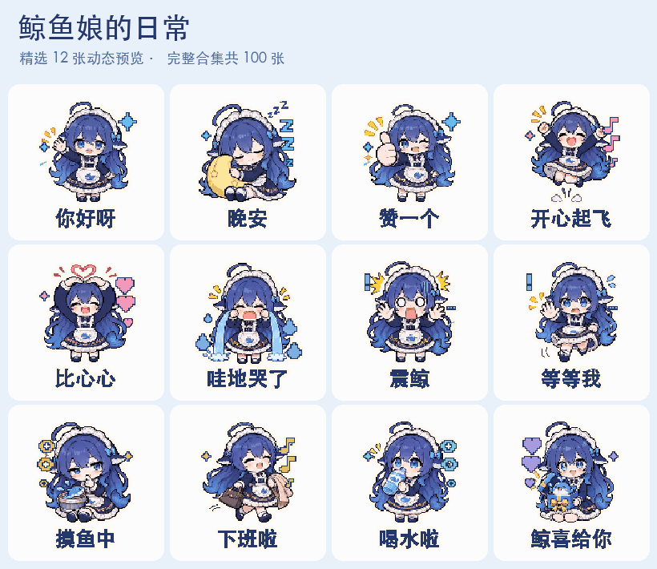

<strong>🐋 大肥鱼（鲸鱼娘） · 100 张 · 点击窗口展开</strong>

蓝发鲸鱼娘的日常聊天表情，分为日常问候、开心撒娇、情绪反应、聊天回应、工作学习、生活状态和鲸喜祝福。

### 日常问候 · 16 张

| | | | |
| --- | --- | --- | --- |
|  001 你好呀 |  002 早安 |  003 晚安 |  004 请多关照 |
|  005 欢迎呀 |  006 谢谢你 |  007 对不起 |  008 好哒 |
|  009 赞一个 |  010 拜拜啦 |  011 有点害羞 |  012 乖巧等候 |
|  013 在吗在吗 |  014 探个头 |  015 是我呀 |  016 为你服务 |

### 开心撒娇 · 16 张

| | | | |
| --- | --- | --- | --- |
|  017 哈哈哈哈 |  018 耶 |  019 开心起飞 |  020 好耶 |
|  021 得意一下 |  022 啵一个 |  023 害羞了 |  024 抱抱你 |
|  025 比心心 |  026 拜托拜托 |  027 略略略 |  028 偷笑一下 |
|  029 贴贴 |  030 转个圈圈 |  031 撒花 |  032 送你礼物 |

### 情绪反应 · 16 张

| | | | |
| --- | --- | --- | --- |
|  033 哇地哭了 |  034 委屈巴巴 |  035 气鼓鼓 |  036 生气了 |
|  037 自闭一会 |  038 震鲸 |  039 怕怕 |  040 我不理解 |
|  041 尴尬一笑 |  042 无语住了 |  043 我躺平了 |  044 啊啊啊 |
|  045 失落了 |  046 哼 |  047 慌得一批 |  048 我很怀疑 |

### 聊天回应 · 16 张

| | | | |
| --- | --- | --- | --- |
|  049 收到 |  050 听着呢 |  051 安排 |  052 等等我 |
|  053 马上来 |  054 我先溜了 |  055 让我看看 |  056 真的假的 |
|  057 我懂了 |  058 不可以 |  059 可以哒 |  060 请继续 |
|  061 听我说 |  062 交给我 |  063 救救我 |  064 保密哦 |

### 工作学习 · 16 张

| | | | |
| --- | --- | --- | --- |
|  065 开工啦 |  066 努力中 |  067 头秃了 |  068 摸鱼中 |
|  069 加油鸭 |  070 搞定 |  071 下班啦 |  072 开会中 |
|  073 学习中 |  074 记下来 |  075 有灵感了 |  076 再试一次 |
|  077 卡住了 |  078 求夸夸 |  079 冲鸭 |  080 发工资啦 |

### 生活状态 · 16 张

| | | | |
| --- | --- | --- | --- |
|  081 饭饭呢 |  082 好好吃 |  083 喝水啦 |  084 来杯茶 |
|  085 好困啊 |  086 起不来 |  087 洗香香 |  088 出门啦 |
|  089 下雨了 |  090 好热啊 |  091 好冷啊 |  092 运动一下 |
|  093 买买买 |  094 追剧中 |  095 没电了 |  096 满血复活 |

### 鲸喜祝福 · 4 张

| | | | |
| --- | --- | --- | --- |
|  097 生日快乐 |  098 好运来 |  099 周末快乐 |  100 鲸喜给你 |

<strong>🎮 像素风 · 完整动作 · 4 个角色 × 5 张 · 点击窗口展开</strong>

这一组会让角色完整做完一个动作：男孩抬腿挥拳、女孩侧步招手、太空猫起跳落地、企鹅左右扭动。头、身体和手一起配合，衣服和配饰也跟着动。

这套 20 张已经过使用者确认。每张都是 320 × 320 的透明 GIF，16 个姿势，约 1.92 秒一轮。

[只下载这套 20 张](examples/pixel-actions/pixel-actions-20.zip) · [查看制作记录](examples/pixel-actions/production.json)

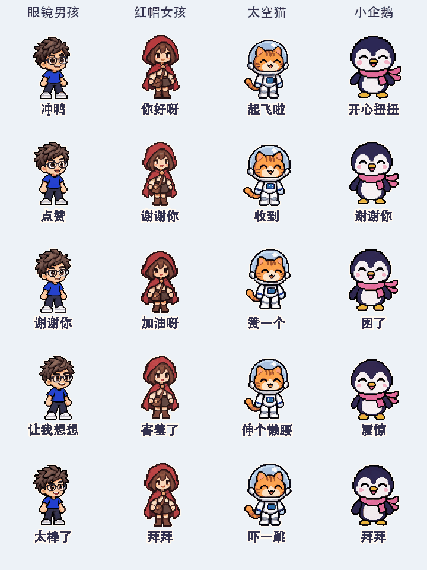

### 眼镜男孩 · 5 张

| | | | | |
| --- | --- | --- | --- | --- |
|  冲鸭 |  点赞 |  谢谢你 |  让我想想 |  太棒了 |

### 红帽女孩 · 5 张

| | | | | |
| --- | --- | --- | --- | --- |
|  你好呀 |  谢谢你 |  加油呀 |  害羞了 |  拜拜 |

### 太空猫 · 5 张

| | | | | |
| --- | --- | --- | --- | --- |
|  起飞啦 |  收到 | <a href="examples/pixel-actions/cat/03.gif">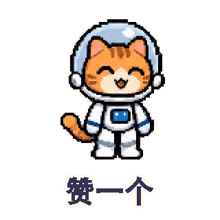</a> 赞一个 |  伸个懒腰 | <a href="examples/pixel-actions/cat/05.gif">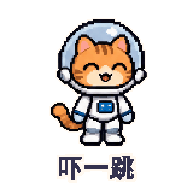</a> 吓一跳 |

### 小企鹅 · 5 张

| | | | | |
| --- | --- | --- | --- | --- |
|  开心扭扭 |  谢谢你 |  困了 |  震惊 |  拜拜 |

<strong>🔎 完整动作试样 · 2 张修正版 · 点击展开</strong>

阿尼亚比心、哆啦A梦挥手的重做版本，主要改善变脸和动作跳动。已经逐张检查并查看播放，**还在等使用者确认，暂不当作已认可的范例**。

| 阿尼亚 · 喜欢你 | 哆啦A梦 · 交给我 |
| --- | --- |
|  | <a href="examples/anime-stability/doraemon.gif">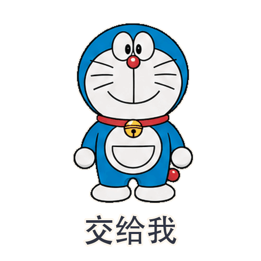</a> |

两张都是 512 × 512 的透明 GIF，约 1.6 秒一轮。阿尼亚用了 16 个姿势；哆啦A梦去掉了一张不自然的过渡，保留 15 个姿势，眨眼时稍作停顿。

查看[制作和检查记录](examples/anime-stability/review.json)、[阿尼亚逐帧图](examples/anime-stability/anya-frames.png)、[哆啦A梦逐帧图](examples/anime-stability/doraemon-frames.png)。好不好看、动起来顺不顺，还要看实际播放。

<strong>🎬 真人 × 二次元 · 连续动作 GIF 6 张 · 点击窗口展开</strong>

每张采用多个连续姿势，表现点赞、摊手、挥手、挥拳、打气和比心；512 × 512 透明循环 GIF。关键姿势间可能有轻微跳帧或人物细节变化。

### 真人动作 · 3 张

| | | |
| --- | --- | --- |
|  雷军 · 这就稳了 |  周星驰 · 我也没办法 |  山姆奥特曼 · 你好呀 |

### 二次元动作 · 3 张

| | | |
| --- | --- | --- |
|  路飞 · 冲鸭 |  鸣人 · 加油啊 |  阿尼亚 · 爱你哦 |

[制作记录、参考来源与提示词](examples/mixed-actions/generation.json) · [连续动作制作说明](references/keyframes.md)

台词与姿势为趣味二创，并非真人原话或真实事件。动漫角色为同人小样。

<strong>👤 四位人物 · 高清 GIF 4 张 · 点击窗口展开</strong>

512 × 512 透明循环 GIF，使用高清合成方式保留人物脸部和衣服细节。Tibo 为 **@thsottiaux（Thibault Sottiaux）**，Dario 为 **Anthropic 的 Dario Amodei**。

| | |
| --- | --- |
|  马斯克 冲就完了 |  Thibault Sottiaux（@thsottiaux） 先上线 |
|  Dario Amodei（Anthropic） 已封号 |  黄仁勋 安排算力 |

[查看同尺寸清晰度对比](examples/public-figures-hd/clarity-comparison.png) · [人物参考来源与署名](examples/public-figures-hd/sources.json)

以上台词和姿势为趣味二创，并非本人原话；“已封号”为表情包文案，不表示真实封号事件。马斯克参考照片作者为 Gage Skidmore，原图及该改编按 [CC BY-SA 3.0](https://creativecommons.org/licenses/by-sa/3.0/) 提供。其他人物参考见来源文件。

<strong>🐾 宠物拟人风格 · 柯基 8 张 · 点击窗口展开</strong>

保留真实宠物的毛发与面部特征，搭配服装、道具和拟人姿势，做成中文聊天 GIF。和其他系列一样，使用摇摆、弹跳、挤压及移动小特效制作循环动效。

### 整活与上班 · 4 张

| | | | |
| --- | --- | --- | --- |
|  嗨起来 |  看我操作 |  接着奏乐 |  不想上班 |

### 吃喝与生活 · 4 张

| | | | |
| --- | --- | --- | --- |
|  干饭啦 |  摸鱼中 | <a href="examples/pet-corgi/02-food-and-life/003.gif">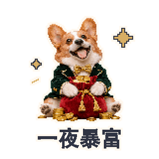</a> 一夜暴富 |  晚安啦 |

宠物原图来自 [Wikimedia Commons](https://commons.wikimedia.org/wiki/File:Fawn_and_white_Welsh_Corgi_puppy_standing_on_rear_legs_and_sticking_out_the_tongue.jpg)，作者 Huoadg5888，CC0 授权；以上为参考原图生成的拟人版本。

<strong>🪟 像素小秘书 × 奶油麻薯 · 100 张 · 点击窗口展开</strong>

原有的像素小秘书系列，按回消息、情绪、陪伴、工作、吃喝玩乐、生活状态和节日彩蛋分类展示。

### 回消息 · 16 张

| | | | |
| --- | --- | --- | --- |
|  001 马上来 |  002 看到了 |  003 没问题 |  004 我在 |
|  005 等我一下 |  006 稍等 |  007 继续说 |  008 懂了 |
|  009 同意 |  010 不行 |  011 随你 |  012 安排上 |
|  013 记住了 |  014 确实 |  015 先这样 |  016 回头聊 |

### 情绪 · 16 张

| | | | |
| --- | --- | --- | --- |
|  017 笑出声 |  018 憋不住 |  019 无语 |  020 好家伙 |
|  021 慌了 |  022 委屈巴巴 |  023 破防了 |  024 别惹我 |
|  025 气鼓鼓 |  026 社死了 |  027 我酸了 |  028 不敢看 |
|  029 眼前一黑 |  030 一点点心动 |  031 我裂开了 |  032 燃起来了 |

### 陪伴 · 16 张

| | | | |
| --- | --- | --- | --- |
|  033 贴贴 |  034 摸摸头 |  035 递纸巾 |  036 别怕 |
|  037 辛苦了 |  038 给你花 |  039 给你糖 |  040 想你了 |
|  041 接住你 |  042 给你靠 |  043 我听着 |  044 亲一口 |
|  045 和好吧 |  046 一起加油 |  047 祝你好运 |  048 抱紧点 |

### 工作 · 16 张

| | | | |
| --- | --- | --- | --- |
|  049 开工 |  050 开会中 |  051 在写了 |  052 改改改 |
|  053 来活了 |  054 查一下 |  055 交作业 |  056 审核中 |
|  057 已保存 |  058 找不到 |  059 打个卡 |  060 会议结束 |
|  061 要下班 |  062 加班中 |  063 请个假 |  064 明天再说 |

### 吃喝玩乐 · 16 张

| | | | |
| --- | --- | --- | --- |
|  065 干饭啦 |  066 喝奶茶 |  067 来一口 |  068 太好吃了 |
|  069 辣到了 |  070 喝水喝水 |  071 碰个杯 |  072 走走走 |
|  073 看电影 |  074 打游戏 |  075 拍一张 |  076 逛街去 |
|  077 收到礼物 |  078 生日快乐 |  079 音乐时间 |  080 拆开看看 |

### 生活状态 · 16 张

| | | | |
| --- | --- | --- | --- |
|  081 早呀 |  082 醒醒 |  083 充会电 |  084 我好困 |
|  085 休息一下 |  086 外面下雨 |  087 好冷 |  088 好热 |
|  089 到家了 |  090 没信号 |  091 电量不足 |  092 我出门啦 |
|  093 运动一下 |  094 整理一下 |  095 一起睡 |  096 做个好梦 |

### 节日彩蛋 · 4 张

| | | | |
| --- | --- | --- | --- |
|  097 新年快乐 |  098 中秋快乐 |  099 节日快乐 |  100 周末快乐 |

<strong>🥐 黏土品牌吉祥物 · 3 位店员 / 4 张 GIF · 点击窗口展开</strong>

虚构面包店的可颂店长、吐司店员和咖啡杯搭子，穿同款鼠尾草绿围裙。前三张是已认可的角色试样；拉纸条动作来自已认可的融合短片。看起来像黏土定格，使用连续姿态合成。

| 可颂店长 · 开工啦 | 吐司店员 · 让我缓缓 | 咖啡杯搭子 · 干杯 | 可颂店长 · 拉开今天 |
| --- | --- | --- | --- |
| <a href="examples/clay-bakery/01-croissant.gif">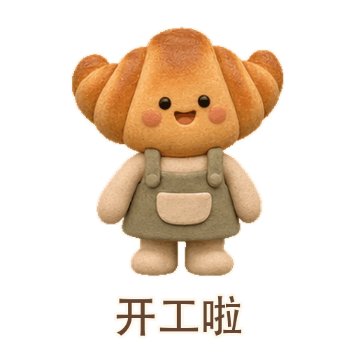</a> | <a href="examples/clay-bakery/02-toast.gif">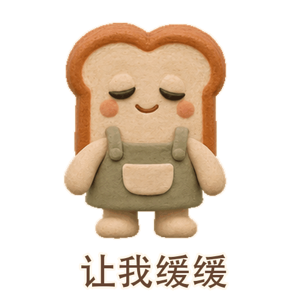</a> |  |  |

[下载这 4 张 GIF](examples/clay-bakery/clay-bakery-4-gifs.zip) · [看看它们怎么拍成广告](examples/brand-films/manman-bakery/README.md)

<strong>🎀 更多插画动作 · 初音与公主裙 · 点击展开</strong>

初音动作与公主裙提裙行礼，是此前已制作的两张插画动作小样；此次补入作品库。仅发布生成的 GIF，不包含用户的原始照片。

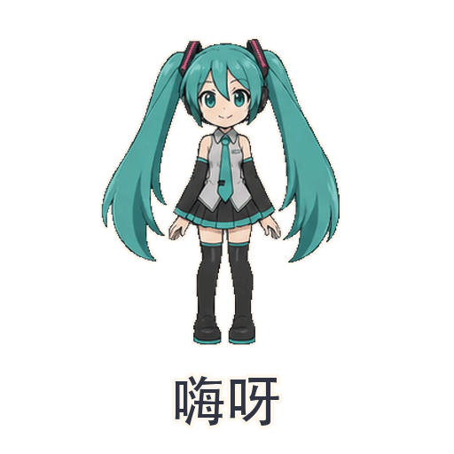

[案例说明](examples/illustrated-actions/README.md) · [更多插画动作](styles/illustrated-actions/STYLE.md)

## 电子光栅卡展厅

同一张卡片在两幅画面间切换：人脸变成面罩，或者普通状态变成另一个形态。这套是 **9 张独立 GIF，每张 480×720、6 秒循环**，标题固定，画面按细条来回变换。蜘蛛侠保留使用者选定的首版近景。

<strong>🪪 电子光栅卡 · 9 张 · 点击窗口展开</strong>

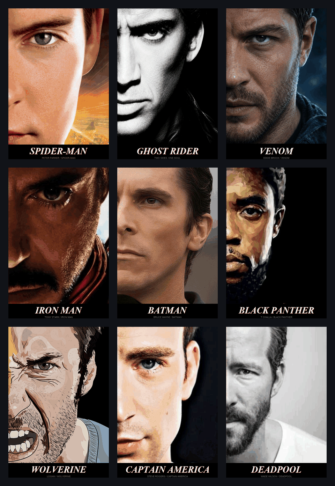

| | | |
| --- | --- | --- |
|  蜘蛛侠 |  恶灵骑士 |  毒液 |
|  钢铁侠 |  蝙蝠侠 |  黑豹 |
| <a href="examples/lenticular-cards/07-wolverine.gif">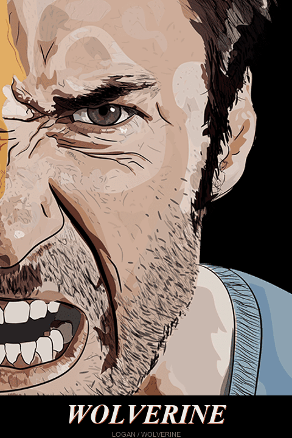</a> 金刚狼 | <a href="examples/lenticular-cards/08-captain-america.gif">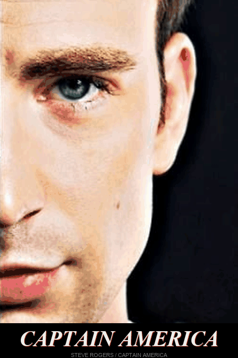</a> 美国队长 |  死侍 |

[下载九张独立 GIF](examples/lenticular-cards/cards.zip) · [静态 A 状态](examples/lenticular-cards/state-a.jpg) · [静态 B 状态](examples/lenticular-cards/state-b.jpg) · [来源与制作说明](examples/lenticular-cards/README.md)

这九张素材做法有区别：有生成图、照片合成，也有现成插画。黑豹和金刚狼带插画质感；金刚狼原画为 [Daniel Vásquez 的作品](https://www.behance.net/gallery/120626151/WolverineHugh-Jackman-Vector)。它们是动态效果案例，软件开源不等于角色和网络图片获得商业授权。

## 动态海报展厅

适合角色宣传、演出预告、活动主视觉。人物从平静切到开唱、蓄力或登场，字也跟着撑开。日期、地点这些要读清楚的信息保持不动。每张都是完整海报循环，不做成有片头片尾的视频。

<strong>⚡ 人物、背景、文字整体融合 · 9 张 · 点击窗口展开</strong>

这套借鉴 P5 式漫画印刷的视觉语言：限定色、墨线、网点和斜切字形一起设计。人物头发能挡住部分标题，手臂和大字形成前后层次。每个角色保留自己的主色，避免一套字硬套所有角色。

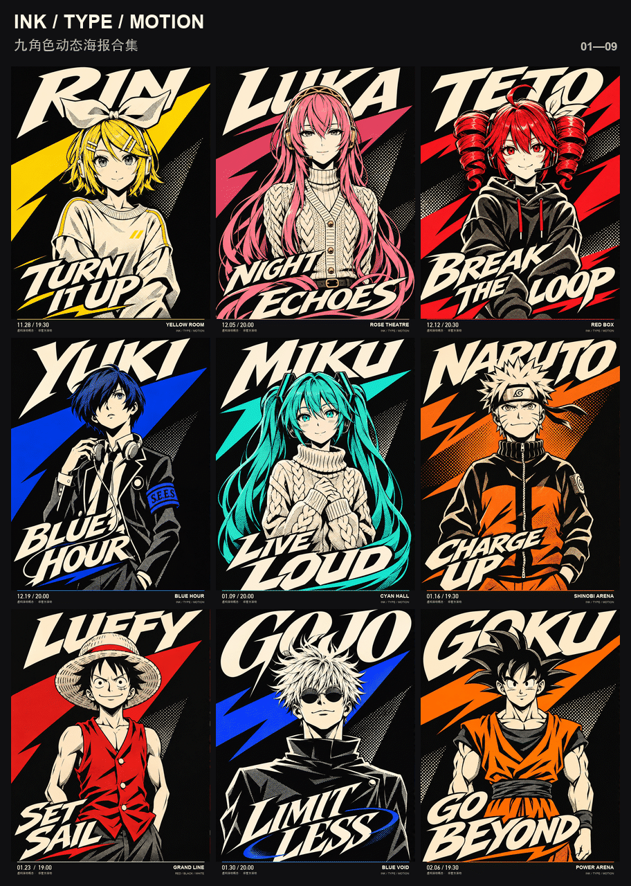

| | | |
| --- | --- | --- |
| <a href="examples/dynamic-posters/p5-integrated/01-rin.gif">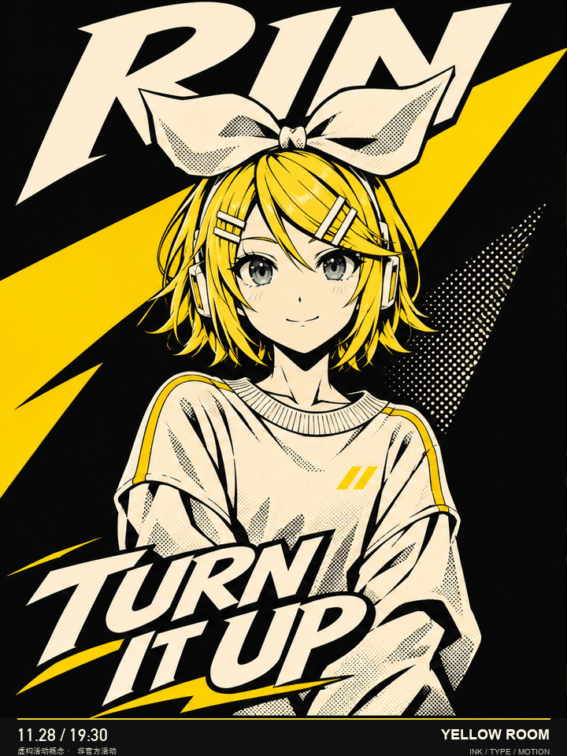</a> 镜音铃 · TURN IT UP | <a href="examples/dynamic-posters/p5-integrated/02-luka.gif">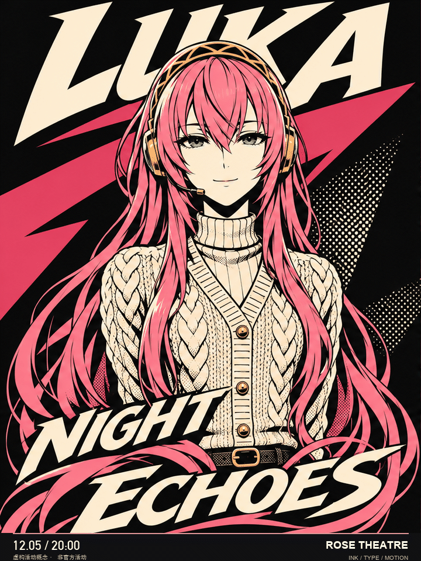</a> 流歌 · NIGHT ECHOES |  Teto · BREAK THE LOOP |
| <a href="examples/dynamic-posters/p5-integrated/04-yuki.gif">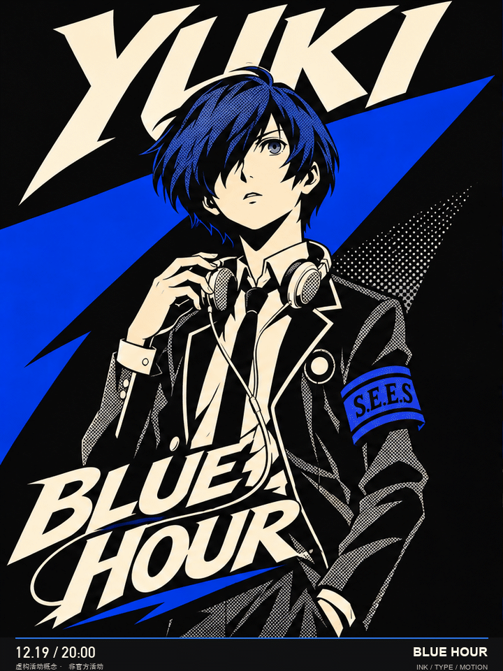</a> 结城理 · BLUE HOUR | <a href="examples/dynamic-posters/p5-integrated/05-miku.gif">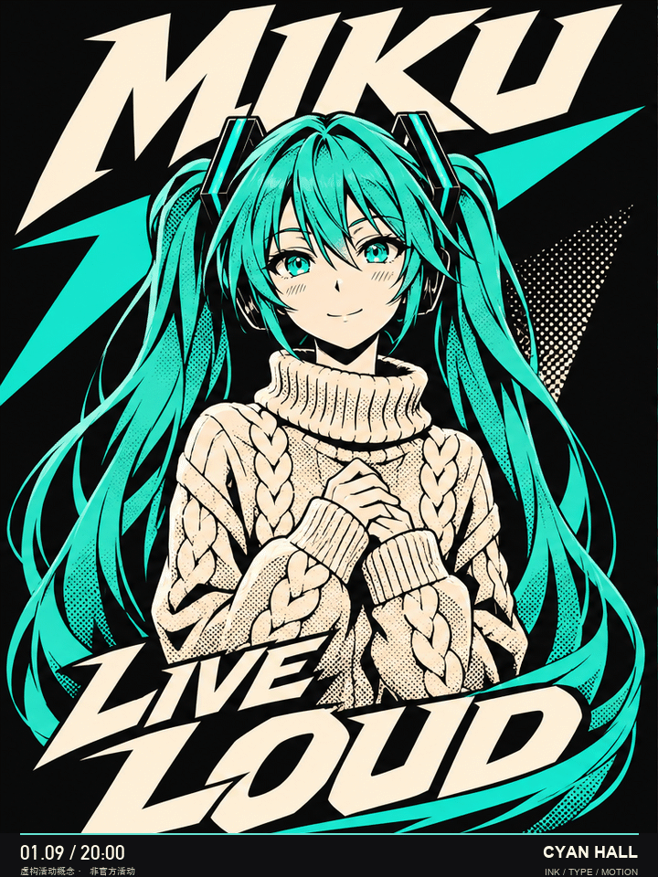</a> 初音 · LIVE LOUD |  鸣人 · CHARGE UP |
| <a href="examples/dynamic-posters/p5-integrated/07-luffy.gif">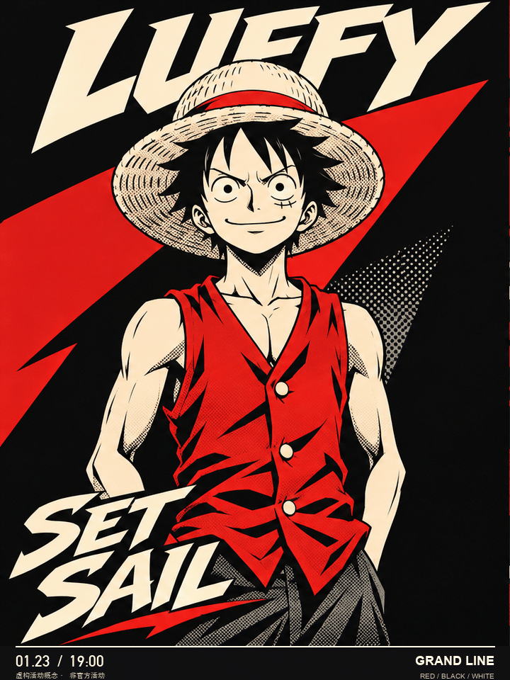</a> 路飞 · SET SAIL | <a href="examples/dynamic-posters/p5-integrated/08-gojo.gif">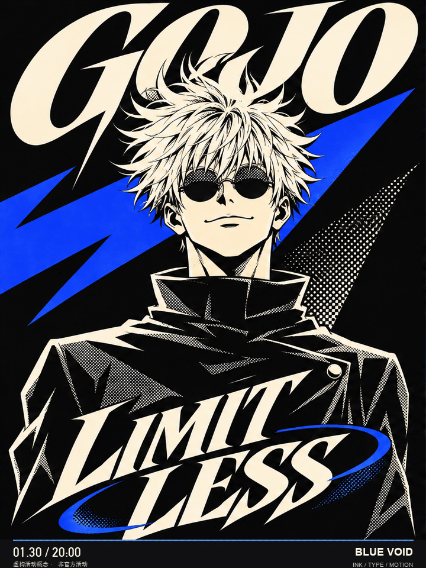</a> 五条悟 · LIMIT LESS |  悟空 · GO BEYOND |

单张 720×960、6 秒循环，点击看原尺寸。结城理在第二排左侧。

[九张文件与制作说明](examples/dynamic-posters/p5-integrated/README.md) · [静态封面](examples/dynamic-posters/p5-integrated/cover.jpg) · [动态海报怎么分类和制作](references/dynamic-posters.md)

这些是非官方角色效果案例，活动信息均为虚构。

<strong>🔤 保留原画＋字体联动 · 4 张 · 点击展开</strong>

人物日常到开唱，文字图层联动，日期场地保持固定。

<table>
<tr>
<td width="33%" valign="top"><a href="examples/dynamic-posters/type-linked/01-rin.gif">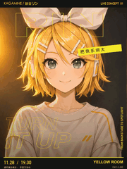</a> 镜音铃</td>
<td width="33%" valign="top"> 流歌</td>
<td width="33%" valign="top"> Teto</td>
</tr>
<tr>
<td width="33%" valign="top"><a href="examples/dynamic-posters/type-linked/04-len.gif">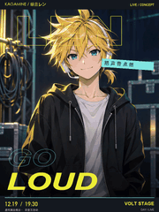</a> 镜音连</td>
</tr>
</table>

[四张独立 GIF 与说明](examples/dynamic-posters/type-linked/README.md) · [风格入口](styles/type-linked/STYLE.md)

## 动态艺术签名

现在支持多种字体，也可以自定义。可以选择书体、描述想要的感觉，或提供自己的字稿；名字、意象、乐器、配色和动效都能调整。

### 多字体动态签名

<a href="skills/dynamic-art-signature/assets/media/multifont/MultiFont_Nine_Grid.mp4">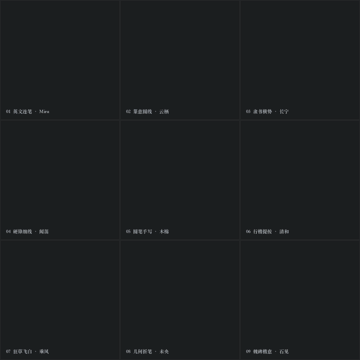</a>

[九种字体与自定义方法](skills/dynamic-art-signature/references/multifont.md) · [完整 GIF](skills/dynamic-art-signature/assets/media/multifont/MultiFont_Nine_Grid.gif) · [MP4](skills/dynamic-art-signature/assets/media/multifont/MultiFont_Nine_Grid.mp4)

这组由九张新字稿分别分层、适配并导出；保留细锋、圆笔、隶意、篆意、狂草与英文连笔各自的结构。已完成逐帧和文件检查，供选择效果与继续自定义。

### 早期英文连笔基准

名字、物体和渐变共享字形轮廓，使用独立上、下笔势与约一秒停顿。末端减速收锋，未写区域无底印，不加轻震或回弹。Levi、Aster 是逐轮修订基准；其余七款是扩展制作样例，技术检查不等同于逐款用户认可。

<a href="skills/dynamic-art-signature/assets/media/nine-grid.gif">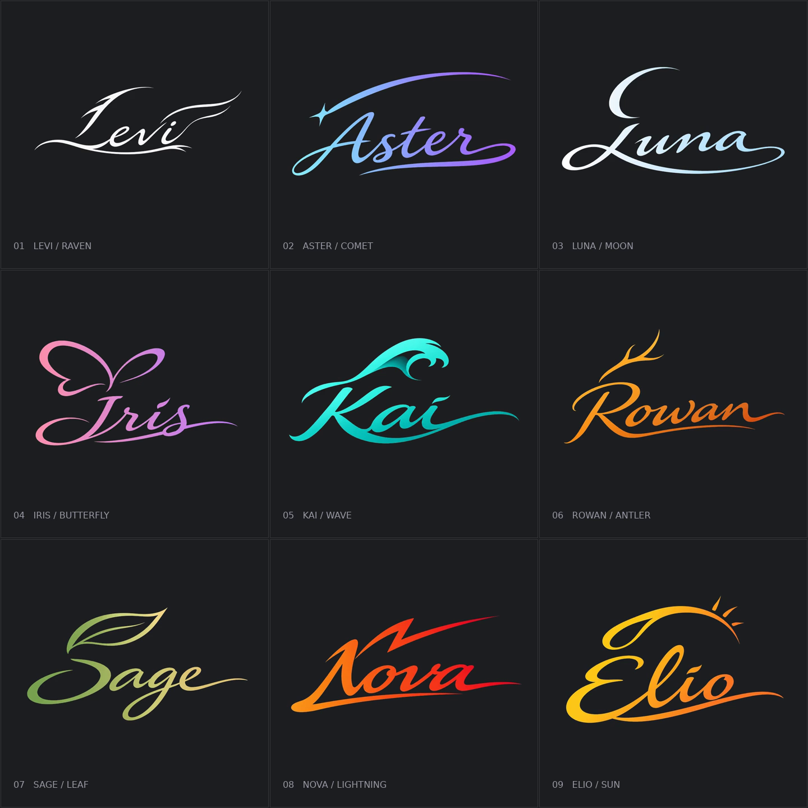</a>

[九款 GIF、MP4 与参数](examples/dynamic-signatures/README.md) · [风格入口](styles/dynamic-signatures/STYLE.md) · [独立模块](skills/dynamic-art-signature/SKILL.md)

### 中文草书签名与三字布局

<a href="skills/dynamic-art-signature/assets/media/chinese/nine-grid.gif">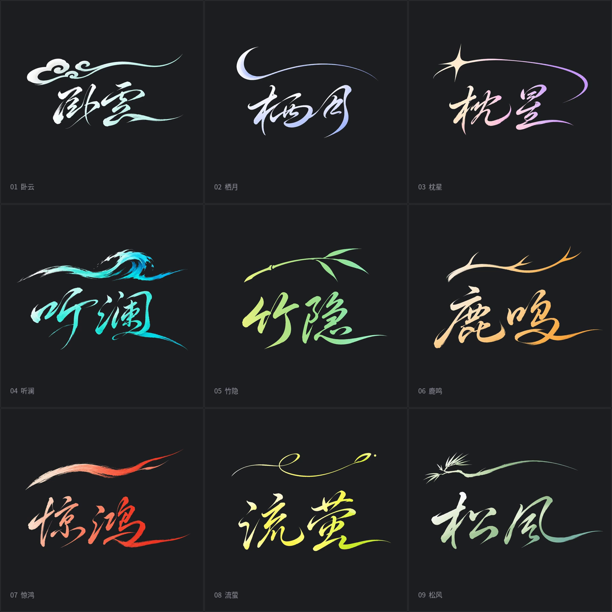</a>

[中文九宫格 GIF](skills/dynamic-art-signature/assets/media/chinese/nine-grid.gif) · [三字卧云间](skills/dynamic-art-signature/assets/media/chinese/Woyunjian.gif) · [十款原图、配置与成品](examples/dynamic-signatures/README.md#中文草书)

## 电影片头 · 40 种字的风格

每种都有一张完整片头图，点开看大图。选好编号，说片名和想要的感觉，就能继续做新图。

<a href="skills/cinematic-title-lettering/assets/style-catalog/previews/new-01.jpg">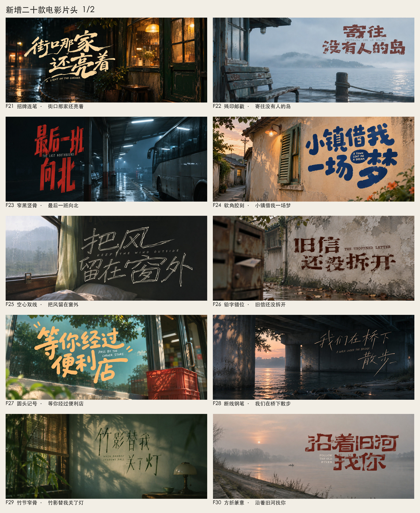</a>

<a href="skills/cinematic-title-lettering/assets/style-catalog/previews/new-02.jpg">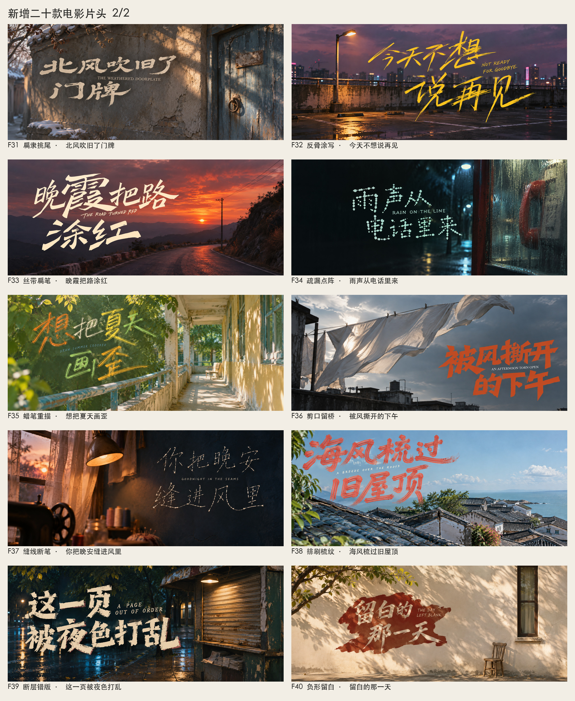</a>

[看全部 40 种和原图](skills/cinematic-title-lettering/references/style-catalog.md) · [片头怎么做](skills/cinematic-title-lettering/references/film-title-frames.md)

## 动态绘本展厅

<strong>📖 风送来的茶会 · 12页 · 54秒 · 真实书本与书写 · 点击展开</strong>

<table>
<tr>
<td align="center" valign="top"><strong>横屏 · 左字右图</strong> </td>
<td align="center" valign="top"><strong>竖屏 · 手机阅读优化</strong> <a href="examples/storybooks/tea-party/portrait-writing.mp4">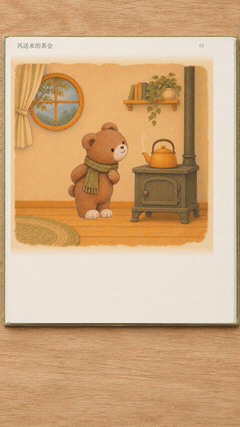</a></td>
</tr>
</table>

横屏摊开绘本、竖屏白框单页，实际6fps，正文快速写出，含轻微沙沙声与配乐。上方为循环网页预览，54秒正式成片中的动作单次完成。

[完整视频与12页独立动作](examples/storybooks/tea-party/README.md) · [适用素材与做法](styles/compact-storybook/STYLE.md) · [独立Skill](skills/compact-storybook/SKILL.md)

## 品牌宣传片展厅

<strong>🎞️ 慢慢面包店 · 黏土角色 × 纸片拼贴 · 15 秒 · 点击展开</strong>

可颂店长拉纸条，店铺展开；热面包出炉，落到手托的一个盘子上，再装进印有店名的外带袋。角色的动作会推动故事往下走，品牌就留在故事里的招牌和包装上。

<a href="examples/brand-films/manman-bakery/film.mp4">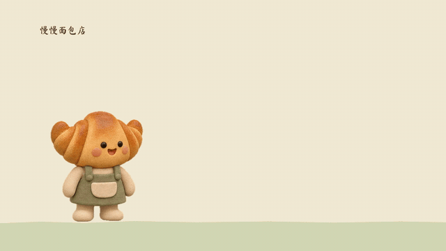</a>

上面是缩小的动图预览，完整 MP4 为 1920 × 1080、有配乐。慢慢面包店是虚构品牌，这版效果已经得到使用者认可。

[查看 / 下载完整视频](https://raw.githubusercontent.com/WoYun520/gif-factory/main/examples/brand-films/manman-bakery/film.mp4) · [下载可编辑工程](examples/brand-films/manman-bakery/editable-project.zip) · [查看案例和素材署名](examples/brand-films/manman-bakery/README.md)

这次借鉴了 [gbro-collage-broll](https://github.com/pyang5166/gbro-collage-broll) 的构思和组装流程，结合本项目的角色动作方法，用可编辑图层完成；没有调用它的 Gemini 视频脚本。发布配乐版时保留[音乐署名](examples/brand-films/manman-bakery/CREDITS.md)。

