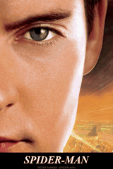
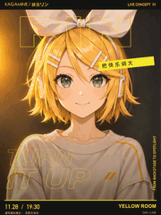
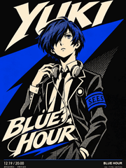
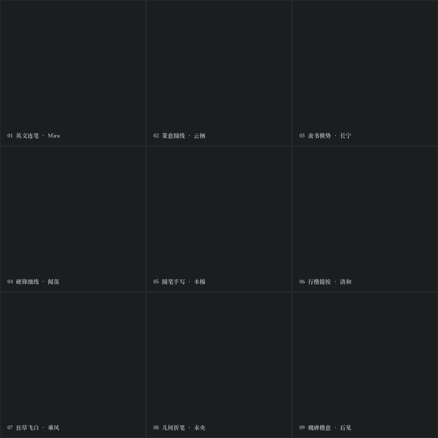
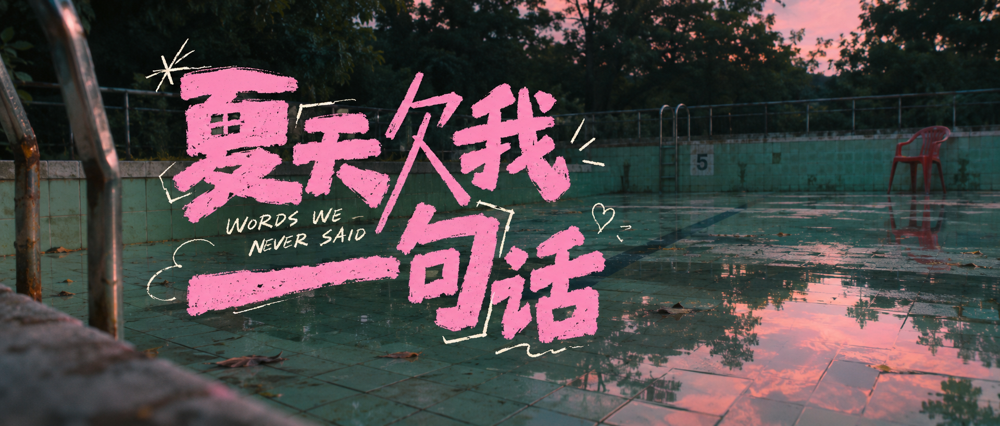
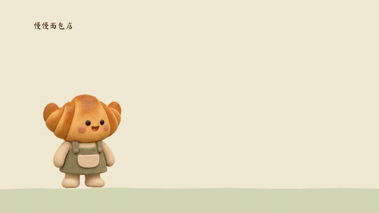

# GIF 工厂

把这句话发给 Codex 安装：

> 帮我安装 GIF 工厂：[https://github.com/WoYun520/gif-factory](https://github.com/WoYun520/gif-factory)

安装 Skill 是加入制作说明和脚本；运行时需要的工具按功能分别准备，见[需要装什么](GUIDE.md#需要装什么)。

装好后，给一张图、一段文字，或直接说想做什么。角色图、场景图、片名、字稿和配乐都可以自己提供，缺的部分再一起补。

[表情包](#stickers) · [光栅变画卡](#cards-transforms) · [动态海报](#posters-type) · [动态签名](#dynamic-signatures) · [电影片头](#cinematic-title-lettering) · [动态绘本](#storybooks) · [品牌短片](#brand-films)

[分类说明](styles/README.md) · [完整作品库](GALLERY.md) · [使用指南](GUIDE.md) · [下载项目](https://github.com/WoYun520/gif-factory/archive/refs/heads/main.zip)

## 仓库里有哪些 Skill

一般安装 GIF 工厂总入口即可，直接说需求。如果只用某个功能，也可以让 Codex 单独安装对应的 Skill 文件夹。

| Skill | 能做什么 | 说明 |
| --- | --- | --- |
| GIF 工厂总入口 | 根据需求选择表情包、卡片、海报、签名、片头、绘本或品牌短片的做法 | [查看](SKILL.md) |
| 动态签名 | 支持多种字体和自定义字稿，把名字与意象融成动态签名 | [查看](skills/dynamic-art-signature/SKILL.md) |
| 电影片头 | 40 种字形可选，可以设计字、配场景，也可以用你提供的素材 | [查看](skills/cinematic-title-lettering/SKILL.md) |
| 动态绘本 | 让插画做完一个动作，再翻到下一页，能做横屏或竖屏 | [查看](skills/compact-storybook/SKILL.md) |

## 表情包

可以做像素、插画、真人、宠物和粘土角色。既能轻轻点头、摇摆，也能让角色完整做完挥手、行礼等动作。

<table>
<tr>
<td align="center"> 像素</td>
<td align="center"> 插画</td>
<td align="center"> 宠物</td>
</tr>
</table>

[像素轻动效](styles/pixel-light/STYLE.md) · [像素完整动作](styles/pixel-actions/STYLE.md) · [插画](styles/illustrated-actions/STYLE.md) · [真人](styles/photo-people/STYLE.md) · [宠物](styles/photo-pets/STYLE.md) · [粘土吉祥物](styles/clay-mascot/STYLE.md) · [全部案例](GALLERY.md#表情包展厅)

> 用这张角色图做 12 张中文表情包，每张表情和姿势不同，加轻微点头或摇摆，文字用我给的这组台词。

## 光栅变画卡

让一张卡片在两种样子之间切换，比如人物与面罩、日常与变身、产品的两种配色。

[看做法](styles/lenticular/STYLE.md) · [全部案例](GALLERY.md#电子光栅卡展厅)

> 用这两张图做一张变画卡，来回切换两种状态，标题保持不动。

## 动态海报

可以保留原画，让人物和文字一起变化；也可以把人物、背景和大字重新设计成一张完整海报。

<table>
<tr>
<td align="center"> 保留原画，字体联动</td>
<td align="center"> 人物、背景和字一起设计</td>
</tr>
</table>

[字体联动](styles/type-linked/STYLE.md) · [漫画印刷风格](styles/comic-fusion/STYLE.md) · [全部案例](GALLERY.md#动态海报展厅)

> 用这个角色做一张动态宣传海报，人物从安静切到登场，大字一起展开，日期和地点固定。

## 动态签名

现在支持多种字体，也可以自定义。可以选样例、描述想要的笔画感觉，或直接提供自己的字稿；名字、意象、乐器和配色都能调整。把这些融进同一组笔画，再做快写、停顿、慢收锋或墨迹聚合。

[多字体视频](skills/dynamic-art-signature/assets/media/multifont/MultiFont_Nine_Grid.mp4) · [九款字体与自定义说明](skills/dynamic-art-signature/references/multifont.md) · [中英文案例](examples/dynamic-signatures/README.md) · [早期乐器案例](skills/dynamic-art-signature/references/instrument-semantic.md) · [Skill](skills/dynamic-art-signature/SKILL.md)

> 做一款「卧云间＋竹笛＋月白到浅青渐变」的动态签名，让乐器融进笔画，沿用仓库的快写和慢收锋节奏。

> 用我提供的字稿，保留字体和颜色，自定义一款动态签名；书写、墨迹聚合和收锋按字形来。

## 电影片头

40 种字的风格，每种都有完整片头图。选喜欢的编号，换成你的片名；字和场景一起设计。场景图、片名文案和现成字稿都可以自己提供。

[40 种字形与原图](skills/cinematic-title-lettering/references/style-catalog.md) · [五种排法](skills/cinematic-title-lettering/references/layout-recipes.md) · [三联图](skills/cinematic-title-lettering/references/promo-triptychs.md) · [Skill](skills/cinematic-title-lettering/SKILL.md)

> 用我提供的风景图和片名，按 F13 粉笔拙块做一张横向片头，字写得有点特别。

## 动态绘本

让插画做完一个小动作，停一下，再翻页。可以做独立动画，也可以做成横屏翻书或适合手机看的竖屏书页。

[看做法](styles/compact-storybook/STYLE.md) · [横屏和竖屏完整案例](examples/storybooks/tea-party/README.md) · [Skill](skills/compact-storybook/SKILL.md)

> 把这个故事做成动态绘本，一页完成一个动作，配上正文和音乐，先做一页小样。

## 品牌短片

让吉祥物和产品一起演一个小故事，比如拿起面包、装进包装、露出店名。可以用自己的角色、产品图和品牌素材。

[看案例和工程](examples/brand-films/manman-bakery/README.md) · [制作方法](references/brand-film.md)

> 用这套吉祥物和产品图做一条 15 秒品牌短片，让角色亲手把产品装进包装，给我成片和可修改的工程。

## 使用说明

想换台词、配色、画风、尺寸或动作，直接说。已经选好的稿子和要求会继续沿用。完整系列和试作的说明放在[作品库](GALLERY.md)，具体怎么提需求看[使用指南](GUIDE.md)。

## 开源许可

制作脚本与 Skill 文档采用 [MIT](LICENSE)。动态海报的角色与参考设计语言不随代码转授商业权利，见[案例说明](examples/dynamic-posters/p5-integrated/README.md)。电子光栅卡中的角色 IP、网络照片与他人插画不随代码一并授予 MIT 权利，出处及使用边界见[案例来源说明](examples/lenticular-cards/README.md)。

第三方配乐和字体按各自许可使用；面包店案例的来源与署名见 [CREDITS](examples/brand-films/manman-bakery/CREDITS.md)。

