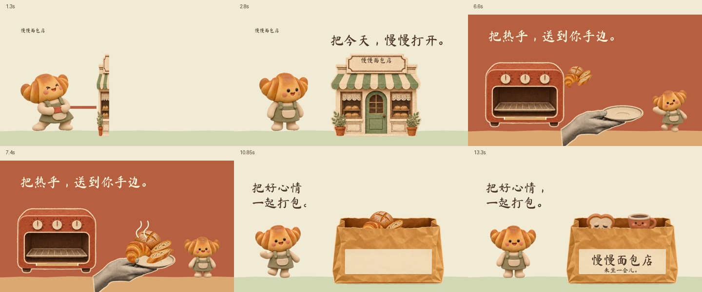

# 慢慢面包店：把角色动作拍成品牌短片

这是一个虚构面包店的15秒样片，使用者已经认可这版效果并要求发布。它把本项目的角色动作方法与纸片组装叙事结合起来。

[播放 / 下载完整 MP4](https://raw.githubusercontent.com/WoYun520/gif-factory/main/examples/brand-films/manman-bakery/film.mp4) · [下载可编辑工程 ZIP](editable-project.zip) · [直接看工程文件](project/) · [下载角色 GIF](../../clay-bakery/clay-bakery-4-gifs.zip)

## 这一条讲什么

| 时间 | 角色和物件发生什么 | 观众看到什么 |
| --- | --- | --- |
| 0–5秒 | 可颂抓住纸条、后仰拉动，店铺逐折展开 | 把今天，慢慢打开 |
| 5–10秒 | 炉门打开，面包沿弧线落到手托的唯一盘子上，再抛向下一镜 | 把热乎，送到你手边 |
| 10–15秒 | 面包进入外带袋，吐司和咖啡从袋口露头 | 把好心情一起打包，记住袋上的店名 |

## 怎么接到自己的品牌

先保留角色身份，再替换真实的产品、包装和品牌文字。让角色完成一件跟产品有关的事，最后把品牌落在招牌、杯套或包装上。新动作先出小样，确认以后再展开。

这版增加了可颂拉纸条的16个连续姿态，其余沿用已认可的店员动作。采用黏土质感姿态序列加可编辑分层合成，非真实三维骨骼动画。拉条接触为近似对齐；面包跨镜头使用拟人化抛接。

本片为1920×1080、30fps、15秒，有配乐；上方动图只是640×360的无声预览。工程里可以分别改角色、纸片、道具、文字和声音，运行方法见[工程说明](project/DELIVERY.md)。

## 检查和来源

已经检查实际导出画面、关键动作、转场和手机尺寸预览，并修正重复盘子、纸袋遮挡边界等问题。音轨和音量经过测量，未做人耳听审。技术记录见 [production.json](production.json)。

构思和组装方法参考 [gbro-collage-broll](https://github.com/pyang5166/gbro-collage-broll)，角色动作沿用本仓库方法。没有使用参考视频的画面或声音，也没有调用对方的Gemini视频脚本。[通用制作规则](../../../references/brand-film.md)。

发布有配乐的视频时，保留[CREDITS里的音乐署名](CREDITS.md)。字体附带自身许可文件；代码的MIT许可不替代第三方素材许可。
