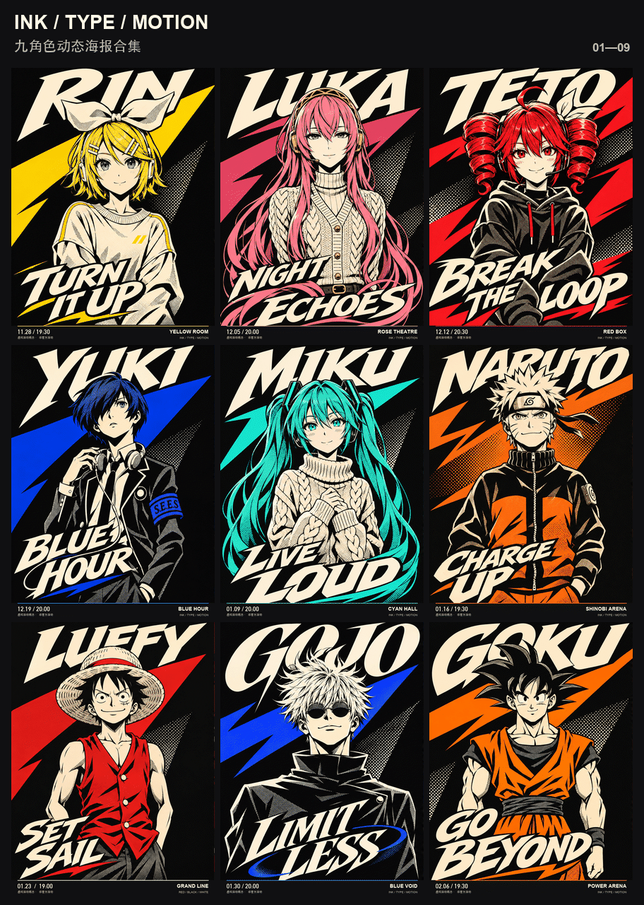

# 人物、背景和文字整体融合 · 九角色动态海报

用 P5 式漫画印刷语言，把整幅海报一起设计：黑色与暖白打底，每个角色保留一种识别色，人物、网点阴影、斜切负空间和定制字形在同一画面中形成前后关系。不是把纸牌字贴在原来的彩色图上。

## 九张独立 GIF

| 角色 | 标题 | 文件 |
| --- | --- | --- |
| 镜音铃 | TURN IT UP | [查看 GIF](01-rin.gif) |
| 流歌 | NIGHT ECHOES | [查看 GIF](02-luka.gif) |
| Teto | BREAK THE LOOP | [查看 GIF](03-teto.gif) |
| 结城理 | BLUE HOUR | [查看 GIF](04-yuki.gif) |
| 初音 | LIVE LOUD | [查看 GIF](05-miku.gif) |
| 鸣人 | CHARGE UP | [查看 GIF](06-naruto.gif) |
| 路飞 | SET SAIL | [查看 GIF](07-luffy.gif) |
| 五条悟 | LIMIT LESS | [查看 GIF](08-gojo.gif) |
| 悟空 | GO BEYOND | [查看 GIF](09-goku.gif) |

每张 720×960、6 秒无限循环，实际编码为 26 帧（重复停留帧已合并），时间采样为 20fps。九宫格为缩略预览，完整尺寸看单张。

[静态合集封面](cover.jpg) · [解码检查](review.json) · [实际提示词](prompts.json) · [制作方法](../../../references/dynamic-posters.md)

## 怎样做的

使用内置生图工具重新生成左右两张完整海报，以前的角色姿态图作身份和动作参考，以已认可的路飞版作设计语言参考；结城理没有肖像参考图，身份来自文字描述，路飞图只提供设计语言。左右关键状态一起包含人物和字形变化，再做光栅循环，底部信息固定。

字体已画在完整关键状态里，不能把它称为逐字独立动效或把成品说成可点击的游戏界面。需要经常修改精确品牌文字时，另外使用分层排版路线。

首批路飞、鸣人、五条悟、初音整体融合版已获用户认可；镜音铃、流歌、Teto、结城理、悟空为随后扩展版本，技术检查通过，未声称使用者已逐张审美确认。结城理按当前九宫格编排替换镜音连，旧版镜音连不覆盖。

活动日期、场地和演出信息均为虚构概念、非官方活动。角色 IP、参考设计语言和字体的商业权利不能由软件的 MIT 许可推定。未打包字体文件或私有原始照片。

下载整个仓库即可取得这九张及预览；仓库不重复保存相同内容的大 ZIP。
