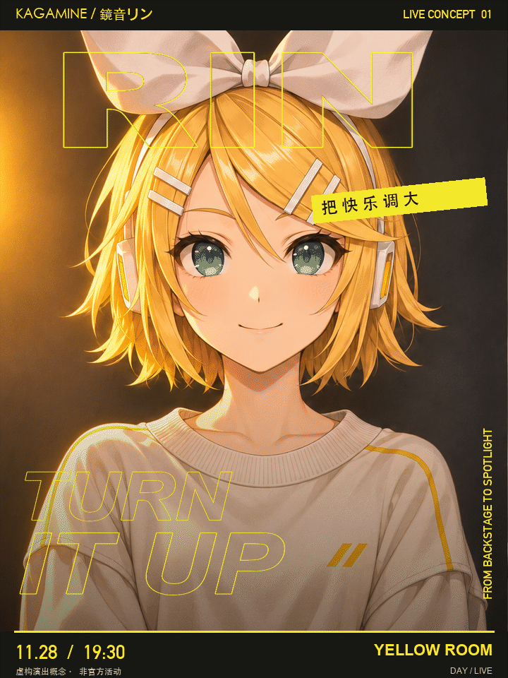
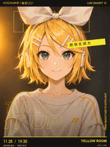
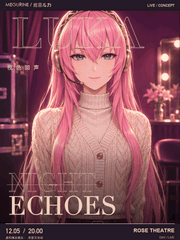
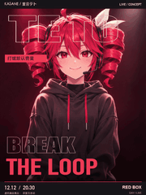
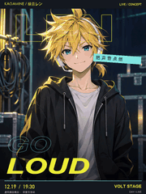

# 保留原画＋独立字体联动 · 4 张

[返回风格说明](../../../styles/type-linked/STYLE.md) · [完整作品库](../../../GALLERY.md#动态海报展厅)

镜音铃从放松微笑切到拿麦开唱，顶部 RIN 由收紧的轮廓字扩成实心字，TURN IT UP 独立文字图层分档放大、错位与倾斜。日期、场地固定。720×960，6 秒无限循环。

此版本已获用户认可，是普通字体联动路线的样例；它保留原插画画风，与后来整幅重新绘制的漫画印刷版区分。人物来自之前以角色参考生成的姿态对照图；本次字体联动没有重新生成人物。此处只发布成品，未把字体图层工程打包。

演出信息为虚构概念、非官方活动，角色与字体权利不随代码转授。

## 更多已制作角色

<table>
<tr>
<td width="33%" valign="top"> 镜音铃</td>
<td width="33%" valign="top"> 流歌</td>
<td width="33%" valign="top"> Teto</td>
</tr>
<tr>
<td width="33%" valign="top"> 镜音连</td>
</tr>
</table>

流歌、Teto、镜音连来自此前生成的配对插画和独立文字合成；不是后来整幅重新绘制的漫画印刷版。
