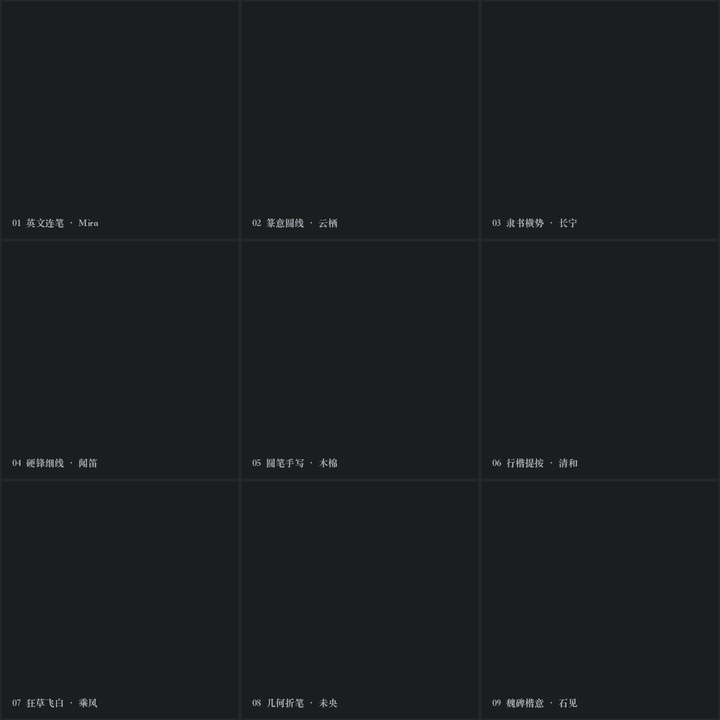
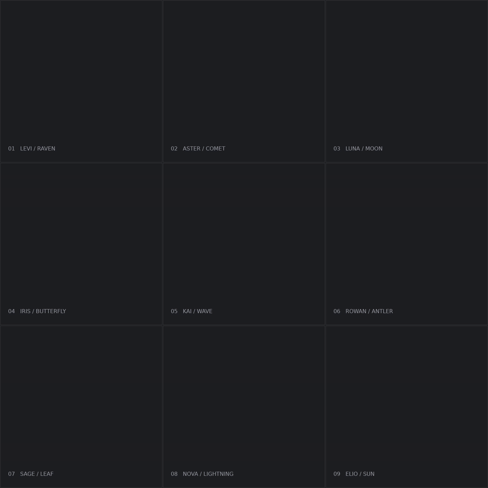
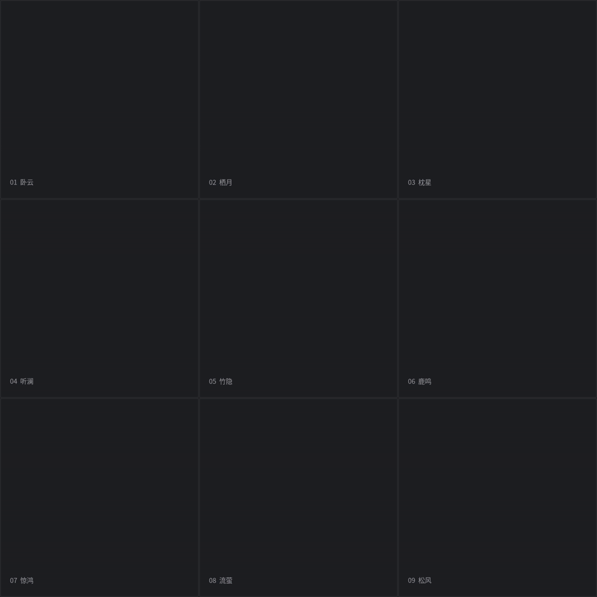

# 动态艺术签名 · 中英文样例

[制作方法](../../skills/dynamic-art-signature/SKILL.md) · [风格入口](../../styles/dynamic-signatures/STYLE.md)

## 多种字体与自定义

现在支持多种字体，也可以自定义。可以提供字稿、字体参考或风格描述，按你的名字、意象、乐器和配色设计。

[九种字体、独立动画、原图与参数](../../skills/dynamic-art-signature/references/multifont.md) · [完整九宫格 MP4](../../skills/dynamic-art-signature/assets/media/multifont/MultiFont_Nine_Grid.mp4)

## 早期英文连笔基准

| 名字 | GIF | MP4 | 原图与参数 |
| --- | --- | --- | --- |
| Levi | [播放](../../skills/dynamic-art-signature/assets/media/Levi.gif) | [视频](../../skills/dynamic-art-signature/assets/media/Levi.mp4) | [原图](../../skills/dynamic-art-signature/assets/examples/Levi.png) · [JSON](../../skills/dynamic-art-signature/assets/examples/Levi.json) |
| Aster | [播放](../../skills/dynamic-art-signature/assets/media/Aster.gif) | [视频](../../skills/dynamic-art-signature/assets/media/Aster.mp4) | [原图](../../skills/dynamic-art-signature/assets/examples/Aster.png) · [JSON](../../skills/dynamic-art-signature/assets/examples/Aster.json) |
| Luna | [播放](../../skills/dynamic-art-signature/assets/media/Luna.gif) | [视频](../../skills/dynamic-art-signature/assets/media/Luna.mp4) | [原图](../../skills/dynamic-art-signature/assets/examples/Luna.png) · [JSON](../../skills/dynamic-art-signature/assets/examples/Luna.json) |
| Iris | [播放](../../skills/dynamic-art-signature/assets/media/Iris.gif) | [视频](../../skills/dynamic-art-signature/assets/media/Iris.mp4) | [原图](../../skills/dynamic-art-signature/assets/examples/Iris.png) · [JSON](../../skills/dynamic-art-signature/assets/examples/Iris.json) |
| Kai | [播放](../../skills/dynamic-art-signature/assets/media/Kai.gif) | [视频](../../skills/dynamic-art-signature/assets/media/Kai.mp4) | [原图](../../skills/dynamic-art-signature/assets/examples/Kai.png) · [JSON](../../skills/dynamic-art-signature/assets/examples/Kai.json) |
| Rowan | [播放](../../skills/dynamic-art-signature/assets/media/Rowan.gif) | [视频](../../skills/dynamic-art-signature/assets/media/Rowan.mp4) | [原图](../../skills/dynamic-art-signature/assets/examples/Rowan.png) · [JSON](../../skills/dynamic-art-signature/assets/examples/Rowan.json) |
| Sage | [播放](../../skills/dynamic-art-signature/assets/media/Sage.gif) | [视频](../../skills/dynamic-art-signature/assets/media/Sage.mp4) | [原图](../../skills/dynamic-art-signature/assets/examples/Sage.png) · [JSON](../../skills/dynamic-art-signature/assets/examples/Sage.json) |
| Nova | [播放](../../skills/dynamic-art-signature/assets/media/Nova.gif) | [视频](../../skills/dynamic-art-signature/assets/media/Nova.mp4) | [原图](../../skills/dynamic-art-signature/assets/examples/Nova.png) · [JSON](../../skills/dynamic-art-signature/assets/examples/Nova.json) |
| Elio | [播放](../../skills/dynamic-art-signature/assets/media/Elio.gif) | [视频](../../skills/dynamic-art-signature/assets/media/Elio.mp4) | [原图](../../skills/dynamic-art-signature/assets/examples/Elio.png) · [JSON](../../skills/dynamic-art-signature/assets/examples/Elio.json) |

两笔分离、约一秒停顿、无底印、无轻震、无回弹，末端减速。Levi 与 Aster 是迭代基准；七款扩展已完成技术检查，未据此推断逐款用户认可。原图为原创生成设计，未包含第三方参考截图。参数使用相对路径，需在安装模块内运行随附脚本。

## 中文草书

| 名字 | GIF | MP4 | 原图与参数 |
| --- | --- | --- | --- |
| 卧云 | [播放](../../skills/dynamic-art-signature/assets/media/chinese/Woyun.gif) | [视频](../../skills/dynamic-art-signature/assets/media/chinese/Woyun.mp4) | [原图](../../skills/dynamic-art-signature/assets/chinese/Woyun.png) · [配置](../../skills/dynamic-art-signature/assets/chinese/Woyun.json) |
| 栖月 | [播放](../../skills/dynamic-art-signature/assets/media/chinese/Qiyue.gif) | [视频](../../skills/dynamic-art-signature/assets/media/chinese/Qiyue.mp4) | [原图](../../skills/dynamic-art-signature/assets/chinese/Qiyue.png) · [配置](../../skills/dynamic-art-signature/assets/chinese/Qiyue.json) |
| 枕星 | [播放](../../skills/dynamic-art-signature/assets/media/chinese/Zhenxing.gif) | [视频](../../skills/dynamic-art-signature/assets/media/chinese/Zhenxing.mp4) | [原图](../../skills/dynamic-art-signature/assets/chinese/Zhenxing.png) · [配置](../../skills/dynamic-art-signature/assets/chinese/Zhenxing.json) |
| 听澜 | [播放](../../skills/dynamic-art-signature/assets/media/chinese/Tinglan.gif) | [视频](../../skills/dynamic-art-signature/assets/media/chinese/Tinglan.mp4) | [原图](../../skills/dynamic-art-signature/assets/chinese/Tinglan.png) · [配置](../../skills/dynamic-art-signature/assets/chinese/Tinglan.json) |
| 竹隐 | [播放](../../skills/dynamic-art-signature/assets/media/chinese/Zhuyin.gif) | [视频](../../skills/dynamic-art-signature/assets/media/chinese/Zhuyin.mp4) | [原图](../../skills/dynamic-art-signature/assets/chinese/Zhuyin.png) · [配置](../../skills/dynamic-art-signature/assets/chinese/Zhuyin.json) |
| 鹿鸣 | [播放](../../skills/dynamic-art-signature/assets/media/chinese/Luming.gif) | [视频](../../skills/dynamic-art-signature/assets/media/chinese/Luming.mp4) | [原图](../../skills/dynamic-art-signature/assets/chinese/Luming.png) · [配置](../../skills/dynamic-art-signature/assets/chinese/Luming.json) |
| 惊鸿 | [播放](../../skills/dynamic-art-signature/assets/media/chinese/Jinghong.gif) | [视频](../../skills/dynamic-art-signature/assets/media/chinese/Jinghong.mp4) | [原图](../../skills/dynamic-art-signature/assets/chinese/Jinghong.png) · [配置](../../skills/dynamic-art-signature/assets/chinese/Jinghong.json) |
| 流萤 | [播放](../../skills/dynamic-art-signature/assets/media/chinese/Liuying.gif) | [视频](../../skills/dynamic-art-signature/assets/media/chinese/Liuying.mp4) | [原图](../../skills/dynamic-art-signature/assets/chinese/Liuying.png) · [配置](../../skills/dynamic-art-signature/assets/chinese/Liuying.json) |
| 松风 | [播放](../../skills/dynamic-art-signature/assets/media/chinese/Songfeng.gif) | [视频](../../skills/dynamic-art-signature/assets/media/chinese/Songfeng.mp4) | [原图](../../skills/dynamic-art-signature/assets/chinese/Songfeng.png) · [配置](../../skills/dynamic-art-signature/assets/chinese/Songfeng.json) |
| 卧云间 | [播放](../../skills/dynamic-art-signature/assets/media/chinese/Woyunjian.gif) | [视频](../../skills/dynamic-art-signature/assets/media/chinese/Woyunjian.mp4) | [原图](../../skills/dynamic-art-signature/assets/chinese/Woyunjian.png) · [配置](../../skills/dynamic-art-signature/assets/chinese/Woyunjian.json) |

用户选择中文草书方向，并接受三字「卧云间」；扩展九宫格用于展示设计范围，不据此推断每款逐项认可。[中文设计与渲染规则](../../skills/dynamic-art-signature/references/chinese.md)。

## 乐器入字与粒子成字

- [第一组九宫格 MP4](../../skills/dynamic-art-signature/assets/media/instrument-semantic/Instrument_Semantic_Nine_Grid.mp4) · [封面](../../skills/dynamic-art-signature/assets/media/instrument-semantic/Instrument_Semantic_Nine_Grid.png)
- [第二组九宫格 MP4](../../skills/dynamic-art-signature/assets/media/instrument-semantic/New_Instrument_Signatures_Nine_Grid.mp4) · [封面](../../skills/dynamic-art-signature/assets/media/instrument-semantic/New_Instrument_Signatures_Nine_Grid.png)
- [枕星·竖琴 GIF](../../skills/dynamic-art-signature/assets/media/instrument-semantic/Zhenxing-Harp.gif) · [雨巷·口琴 GIF](../../skills/dynamic-art-signature/assets/media/instrument-semantic/Yuxiang-Harmonica.gif) · [源素材与复现步骤](../../skills/dynamic-art-signature/references/instrument-semantic.md)
