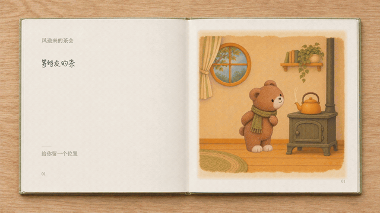
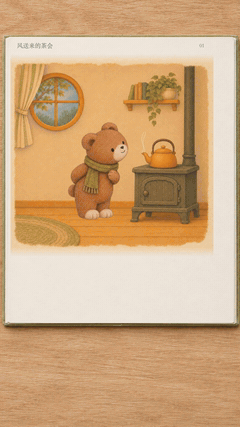

# 风送来的茶会 · 紧凑动态绘本

[返回首页](../../../README.md) · [风格说明](../../../styles/compact-storybook/STYLE.md) · [完整 Skill](../../../skills/compact-storybook/SKILL.md)

小熊备好三只杯子，请女孩把邀请折成纸鸟。狐狸收到信，带一片秋天来做客，最后大家把这一天夹进故事书。

## 真实书本与书写版

<table>
<tr>
<td align="center" valign="top"><strong>横屏 · 左字右图</strong> </td>
<td align="center" valign="top"><strong>竖屏 · 图上字下</strong> </td>
</tr>
</table>

[横屏观看 / 下载](realbook-writing.mp4) · [竖屏观看 / 下载](portrait-writing.mp4)。两版均54秒、12页、6fps，含15组正文书写与相同配乐。

横屏：1920×1080、实际6fps、324帧、12页；正俯拍薄纸书本，原插画动画，15组正文落页后快速写出，配轻微沙沙声。标题和页码静态。版式与书写三页样片已获认可；完整版已逐组检查完成文字及声音间隔。

竖屏采用**手机阅读优化版：1080×1920、54秒、324帧**，单页图上字下、两行手写居中。插画放大至912px、正文78px，减少侧边桌面留白，并为右侧互动栏和底部标题留出空间；保留白框、真实纸纹和木面。以横屏底板为材质参考单独制作竖屏空白单页，并重排原动画；没有将横屏整本缩小或裁切。15组正文完成状态、翻页及音轨已检查，详见 [竖屏规格检查](portrait-verification.json)。

**音乐制作说明**：配乐可用 Suno、Gemini 这类工具单独制作，再导出音频交给本流程混音。本案例使用用户通过 Gemini 一侧制作并提供的《Candle at Dusk》，选取开头54秒，降低音量、首尾淡入淡出；不声称本案例用了 Suno，也不猜测底层模型。书写音效另取自 [SFXMint](https://sfxmint.com/sounds/pencil-writing-01)，来源标注 CC0 和 AI 生成。音乐、音效与代码的许可分别处理；音乐不随仓库代码自动转授 MIT 权利。

真实材质底板由已认可书本图编辑去除文字和插画，再叠回原字体与角色动画。标准笔顺中线近似映射手写字形，不声称恢复了字体真实书写轨迹；未打包系统字体、原始曲目或整份笔顺数据。

## 12页独立动作素材

[打包下载独立动作](pages.zip)。以下是不带书框的原始单页素材，适合参考动作或继续编排。

| 页 | 动作 | 页 | 动作 |
| --- | --- | --- | --- |
| 01 | [水快开了](pages/01.mp4) | 07 | [原来是邀请](pages/07.mp4) |
| 02 | [三只杯子](pages/02.mp4) | 08 | [带一片秋天](pages/08.mp4) |
| 03 | [帮我送封信](pages/03.mp4) | 09 | [前面的暖光](pages/09.mp4) |
| 04 | [折一只纸鸟](pages/04.mp4) | 10 | [终于等到你](pages/10.mp4) |
| 05 | [跟着风走](pages/05.mp4) | 11 | [一起吹一吹](pages/11.mp4) |
| 06 | [落在鼻尖前](pages/06.mp4) | 12 | [把今天留下](pages/12.mp4) |

## 方法与检查

角色参考参与图像生成；透明关键姿态与固定背景逐帧组合，纸鸟使用轨迹与手心锚点衔接，翻页单独制作。没有使用连续生成视频或插帧。

已核对实际导出帧率、时长、帧数，检查首中末帧及道具交接；修正过纸鸟落点和杯子桌面位置。真实书本与书写样片已获认可，54秒成片已完成逐页与声音检查。规格记录见 [verification.json](verification.json)，规格检查不代表所有新故事都能自动稳定。

本目录发布当前成片、独立动作素材及预览。可复用的制作规则和检查脚本在独立 Skill 中；此处不包含系统字体和私人原图，也不承诺案例资产的独占商用权。
