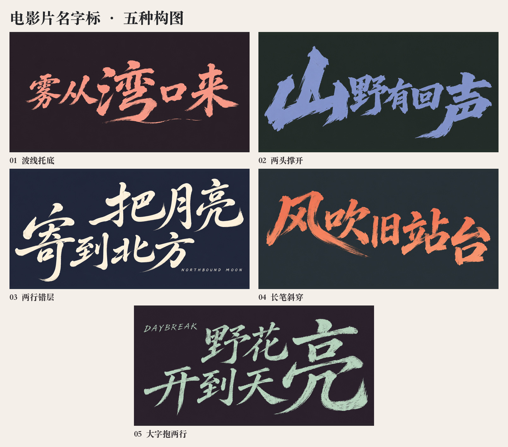

# 五种电影片名排法

用户可以附一张图和新片名，也可以报编号。先从图里辨认视觉主字、读序、行间嵌套、长笔走向和副题落点，再匹配下列排法。多个关系同时出现时，以主导整句外轮廓的那一项为准。用户只给了图片时，先看能否从请求判断要沿用还是换片名。两者都不明确时，直接问新片名。

| 排法 | 固定的关系 | 换字时怎么做 | 示例 |
| --- | --- | --- | --- |
| 01 波线托底 | 一行大字压住画面，低位长笔和细线串起底部。 | 选有自然横扫收笔的字作为起点。把长线融入字脚或它旁边的空隙，给底线留呼吸。 | [雾从湾口来](../assets/layout-examples/01.jpg) |
| 02 两头撑开 | 两端字拉开整体宽度，小字挤在中间。 | 确定哪个端字主导，再根据它的凹凸安排中间的字。用字身或长笔来撑开端部。 | [山野有回声](../assets/layout-examples/02.jpg) |
| 03 两行错层 | 两行有明显横向位移，一笔或一处字形占住行间留白。 | 按词组断行。长笔来自适合延展的字，副题落在错层留下的空位。 | [把月亮寄到北方](../assets/layout-examples/03.jpg) |
| 04 长笔斜穿 | 一笔顺着斜向穿过字间留白，带动整句重心。 | 从新字里找一笔适合拉长的撇、捺或斜钩。根据它的轨迹收窄或错开相邻字。 | [风吹旧站台](../assets/layout-examples/04.jpg) |
| 05 大字抱两行 | 一个大字占两行高，其余字嵌在同一侧的两层空间。 | 大字可以在句首或句末。按读序决定左右，再围绕该字的轮廓排列两行。 | [野花开到天亮](../assets/layout-examples/05.jpg) |

## 从排法到成稿

1. 把片名和可选副题逐字写进设计描述。具体写出哪个字大、哪些字成组、哪一笔会延长、它穿过哪个空位，以及读序。只有需要副题时才给它留位置。
2. 先定整组字的轮廓。以新字的偏旁、开口和笔势确定造型，再按题材选择笔刷、颜色和背景。如果参考图上的特征集中在同一处，重新选主字、长笔走向或行的起点，让构图由新片名决定。
3. 让图像生成工具一次画出完整字标，也可手绘整组。新片名较长时先按语义切分，再把每组写入它在构图中的位置。缩小核对整组轮廓和读序，放大核对每个字和副题。叠照片时另导透明字标。

仓库里的五个例子均使用文字描述生成。可直接给 AI 图和新片名，例如：

> 用排法 03 为《沿河等一盏灯》设计片名。上行写「沿河」，向右错半个字，下行写「等一盏灯」。「等」的长竖下落，用「河」的右侧留白拉开两行。浅米色干刷，横幅，留出四周空间。
