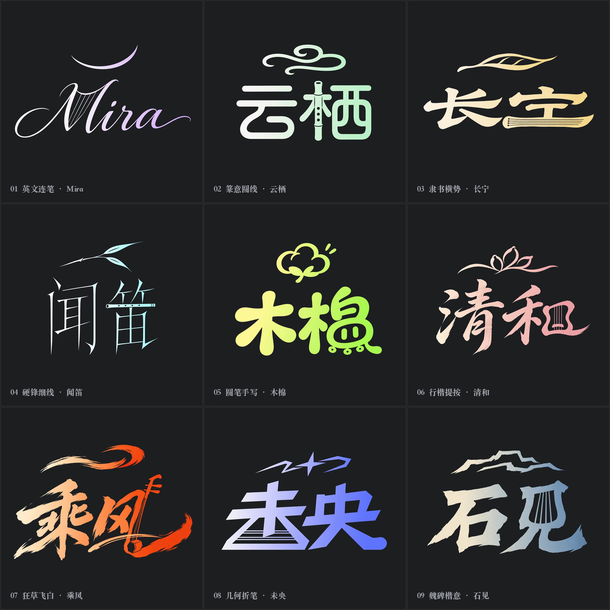

# 多种字体，也可以自定义

动态签名现在支持多种字体，也可以自定义。可以选下面的方向、描述你想要的感觉，或直接提供自己的字稿。名字、意象、乐器、配色和动效都能按需求调整。

这些是原创字稿示例。每换一张稿，都会重新检查粗细、连笔、点画和回钩，再安排动画。

[动态九宫格 GIF](../assets/media/multifont/MultiFont_Nine_Grid.gif) · [MP4](../assets/media/multifont/MultiFont_Nine_Grid.mp4) · [静态对照](../assets/media/multifont/MultiFont_Nine_Grid.png)



| 编号 | 名字 | 字体方向 | 融入的乐器 | 文件 |
| --- | --- | --- | --- | --- |
| 01 | Mira | 英文连笔 | 竖琴 | [GIF](../assets/media/multifont/Mira-Latin.gif) · [MP4](../assets/media/multifont/Mira-Latin.mp4) · [原图](../assets/adaptive/multifont/01/source.png) · [配置](../assets/adaptive/multifont/01/config.json) · [提示词](../assets/adaptive/multifont/01/prompt.txt) |
| 02 | 云栖 | 篆意圆线 | 洞箫 | [GIF](../assets/media/multifont/Yunqi-Seal.gif) · [MP4](../assets/media/multifont/Yunqi-Seal.mp4) · [原图](../assets/adaptive/multifont/02/source.png) · [配置](../assets/adaptive/multifont/02/config.json) · [提示词](../assets/adaptive/multifont/02/prompt.txt) |
| 03 | 长宁 | 隶书横势 | 古琴 | [GIF](../assets/media/multifont/Changning-Clerical.gif) · [MP4](../assets/media/multifont/Changning-Clerical.mp4) · [原图](../assets/adaptive/multifont/03/source.png) · [配置](../assets/adaptive/multifont/03/config.json) · [提示词](../assets/adaptive/multifont/03/prompt.txt) |
| 04 | 闻笛 | 硬锋细线 | 竹笛 | [GIF](../assets/media/multifont/Wendi-Fine.gif) · [MP4](../assets/media/multifont/Wendi-Fine.mp4) · [原图](../assets/adaptive/multifont/04/source.png) · [配置](../assets/adaptive/multifont/04/config.json) · [提示词](../assets/adaptive/multifont/04/prompt.txt) |
| 05 | 木棉 | 圆笔手写 | 铃鼓 | [GIF](../assets/media/multifont/Mumian-Round.gif) · [MP4](../assets/media/multifont/Mumian-Round.mp4) · [原图](../assets/adaptive/multifont/05/source.png) · [配置](../assets/adaptive/multifont/05/config.json) · [提示词](../assets/adaptive/multifont/05/prompt.txt) |
| 06 | 清和 | 行楷提按 | 小提琴 | [GIF](../assets/media/multifont/Qinghe-Running.gif) · [MP4](../assets/media/multifont/Qinghe-Running.mp4) · [原图](../assets/adaptive/multifont/06/source.png) · [配置](../assets/adaptive/multifont/06/config.json) · [提示词](../assets/adaptive/multifont/06/prompt.txt) |
| 07 | 乘风 | 狂草飞白 | 二胡 | [GIF](../assets/media/multifont/Chengfeng-Cursive.gif) · [MP4](../assets/media/multifont/Chengfeng-Cursive.mp4) · [原图](../assets/adaptive/multifont/07/source.png) · [配置](../assets/adaptive/multifont/07/config.json) · [提示词](../assets/adaptive/multifont/07/prompt.txt) |
| 08 | 未央 | 几何折笔 | 扬琴 | [GIF](../assets/media/multifont/Weiyang-Geometric.gif) · [MP4](../assets/media/multifont/Weiyang-Geometric.mp4) · [原图](../assets/adaptive/multifont/08/source.png) · [配置](../assets/adaptive/multifont/08/config.json) · [提示词](../assets/adaptive/multifont/08/prompt.txt) |
| 09 | 石见 | 魏碑楷意 | 琵琶 | [GIF](../assets/media/multifont/Shijian-Wei.gif) · [MP4](../assets/media/multifont/Shijian-Wei.mp4) · [原图](../assets/adaptive/multifont/09/source.png) · [配置](../assets/adaptive/multifont/09/config.json) · [提示词](../assets/adaptive/multifont/09/prompt.txt) |

## 自定义可以怎么提

> 给“清和”做行楷动态签名，米白到豆沙粉，保留小提琴融字，末锋慢下来。

> 用我提供的字稿，保留字体、名字和颜色，按字形做书写与墨迹聚合。

> 给同一个名字随机设计几种差异明显的字体方向，我想比较细线、厚笔和圆笔。

可以给字体参考或字体文件，也可以只描述“瘦硬一点”“圆润一点”“横向舒展一点”。现成字稿按要求直接沿用；需要新设计时，先把名字与意象写成一张完整字稿，再做动画。不需要自己填写遮罩、组件编号或起笔坐标。

## 本地重跑

这九款有字稿、分层、配置和成片。需要 Python 3、Pillow、NumPy、FFmpeg；九宫格标签需要本机有中文字形的字体。从 Skill 目录运行：

```bash
python3 -m pip install Pillow numpy
python3 scripts/render_collection.py --manifest assets/adaptive/multifont/cases.json --out /tmp/signature-multifont
```

只重跑一款：

```bash
python3 scripts/render_ink_signature.py --config assets/adaptive/multifont/01/config.json --out /tmp/mira
```

这些配置没有手填起笔点、尾巴路径或碎片参数。分层按字稿准备好后，脚本根据墨迹计算；“云栖”和“木棉”保留原有结构，没有另加长尾。需要改节奏、修交叉或换字稿时看[字体适配](font-adaptation.md)与[渲染说明](rendering.md)。

本组每款为 960×640、4 秒循环，MP4 60fps、GIF 25fps；九宫格 MP4 为 1440×1440、30fps，GIF 为 1080×1080、25fps。九宫格由九段实际成片合成。

九款已检查上笔逐段写出、停顿时下方干净、定格与合成字稿一致、实际视频参数及 GIF 循环，见[检查记录](../assets/adaptive/multifont/checks.json)。本组是已导出的展示案例，自定义新字稿仍需看预览检查；视觉笔势不等于从静态图恢复真实书法笔顺。原始字稿由内置生图工具仅按文字描述生成，提示词随案例保留。
