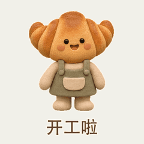
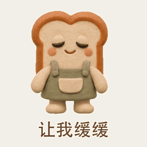
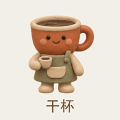
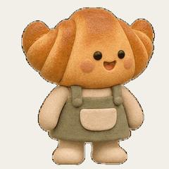

# 粘土吉祥物

[返回风格库](../README.md) · [查看原尺寸案例](../../examples/clay-bakery/01-croissant.gif)

## 动态案例 · 4 张

<table>
<tr>
<td width="33%" valign="top"> 牛角包</td>
<td width="33%" valign="top"> 吐司</td>
<td width="33%" valign="top"> 咖啡</td>
</tr>
<tr>
<td width="33%" valign="top"> 拉开纸片</td>
</tr>
</table>

## 怎么做

圆润、哑光、有体积感的角色，动作时保留眼睛、轮廓和光线。默认 512×512，时长按动作安排。这是画面风格，不代表交付真实三维模型。

## 可以直接这样说

> 设计一个粘土小吉祥物，做开心、困了和收到三个动作。

[具体做法](../../references/appearance.md) · [完整案例与版本状态](../../GALLERY.md#表情包展厅)

预览用于选效果，交付以实际导出的原文件为准。
