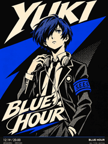
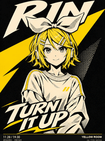
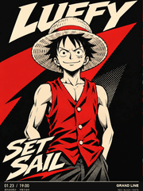

# 漫画印刷整体融合

[返回风格库](../README.md) · [查看原尺寸案例](../../examples/dynamic-posters/p5-integrated/04-yuki.gif)

## 动态案例 · 9 张

<table>
<tr>
<td width="33%" valign="top"> 结城理</td>
<td width="33%" valign="top"> 镜音铃</td>
<td width="33%" valign="top"> 流歌</td>
</tr>
<tr>
<td width="33%" valign="top"> Teto</td>
<td width="33%" valign="top"> 初音</td>
<td width="33%" valign="top"> 鸣人</td>
</tr>
<tr>
<td width="33%" valign="top"> 路飞</td>
<td width="33%" valign="top"> 五条悟</td>
<td width="33%" valign="top"> 悟空</td>
</tr>
</table>

## 怎么做

人物、背景和字一起重新设计，用少量颜色、墨线和网点形成完整海报。默认 720×960、6 秒。现有案例在两幅完整状态间切换，不是每个字都能独立编辑。

## 可以直接这样说

> 把人物和片名一起设计成漫画印刷海报，字要和人物有关系。

[具体做法](../../references/dynamic-posters.md) · [完整案例与版本状态](../../GALLERY.md#动态海报展厅)

预览用于选效果，交付以实际导出的原文件为准。
