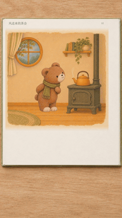

# 紧凑动态绘本

[返回风格库](../README.md) · [看完整案例](../../examples/storybooks/tea-party/README.md) · [独立 Skill](../../skills/compact-storybook/SKILL.md)

让一张插画把一件事做完：递一封信、放飞纸鸟、接住礼物、合上书。动作之后短暂停留，再翻到下一页。适合绘本故事、角色小剧场、品牌故事和插画叙事。

<table>
<tr>
<td align="center" valign="top"><strong>横屏 · 左字右图</strong> </td>
<td align="center" valign="top"><strong>竖屏 · 图上字下</strong> </td>
</tr>
</table>

## 怎么做

默认固定画面、实际 6fps、每页约三秒，一个动作做完后停留片刻。可做独立动画、横屏翻书或竖屏书页，沿用用户指定画风。横屏左字右图，竖屏图上字下，各自排版。

翻页后正文可快速写出，配轻微书写声；配乐可以由用户提供。翻页时保留旧页动作的结果，下一页接着往下讲。网页 GIF 会循环，正式故事不自动倒放回起点。

## 可以直接这样说

> 把这个故事做成动态绘本，每页只做一个清楚的动作，保留我的插画画风。

[制作规则](../../skills/compact-storybook/SKILL.md) · [书本、排版与音乐](../../skills/compact-storybook/references/book-and-sound.md) · [正文书写](../../skills/compact-storybook/references/handwriting.md) · [完整案例与版本状态](../../examples/storybooks/tea-party/README.md)
