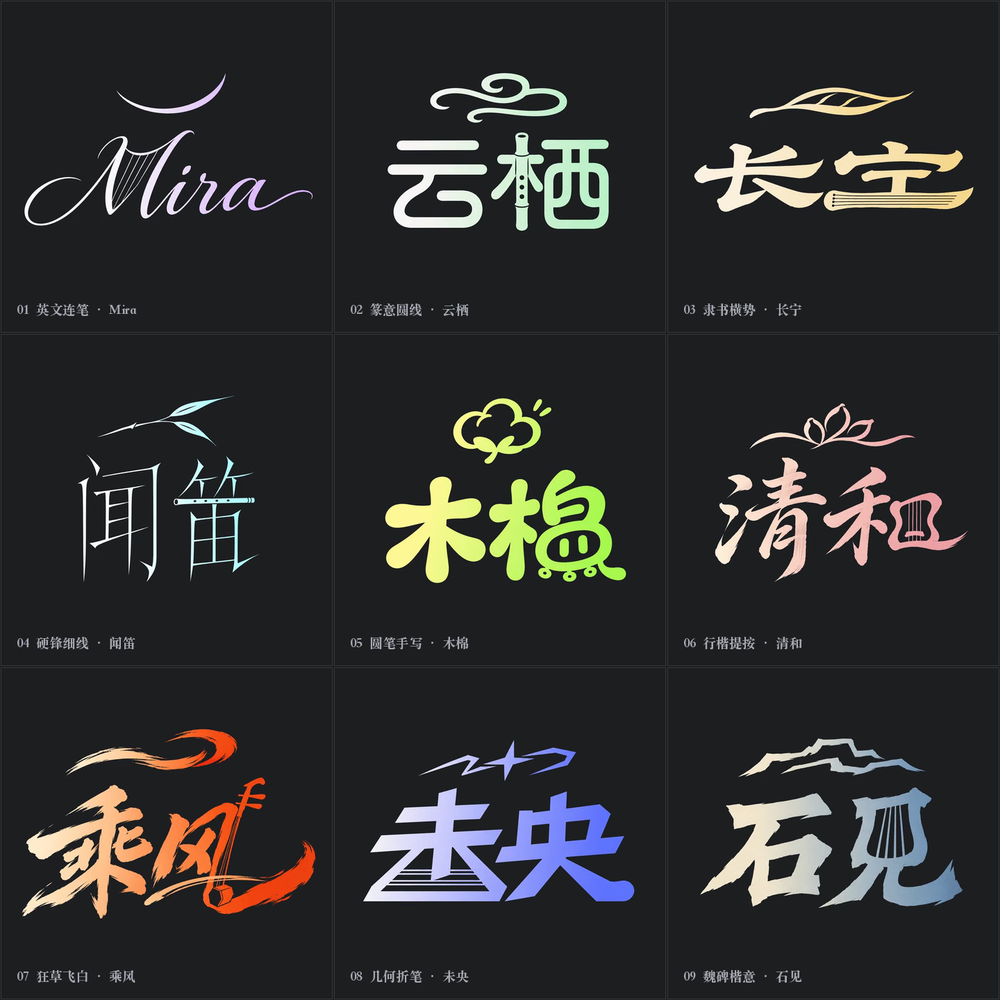

# 动态艺术签名

[返回风格库](../README.md) · [多字体 GIF](../../skills/dynamic-art-signature/assets/media/multifont/MultiFont_Nine_Grid.gif)

## 怎么做

把名字与意象融进同一组笔画，再做上方快写、停顿、下方快写和慢收锋。默认 960×640、4 秒，MP4 60fps、GIF 25fps。换书体仍保留签名节奏，普通款不加金属、发光或抖动。

现在支持多种字体，也可以自定义。可以选书体、描述笔画感觉，或直接提供字稿。代理会按当前笔画的粗细、连笔和回钩重新安排动画，不用用户填起笔坐标或路径。

## 可以直接这样说

> 给“卧云间”做一款有意象的动态签名，两段快写，末锋慢下来。

> 用我的字稿和配色，自定义一款动态签名，让乐器融进字里，再按字形做墨迹聚合。

[多字体与自定义](../../skills/dynamic-art-signature/references/multifont.md) · [具体做法](../../references/dynamic-signatures.md) · [完整案例与版本状态](../../GALLERY.md#动态艺术签名)

预览用于选效果，交付以实际导出的原文件为准。
