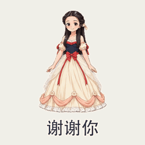

# 插画角色动作

[返回风格库](../README.md) · [查看原尺寸案例](../../examples/mixed-actions/02-二次元/005.gif)

## 动态案例 · 4 张

<table>
<tr>
<td width="33%" valign="top"> 鸣人·加油</td>
<td width="33%" valign="top"> 路飞·冲鸭</td>
<td width="33%" valign="top"> 初音·嗨呀</td>
</tr>
<tr>
<td width="33%" valign="top"> 公主裙·提裙行礼</td>
</tr>
</table>

## 怎么做

保留插画画风，让脸、身体、衣服和手脚连续配合。默认 512×512，时长按动作安排；新动作先看姿态、五官和接触位置。

## 可以直接这样说

> 用这张插画做递礼物的动作，角色和衣服保持一致。

[具体做法](../../references/keyframes.md) · [完整案例与版本状态](../../GALLERY.md#表情包展厅)

预览用于选效果，交付以实际导出的原文件为准。
