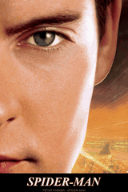
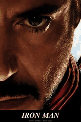
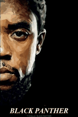
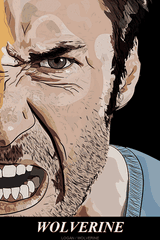
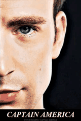

# 双状态光栅卡

[返回风格库](../README.md) · [查看原尺寸案例](../../examples/lenticular-cards/01-spider-man.gif)

## 动态案例 · 9 张

<table>
<tr>
<td width="33%" valign="top"> 蜘蛛侠</td>
<td width="33%" valign="top"> 恶灵骑士</td>
<td width="33%" valign="top"> 毒液</td>
</tr>
<tr>
<td width="33%" valign="top"> 钢铁侠</td>
<td width="33%" valign="top"> 蝙蝠侠</td>
<td width="33%" valign="top"> 黑豹</td>
</tr>
<tr>
<td width="33%" valign="top"> 金刚狼</td>
<td width="33%" valign="top"> 美国队长</td>
<td width="33%" valign="top"> 死侍</td>
</tr>
</table>

## 怎么做

在同一构图的两幅图之间，用纵向细条来回变画。默认 480×720、6 秒循环、标题固定。先对齐角度、眼线、下巴和肩线，不用拉宽脸或黑边掩盖错配。

## 可以直接这样说

> 用这两张图做双状态光栅卡，先检查脸和构图能否对齐。

[具体做法](../../references/lenticular.md) · [完整案例与版本状态](../../GALLERY.md#电子光栅卡展厅)

预览用于选效果，交付以实际导出的原文件为准。
