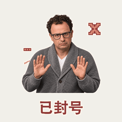

# 真人轻动效

[返回风格库](../README.md) · [查看原尺寸案例](../../examples/public-figures-hd/001.gif)

## 动态案例 · 4 张

<table>
<tr>
<td width="33%" valign="top"> 马斯克</td>
<td width="33%" valign="top"> Tibo</td>
<td width="33%" valign="top"> Dario Amodei</td>
</tr>
<tr>
<td width="33%" valign="top"> 黄仁勋</td>
</tr>
</table>

## 怎么做

沿用照片里的脸、衣着和光线，做小幅点头、眨眼或摇摆。默认 512×512、约两秒，不自行美颜或改成卡通。

## 可以直接这样说

> 用这张照片做轻轻点头的表情包，保留本人样子。

[具体做法](../../references/light-motion.md) · [完整案例与版本状态](../../GALLERY.md#表情包展厅)

预览用于选效果，交付以实际导出的原文件为准。
