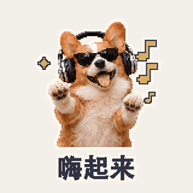
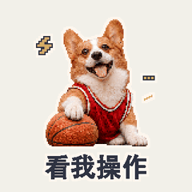
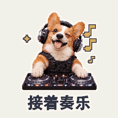
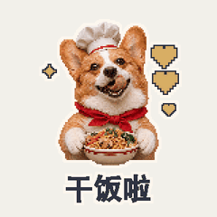
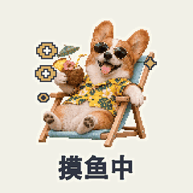
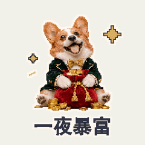
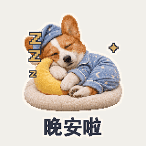

# 宠物拟人

[返回风格库](../README.md) · [查看原尺寸案例](../../examples/pet-corgi/01-fun-and-work/001.gif)

## 动态案例 · 8 张

<table>
<tr>
<td width="33%" valign="top"> 柯基·整活1</td>
<td width="33%" valign="top"> 柯基·整活2</td>
<td width="33%" valign="top"> 柯基·整活3</td>
</tr>
<tr>
<td width="33%" valign="top"> 柯基·整活4</td>
<td width="33%" valign="top"> 柯基·生活1</td>
<td width="33%" valign="top"> 柯基·生活2</td>
</tr>
<tr>
<td width="33%" valign="top"> 柯基·生活3</td>
<td width="33%" valign="top"> 柯基·生活4</td>
</tr>
</table>

## 怎么做

保留宠物的毛色、花纹和脸部特征，配合表情、道具和轻动作。默认 512×512、约两秒，新照片和新动作先做小样。

## 可以直接这样说

> 用我家猫做一组上班表情包，保留毛色和花纹。

[具体做法](../../references/light-motion.md) · [完整案例与版本状态](../../GALLERY.md#表情包展厅)

预览用于选效果，交付以实际导出的原文件为准。
