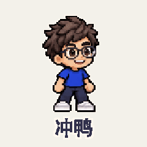
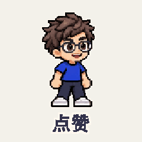
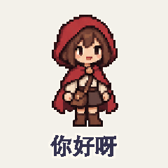
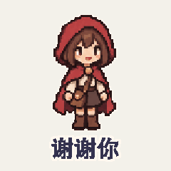
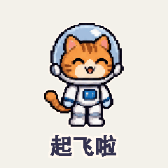
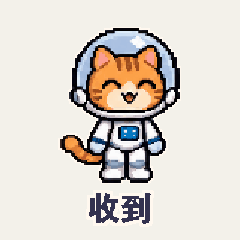
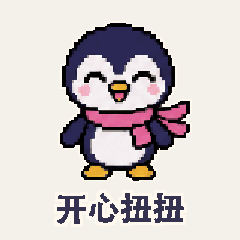
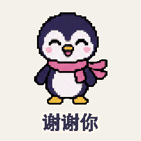

# 像素完整动作

[返回风格库](../README.md) · [查看原尺寸案例](../../examples/pixel-actions/boy/01.gif)

## 动态案例 · 8 张

<table>
<tr>
<td width="33%" valign="top"> 眼镜男孩·冲鸭</td>
<td width="33%" valign="top"> 眼镜男孩·点赞</td>
<td width="33%" valign="top"> 红帽女孩·你好呀</td>
</tr>
<tr>
<td width="33%" valign="top"> 红帽女孩·谢谢你</td>
<td width="33%" valign="top"> 太空猫·起飞啦</td>
<td width="33%" valign="top"> 太空猫·收到</td>
</tr>
<tr>
<td width="33%" valign="top"> 小企鹅·开心扭扭</td>
<td width="33%" valign="top"> 小企鹅·谢谢你</td>
</tr>
</table>

## 怎么做

让像素角色把挥手、比心等动作做完整，头、身体和手脚一起配合。默认 320×320，按动作安排时长；不能只转动一只手臂。

## 可以直接这样说

> 给这个像素角色做一个完整挥手动作，保留原来的像素画风。

[具体做法](../../references/pixel-actions.md) · [完整案例与版本状态](../../GALLERY.md#表情包展厅)

预览用于选效果，交付以实际导出的原文件为准。
