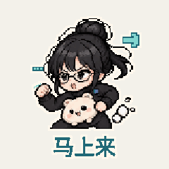

# 像素轻动效

[返回风格库](../README.md) · [查看原尺寸案例](../../examples/whale-maid/01-greetings/001.gif)

## 动态案例 · 6 张

<table>
<tr>
<td width="33%" valign="top"> 鲸鱼娘·问候</td>
<td width="33%" valign="top"> 鲸鱼娘·开心</td>
<td width="33%" valign="top"> 鲸鱼娘·情绪</td>
</tr>
<tr>
<td width="33%" valign="top"> 小秘书·回消息</td>
<td width="33%" valign="top"> 小秘书·情绪</td>
<td width="33%" valign="top"> 小秘书·生活</td>
</tr>
</table>

## 怎么做

用清楚的像素块做角色表情，点头、弹跳或轻轻摇摆。每张姿态和表情有区别，字幕固定。默认 320×320、约两秒，保持像素边缘。

## 可以直接这样说

> 用这个角色做一组像素表情包，每张不同表情，动作轻一点。

[具体做法](../../references/light-motion.md) · [完整案例与版本状态](../../GALLERY.md#表情包展厅)

预览用于选效果，交付以实际导出的原文件为准。
