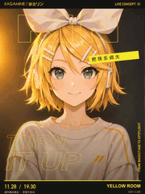
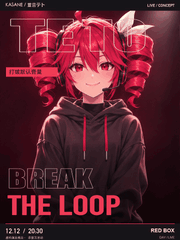
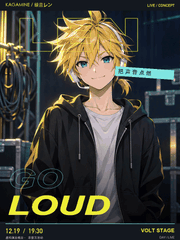

# 人物与字体联动

[返回风格库](../README.md) · [查看原尺寸案例](../../examples/dynamic-posters/type-linked/01-rin.gif)

## 动态案例 · 4 张

<table>
<tr>
<td width="33%" valign="top"> 镜音铃</td>
<td width="33%" valign="top"> 流歌</td>
<td width="33%" valign="top"> Teto</td>
</tr>
<tr>
<td width="33%" valign="top"> 镜音连</td>
</tr>
</table>

## 怎么做

保留原画，再安排文字与人物动作呼应。默认 720×960、6 秒，重要信息保持可读，文字避开脸和关键道具。

## 可以直接这样说

> 保留这张人物原画，让片名跟着动作轻轻变化。

[具体做法](../../references/dynamic-posters.md) · [完整案例与版本状态](../../GALLERY.md#动态海报展厅)

预览用于选效果，交付以实际导出的原文件为准。
